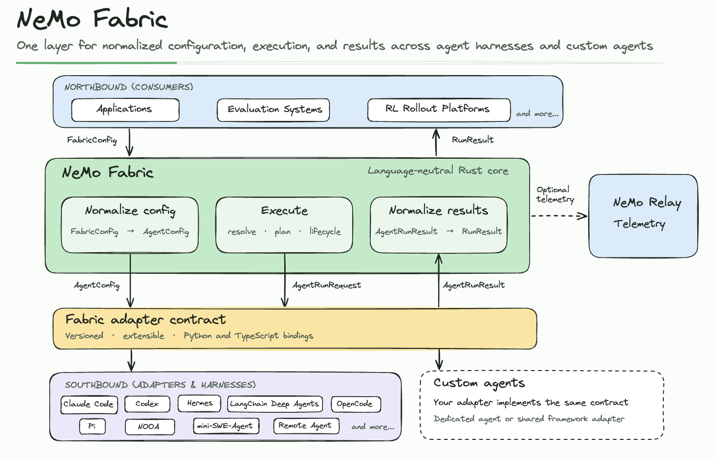

<!--
SPDX-FileCopyrightText: Copyright (c) 2026, NVIDIA CORPORATION & AFFILIATES. All rights reserved.
SPDX-License-Identifier: Apache-2.0
-->

# NVIDIA NeMo Fabric

  

NeMo Fabric gives applications, evaluation systems, and rollout platforms a consistent interface for running agent harnesses and custom agents.

- **Compose runs:** Configure models, tools, skills, MCP servers, subagents, and runtime settings consistently.
- **Validate before execution:** Detect unsupported configurations before starting a runtime.
- **Switch harnesses:** Reuse the consumer integration while adapters handle harness-specific behavior.
- **Compare outcomes:** Collect normalized results, errors, artifacts, lifecycle events, and telemetry references.

## Supported Agent Harnesses

NeMo Fabric includes adapters for the following harnesses and execution targets. Select a harness name for its adapter documentation:

| Agent Harness | Tool Policy | MCP | Skills | Telemetry |
| --- | :---: | :---: | :---: | :---: |
| [Claude Code](adapters/python/claude/README.md) | ✅ | ✅ | ✅ | ✅ |
| [Cline](adapters/typescript/cline/README.md) | ✅ | ✅ | ✅ | — |
| [Codex](adapters/python/codex/README.md) | — | ✅ | ✅ | ✅ |
| [Factory Droid](adapters/typescript/droid/README.md) | ✅ | ✅ | ✅ | — |
| [Hermes Agent](adapters/python/hermes/README.md) | ✅ | ✅ | ✅ | ✅ |
| [Kilo Code](adapters/typescript/kilo/README.md) | ✅ | ✅ | ✅ | — |
| [AWS Kiro](adapters/typescript/kiro/README.md) | — | ✅ | — | — |
| [AWS Strands](adapters/typescript/strands/README.md) | — | ✅ | — | — |
| [LangChain Deep Agents](adapters/python/deepagents/README.md) | ✅ | ✅ | ✅ | ✅ |
| [mini-SWE-agent](adapters/python/mini-swe-agent/README.md) | — | — | — | ✅ |
| [NOOA](adapters/python/nooa/README.md) | — | ✅ | ✅ | ✅ |
| [OpenClaw](adapters/python/openclaw/README.md) | ✅ | ✅ | ✅ | — |
| [OpenHands](adapters/python/openhands/README.md) | ✅ | ✅ | ✅ | — |
| [OpenCode](adapters/typescript/opencode/README.md) | — | ✅ | ✅ | — |
| [Pi](adapters/typescript/pi/README.md) | ✅ | — | ✅ | ✅ |
| [Qwen Code](adapters/typescript/qwen/README.md) | ✅ | ✅ | ✅ | — |
| [Remote Agent](adapters/python/remote-agent/README.md) | — | — | — | ✅ |

✅ Supported · — Not supported. Support may come through normalized configuration, native harness behavior, or a specific target. Refer to each adapter guide or the [complete compatibility matrix](adapters/README.md#configuration-compatibility) for details and limitations.

## NVIDIA Ecosystem

NeMo Fabric is an execution layer for NVIDIA products that build, evaluate, deploy, and improve agents. The ecosystem includes shipped integrations with [NVIDIA NeMo Helix](https://github.com/NVIDIA-NeMo/nemo-helix), concrete integrations with [NVIDIA NemoClaw](https://github.com/NVIDIA/NemoClaw/) and [NVIDIA NeMo Gym](https://github.com/NVIDIA-NeMo/gym), and emerging rollout integrations such as [NVIDIA Polar](https://github.com/NVIDIA-NeMo/ProRL-Agent-Server). [Explore the NeMo Fabric ecosystem](docs/about-nemo-fabric/ecosystem.mdx).

## Extensibility

NeMo Fabric separates consumers from execution targets through a stable, versioned contract. This makes it extensible in two directions:

- **Integrate a consumer:** Applications, evaluation systems, and rollout platforms use the Python SDK and typed `FabricConfig` to run different harnesses without implementing each harness integration. Start with the [consumer integration overview](docs/integrations/consumer/overview.mdx) or [consumer integration skills](skills/README.md).
- **Add an execution target:** Adapters translate the NeMo Fabric contract into the native behavior of a harness, framework, custom agent, or remote service. Start with the [adapter contract](docs/adapter-contract/README.md) and [adapter examples](docs/adapter-contract/examples.md).

## Documentation

- [Quickstart](docs/getting-started/quickstart.mdx): Run a first agent through the Python SDK.
- [Invocation system stats](docs/sdk/python.mdx#invocation-system-stats): Select per-invocation metric groups, sampled peaks, and cgroup conditions; disable collection independently of sampling.
- [Conversation telemetry](docs/sdk/python.mdx): Use `RunRequest.relay_session_root` to group Deep Agents and mini-SWE-agent turns under one NeMo Relay session.
- [Installation](docs/getting-started/install.mdx): Install the runtime, adapters, harness dependencies, and telemetry components, and choose a deployment scenario.
- [Adapter catalog](sdk/python/nemo-fabric-adapter-catalog/README.md): Inspect bundled adapter metadata on a host without installing harness SDKs.
- [Host admission](docs/sdk/python.mdx#inspect-metadata-on-a-separate-host): Validate requested capabilities and reject host/task descriptor drift before execution.
- [NeMo Fabric runtime server](sdk/python/nemo-fabric-runtime/src/nemo_fabric/runtime_server/README.md): Manage runtimes and check server responsiveness inside one sandbox through `fabric-agent-ctl` and one private local socket. Unconfirmed cleanup retains sandbox ownership and blocks replacement servers.
- [Health checks](docs/sdk/python.mdx#runtime-health): Use `Fabric.check()` for OpenShell runtime-server checks, Cline, Pi, OpenClaw, and OpenHands runtime checks, and prepared or attached OpenClaw Gateway service checks. OpenShell server and runtime requests map to `fabric-agent-ctl check`; service checks use the local SDK.
- [Documentation overview](docs/about-nemo-fabric/overview.mdx): Understand the execution model and choose an interface.
- [Adapter reference](adapters/README.md): Compare adapter configuration, runtime, and observability support.
- [Contribution guide](CONTRIBUTING.md): Build, test, and contribute to the project.

## Roadmap

Planned areas of development include:

- **Harness coverage:** Expand supported harnesses and adapter capabilities.
- **Configuration explainability:** Explain native configuration, mappings, precedence, and unsupported fields; redact secrets without launching harnesses or modifying workspaces.
- **ACP integration:** Support negotiated sessions, streaming, cancellation, permissions, and capability-dependent resume through Agent Client Protocol.
- **Sandbox execution:** Support additional sandbox providers, configurable access boundaries, provider-supported sudo, and judge-code isolation.
- **Environment bootstate:** Capture files, configuration, dependencies, and supported image snapshots for restoration and branching evaluations.
- **System statistics:** Correlate CPU, memory, elapsed time, available GPU usage, and available token/cost metrics with Fabric execution IDs; identify unavailable measurements.
