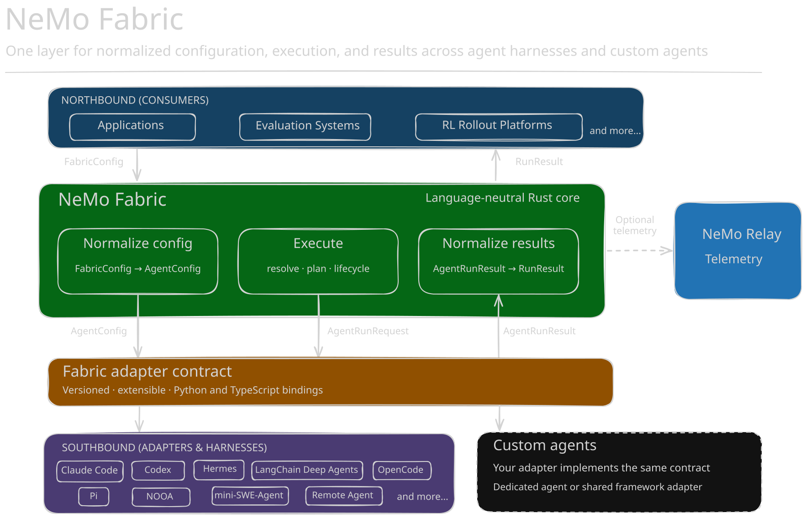

<!--
SPDX-FileCopyrightText: Copyright (c) 2026, NVIDIA CORPORATION & AFFILIATES. All rights reserved.
SPDX-License-Identifier: Apache-2.0
-->

# NVIDIA NeMo Fabric

  

NeMo Fabric gives applications, evaluation systems, and rollout platforms a consistent interface for running agent harnesses and custom agents.

- **Compose runs:** Configure models, tools, skills, MCP servers, subagents, and runtime settings consistently.
- **Validate before execution:** Detect unsupported configurations before starting a runtime.
- **Switch harnesses:** Reuse the consumer integration while adapters handle harness-specific behavior.
- **Compare outcomes:** Collect normalized results, errors, artifacts, lifecycle events, and telemetry references.

Configure buffered response and artifact budgets with [`runtime.response_limits`](docs/sdk/results-and-errors.mdx#response-and-artifact-limits). Both host and OpenShell execution enforce configured budgets. When limits are omitted, OpenShell applies default transfer budgets; local execution has no SDK response or artifact budget enforcement.

## Supported Agent Harnesses

NeMo Fabric includes adapters for the following harnesses and execution targets. Select a harness name for its adapter documentation:

| Agent Harness | Tool Policy | MCP | Skills | Telemetry | Native Interfaces |
| --- | :---: | :---: | :---: | :---: | :---: |
| [Claude Code](adapters/python/claude/README.md) | ✅ | ✅ | ✅ | ✅ | — |
| [Cline](adapters/typescript/cline/README.md) | ✅ | ✅ | ✅ | — | — |
| [Codex](adapters/python/codex/README.md) | — | ✅ | ✅ | ✅ | — |
| [Factory Droid](adapters/typescript/droid/README.md) | ✅ | ✅ | ✅ | — | — |
| [Hermes Agent](adapters/python/hermes/README.md) | ✅ | ✅ | ✅ | ✅ | ✅ |
| [Kilo Code](adapters/typescript/kilo/README.md) | ✅ | ✅ | ✅ | — | — |
| [AWS Kiro](adapters/typescript/kiro/README.md) | — | ✅ | — | — | — |
| [AWS Strands](adapters/typescript/strands/README.md) | — | ✅ | — | — | — |
| [LangChain Deep Agents](adapters/python/deepagents/README.md) | ✅ | ✅ | ✅ | ✅ | — |
| [mini-SWE-agent](adapters/python/mini-swe-agent/README.md) | — | — | — | ✅ | — |
| [NOOA](adapters/python/nooa/README.md) | — | ✅ | ✅ | ✅ | — |
| [OpenClaw](adapters/python/openclaw/README.md) | ✅ | ✅ | ✅ | — | ✅ |
| [OpenHands](adapters/python/openhands/README.md) | ✅ | ✅ | ✅ | — | — |
| [OpenCode](adapters/typescript/opencode/README.md) | — | ✅ | ✅ | — | — |
| [Pi](adapters/typescript/pi/README.md) | ✅ | — | ✅ | ✅ | — |
| [Qwen Code](adapters/typescript/qwen/README.md) | ✅ | ✅ | ✅ | — | — |
| [Remote Agent](adapters/python/remote-agent/README.md) | — | — | — | ✅ | — |

Native interfaces: harness-native API, dashboard, or TUI access enabled through Fabric.

✅ Supported · — Not supported. Support may come through normalized configuration, native harness behavior, or a specific target. Refer to each adapter guide or the [complete compatibility matrix](adapters/README.md#configuration-compatibility) for details and limitations.

## Ecosystem

NeMo Fabric brings supported agent harnesses into the frameworks teams use to benchmark and improve agents:

- **Harbor ships FabricAgent upstream.** [Harbor 0.25.0](https://github.com/harbor-framework/harbor/releases/tag/v0.25.0) includes `FabricAgent`, bringing NeMo Fabric-backed harnesses directly into Harbor's benchmarking workflows. Its `fabric` extra requires NeMo Fabric 0.5.x; for NeMo Fabric 0.6, use the separate [Harbor bridge](docs/integrations/consumer/harbor.mdx) with Harbor 0.24. The bridge preserves available guest evidence on execution failure with explicit coverage gaps.
- **NeMo Gym supports NeMo Fabric-backed agents.** [NVIDIA NeMo Gym](https://github.com/NVIDIA-NeMo/gym) integrates NeMo Fabric for evaluation and training rollouts.

The ecosystem also includes shipped workflows in [NVIDIA NeMo Helix](https://github.com/NVIDIA-NeMo/nemo-helix), an active integration with [NVIDIA NemoClaw](https://github.com/NVIDIA/NemoClaw/), and emerging rollout integrations such as [NVIDIA Polar](https://github.com/NVIDIA-NeMo/ProRL-Agent-Server). [Explore the NeMo Fabric ecosystem](docs/about-nemo-fabric/ecosystem.mdx).

## Extensibility

NeMo Fabric separates consumers from execution targets through a stable, versioned contract. This makes it extensible in two directions:

- **Integrate a consumer:** Applications, evaluation systems, and rollout platforms use the Python SDK and typed `FabricConfig` to run different harnesses without implementing each harness integration. Start with the [consumer integration overview](docs/integrations/consumer/overview.mdx) or [consumer integration skills](skills/README.md).
- **Shared Python contracts:** The SDK and adapter contract consume the standard-library [shared contract package](sdk/python/nemo-fabric-evidence/README.md) for software evidence and validation.
- **Add an execution target:** Adapters translate the NeMo Fabric contract into the native behavior of a harness, framework, custom agent, or remote service. Start with the [adapter contract](docs/adapter-contract/README.md) and [adapter examples](docs/adapter-contract/examples.md).

Host-side metadata admission uses `inspect_adapter(config, descriptor)` from
`nemo-fabric-runtime`. Diagnostic reports are the default; check `result.issues` before changing a deployment. Pass `diagnostics=False` for exception-based rejection. A compatible report provides capability flags in `result.capability_profile`; incompatible reports contain issues and no profile.
See the [inspection guide](docs/sdk/python.mdx#inspect-metadata-on-a-separate-host)
for descriptor sources, compatibility limits, and API migration examples.

## Documentation

- [Quickstart](docs/getting-started/quickstart.mdx): Run a first agent through the Python SDK.
- [Invocation system stats](docs/sdk/system-stats.mdx#invocation-system-stats): Select per-invocation metric groups, sampled peaks, and cgroup conditions; disable collection independently of sampling.
- [Selected software evidence](docs/sdk/software-execution-evidence.mdx#selected-software-evidence): Inspect versions in optional `RunResult.execution` and control collection before initialization.
- [Conversation telemetry](docs/sdk/configure-agents.mdx#custom-fields-and-adapter-settings): Use `RunRequest.relay_session_root` to group Deep Agents and mini-SWE-agent turns under one NeMo Relay session.
- [Native interfaces](adapters/python/hermes/README.md#execution-paths): Use the Hermes API, dashboard, or experimental terminal TUI; refer to the [OpenClaw adapter](adapters/python/openclaw/README.md) for Gateway access.
- [Recorded runtime status](docs/sdk/requests-and-runtimes.mdx#recorded-runtime-status): Rediscover runtime handles and read recorded lifecycle state; use health checks for a fresh observation.
- [Saved invocation results](docs/sdk/results-and-errors.mdx#recover-a-buffered-invocation-result): Retrieve completed results by runtime and request ID from retained storage. A missing result does not establish that repeating the request is safe.
- [Hermes cold resume](docs/sdk/requests-and-runtimes.mdx#resume-a-hermes-conversation): Retain native state and explicitly reopen a conversation with `SessionRef`.
- [Installation](docs/getting-started/install.mdx): Install the runtime, adapters, harness dependencies, and telemetry components, and choose a deployment scenario.
- [Adapter catalog](sdk/python/nemo-fabric-adapter-catalog/README.md): Inspect bundled adapter metadata on a host without installing harness SDKs.
- [Host admission](docs/sdk/python.mdx#inspect-metadata-on-a-separate-host): Validate requested capabilities and descriptor-declared conditional requirements, then reject host/task descriptor drift before execution. Installed dependencies, native model catalogs, credentials, and endpoint health remain runtime checks.
- [NeMo Fabric runtime server](sdk/python/nemo-fabric-runtime/src/nemo_fabric/runtime_server/README.md): Manage runtimes, rediscover their recorded status and safe handles, and check server responsiveness inside one sandbox through `fabric-agent-ctl` and one private local socket. Each SDK client keeps at most 128 runtime records, evicting stopped records first and rejecting new starts when active, failed, and pending runtimes fill the limit. Unconfirmed cleanup retains sandbox ownership and blocks replacement servers.
- [Health checks](docs/sdk/health-checks.mdx): Use `Fabric.check()` for OpenShell runtime-server checks, agent runtime checks, and prepared or attached OpenClaw Gateway service checks. Refer to the [adapter support table](docs/sdk/health-checks.mdx#native-evidence-by-adapter) for supported levels and native evidence. OpenShell server and runtime requests map to `fabric-agent-ctl check`; service checks use the local SDK.
- [Documentation overview](docs/about-nemo-fabric/overview.mdx): Understand the execution model and choose an interface.
- [Adapter reference](adapters/README.md): Compare adapter configuration, runtime, and observability support.
- [Contribution guide](CONTRIBUTING.md): Build, test, and contribute to the project.

## Roadmap

Planned areas of development include:

- **Task visibility and control:** Monitor agent progress, guide ongoing work, and manage pauses, approvals, and continuation.
- **Extensible agents and subagents:** Extend custom tools, skills, and middleware to support richer agent workflows and delegation.
- **Execution observability:** Provide connected run histories, traces, diagnostics, and retained evidence across successful and failed executions.
- **Usage, cost, and comparison:** Standardize model-usage accounting, add transparent cost estimates, and enable meaningful comparisons across task attempts.
- **Broader agent coverage:** Expand supported agents and evaluation workflows, including NOOA Atom and Goose.
- **Simpler integration and setup:** Improve onboarding, configuration validation, and adapter environment setup.
