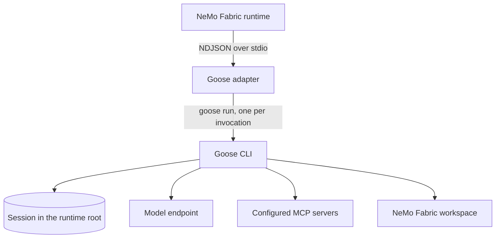

<!--
SPDX-FileCopyrightText: Copyright (c) 2026, NVIDIA CORPORATION & AFFILIATES. All rights reserved.
SPDX-License-Identifier: Apache-2.0
-->

# Goose Adapter for NVIDIA NeMo Fabric

This package runs the [Goose](https://github.com/aaif-goose/goose) CLI for NVIDIA
NeMo Fabric. Each NeMo Fabric runtime owns one Goose session. Each invocation
runs `goose run` headless and resumes that session.

## Install

Install the Goose CLI, then install the adapter:

```bash
curl -fLO https://github.com/aaif-goose/goose/releases/download/v1.57.0/goose-x86_64-unknown-linux-musl.tar.gz
echo "6c3a05e30e1a425dc06a410dbe24b3f3697c9721b1ea2340434ddda6b64267ae  goose-x86_64-unknown-linux-musl.tar.gz" | sha256sum -c -
tar xzf goose-x86_64-unknown-linux-musl.tar.gz -C ~/.local/bin ./goose
pip install "nemo-fabric[goose]"
```

NeMo Fabric tests Goose 1.54.0 and 1.57.0. Other platforms can use the
matching archive from the same release. The adapter package does not install
Goose. It runs `goose` from `PATH` unless the `goose_command` harness setting
names another executable. Relative paths that contain a directory resolve from
the configuration base directory.

## Configure

Select `nvidia.fabric.goose`. The adapter uses Goose's OpenAI provider, which
serves OpenAI and any OpenAI-compatible Chat Completions endpoint. A provider
other than `openai` requires `base_url`.

```python
from nemo_fabric import EnvironmentConfig
from nemo_fabric import FabricConfig
from nemo_fabric import HarnessConfig
from nemo_fabric import InstructionConfig
from nemo_fabric import InstructionsConfig
from nemo_fabric import ModelConfig
from nemo_fabric import RuntimeConfig

config = FabricConfig(
    harness=HarnessConfig(adapter_id="nvidia.fabric.goose"),
    models={
        "default": ModelConfig(
            provider="nvidia",
            model="nvidia/nemotron-3-nano-omni-30b-a3b-reasoning",
            api_key_env="NVIDIA_API_KEY",
            base_url="https://integrate.api.nvidia.com/v1",
        )
    },
    instructions=InstructionsConfig(
        system=InstructionConfig(content="Review the requested code change.", mode="append")
    ),
    runtime=RuntimeConfig(max_turns=20),
    environment=EnvironmentConfig(provider="local", workspace="."),
)
```

The adapter maps NeMo Fabric configuration into Goose as follows:

| NeMo Fabric | Goose |
| --- | --- |
| `models.default.model` | `GOOSE_MODEL` with `GOOSE_PROVIDER=openai` |
| `base_url`, `api_key_env`, `temperature` | `OPENAI_BASE_URL`, `OPENAI_API_KEY`, `GOOSE_TEMPERATURE` |
| `instructions.system` with `mode="append"` | `goose run --system` |
| `instructions.system` with `mode="replace"` | `GOOSE_SYSTEM_PROMPT_FILE_PATH` |
| `runtime.max_turns` | `goose run --max-turns` |
| stdio and streamable HTTP `mcp.servers` | Goose `stdio` and `streamable_http` extensions |
| `environment.workspace` | Working directory of `goose run` |

Goose keeps its default extensions, including the developer shell and file
tools, beside the configured MCP servers. Goose runs tool calls without
approval (`GOOSE_MODE=auto`) because a headless run cannot answer approval
prompts. Other `GOOSE_*` variables in the adapter environment, such as
`GOOSE_CONTEXT_LIMIT`, reach Goose unchanged.

The adapter does not support Relay telemetry, native streaming, skills,
tool selection, MCP authentication, per-server MCP tool filters, or SSE MCP
servers.

## Understand the Runtime Lifecycle

`start` writes Goose's configuration to a private temporary root
(`GOOSE_PATH_ROOT`), so a runtime never reads or changes the user's Goose
configuration, sessions, or keyring. The first invocation creates the session
and later invocations resume it. `stop` removes the root.



Each invocation returns the final assistant message and its own usage. Goose
reports cumulative session token totals, and the adapter reports the change
since the previous invocation. Input tokens include cached input. A counter that
the model endpoint does not report stays unknown. If a run ends without totals,
its usage and the next invocation's usage are unknown.

An invocation fails with one of these codes:

| Code | Cause |
| --- | --- |
| `goose_timeout` | The run passed the invocation deadline. The adapter stops Goose and, on Linux, the tool commands it started. |
| `goose_exit_failure` | Goose exited with a nonzero status, for example when the model endpoint is unreachable. |
| `goose_max_turns_reached` | Goose stopped at `runtime.max_turns`. |
| `goose_model_error` | Goose ended the run with its own notice instead of a model answer, for example after model request errors. |
| `goose_extension_failed` | An extension, such as a configured MCP server, failed to start. |
| `goose_no_response` | Goose finished without an assistant message. |

Tool commands that Goose leaves running keep running until `stop`, which ends
them on Linux.
