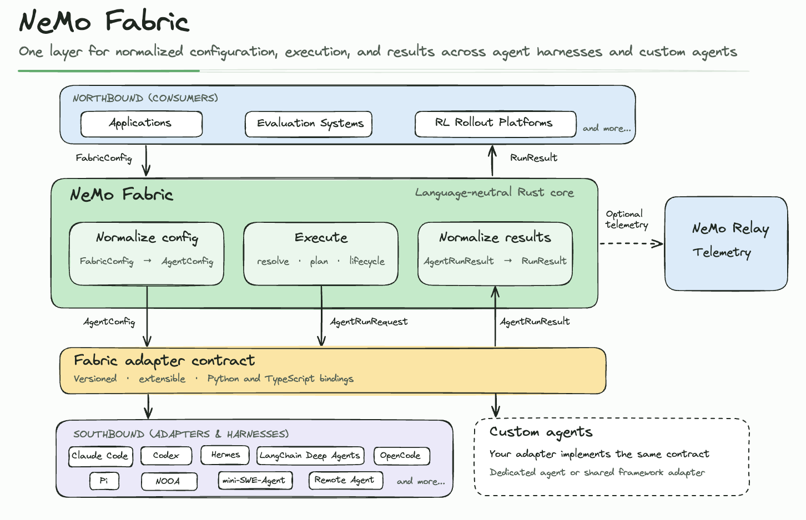

<!--
SPDX-FileCopyrightText: Copyright (c) 2026, NVIDIA CORPORATION & AFFILIATES. All rights reserved.
SPDX-License-Identifier: Apache-2.0
-->

# NVIDIA NeMo Fabric Hermes Agent Adapter

`nemo-fabric-adapters-hermes` provides a NeMo Fabric adapter for use with [Hermes Agent](https://hermes-agent.nousresearch.com/).

## Install

The adapter package supports Python 3.11 through 3.14. Use [Hermes Agent v0.22.7](https://github.com/NousResearch/hermes-agent/releases/tag/v0.22.7) with Python 3.14 and Relay 0.11 on supported platforms. This release includes dependency security fixes absent from v2026.9.24. Hermes Agent 0.20 and later is not installable from PyPI. Follow the [Hermes Agent installation guide](https://hermes-agent.nousresearch.com/docs/installation), select v0.22.7, then install the NeMo Fabric packages into the same Python environment.

The following table shows which NeMo Fabric components each package expression
provides. None of these expressions installs Hermes Agent:

| Installation | Runtime | Adapter | Harness | NeMo Relay Python Package |
| --- | --- | --- | --- | --- |
| `pip install nemo-fabric nemo-fabric-adapters-hermes` | Yes | Yes | No | No |
| `pip install "nemo-fabric-adapters-hermes[full]"` | No | Yes | No | Yes |
| `pip install "nemo-fabric-adapters-hermes[relay]"` | No | Yes | No | Yes |
| `pip install nemo-fabric-adapters-hermes` | No | Yes | No | No |

NeMo Fabric tests Hermes Agent v0.22.7, including Relay telemetry and streaming, on Python 3.14. The adapter's `relay` and `full` extras accept `nemo-relay>=0.10,<0.12`; Hermes v0.22.7 requires `>=0.11,<0.12` on supported platforms. Hermes v0.22.5 with Relay 0.10 remains supported. Use a separate Python 3.14 Hermes environment when the application uses another Python version, and set `ADAPTER_PYTHON` to its interpreter. The adapter checks the Hermes integration and Relay version at startup when telemetry is enabled. Hermes Agent declares its Python package version as `0.0.0`; identify v0.22.7 by its Git commit `b200f5bc60e31588ba2cb60e288029c4a54ba5fa` when reviewing scanner results.

Refer to the [installation guide](https://docs.nvidia.com/nemo/fabric/getting-started/install) for more details.
