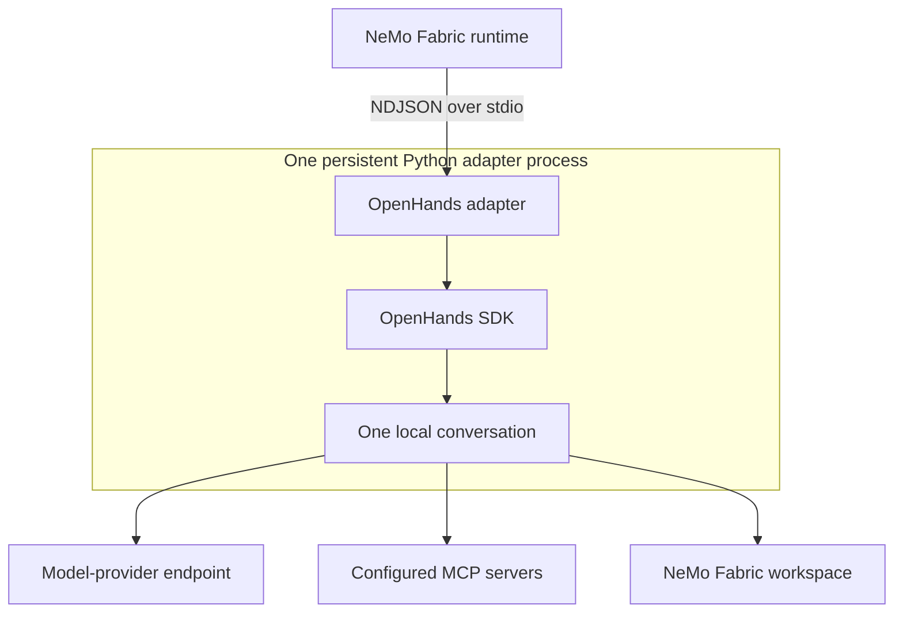

<!--
SPDX-FileCopyrightText: Copyright (c) 2026, NVIDIA CORPORATION & AFFILIATES. All rights reserved.
SPDX-License-Identifier: Apache-2.0
-->

# OpenHands Adapter for NVIDIA NeMo Fabric

This package runs one persistent OpenHands SDK conversation for each NeMo
Fabric runtime. It maps normalized model configuration, system instructions,
built-in tool selection, MCP servers, skills, the workspace, and the
per-invocation iteration limit into OpenHands.

## Install

Install the tested OpenHands SDK and tools, then install the adapter:

```bash
pip install "openhands-sdk==1.50.0" "openhands-tools==1.50.0"
pip install nemo-fabric-adapters-openhands
```

The 1.50.0 package pair is validated with NVIDIA NIM.

The adapter package supports Python 3.11 or later, while OpenHands requires
Python 3.12 or later. The adapter package does not install OpenHands.

For a source checkout, install the adapter and the compatible OpenHands packages
in the repository environment, then select that interpreter for Python adapter
processes:

```bash
uv sync --group adapter-tests
uv pip install "openhands-sdk==1.50.0" "openhands-tools==1.50.0"
export ADAPTER_PYTHON="$PWD/.venv/bin/python"
```

## Configure

Select `nvidia.fabric.openhands`. The built-in tool names are `terminal` (alias
`bash`) and `file_editor` (alias `edit`). OpenHands always retains its internal
finish and reasoning tools.

```python
from nemo_fabric import EnvironmentConfig
from nemo_fabric import FabricConfig
from nemo_fabric import HarnessConfig
from nemo_fabric import InstructionConfig
from nemo_fabric import InstructionsConfig
from nemo_fabric import ModelConfig
from nemo_fabric import RuntimeConfig
from nemo_fabric import ToolsConfig

config = FabricConfig(
    harness=HarnessConfig(adapter_id="nvidia.fabric.openhands"),
    models={
        "default": ModelConfig(
            provider="nvidia",
            model="nvidia/nemotron-3-nano-omni-30b-a3b-reasoning",
            api_key_env="NVIDIA_API_KEY",
            base_url="https://integrate.api.nvidia.com/v1",
        )
    },
    instructions=InstructionsConfig(
        system=InstructionConfig(content="Review the requested code change.")
    ),
    tools=ToolsConfig(enabled=["file_editor"]),
    runtime=RuntimeConfig(max_turns=20),
    environment=EnvironmentConfig(provider="local", workspace="."),
)
```

Relative skill and workspace paths resolve from the configuration base
directory. Each skill path must be a directory containing `SKILL.md`. The
adapter disables ambient OpenHands user, public, project, and memory loading;
only explicitly configured NeMo Fabric skills are loaded.

The adapter configures the OpenHands SDK standard summarizing condenser,
`default_condenser`, with the agent model. When the history sent to the model
exceeds 80 events, or exceeds the model input token limit when OpenHands knows
it, OpenHands replaces older events with a model-generated summary and keeps
the first 4 events. When the model rejects a request for exceeding its context
window, OpenHands condenses the history and continues instead of failing the
invocation. Summarization calls count toward invocation usage, and each
condensation step counts toward `runtime.max_turns`. NeMo Fabric does not
expose condenser tuning parameters.

To keep the full conversation history and make no summarization calls, set the
`condenser` harness setting to `none`. The default value, `default`, enables
the condenser, and any other value is rejected. The following example turns
the condenser off:

```python
from nemo_fabric import HarnessConfig

harness = HarnessConfig(
    adapter_id="nvidia.fabric.openhands",
    settings={"condenser": "none"},
)
```

The initial adapter does not support Relay telemetry, native streaming,
interactive confirmation, MCP authentication, or per-server MCP tool filters.

## Understand the Runtime Lifecycle

The adapter runs the OpenHands SDK directly in a persistent Python adapter
process. It does not start or connect to an OpenHands server. `start` creates
one local conversation for the NeMo Fabric runtime, and ordered invocations
reuse that conversation and its history.



Each invocation returns only the final response and usage for that turn. `stop`
closes the conversation and removes the adapter-owned temporary profile state.
Create a new runtime to change the model, workspace, tools, MCP servers, or
skills.

## Token Usage

Each result's `usage` sums the tokens OpenHands records for the model calls
made during the invocation, including summarization calls. It holds
`input_tokens` with cache reads and cache writes included, `cached_input_tokens`
for cache reads, `output_tokens`, and `total_tokens`. A token counter is
reported only when every model response in the invocation supplies enough
information to determine it. Missing or ambiguous counters remain unknown.

- `cached_input_tokens` is known when every response reported a cache-read
  count, including 0. The adapter reads this from the OpenHands completion
  log callback, which keeps the provider's cache fields. OpenHands writes no
  log file because the adapter sets no log directory. For native Gemini models
  using LiteLLM's `gemini` or `vertex_ai` providers, an omitted cache-read
  count means zero. OpenAI-compatible proxy routes keep it unknown.
- `input_tokens` and `output_tokens` are known when every response reported
  them above 0. LiteLLM stores an omitted prompt or completion count as 0, so
  OpenHands does not retain enough information to tell an omitted counter from
  a reported zero.
- `total_tokens` is known when both input and output are known.
- A count above the uint64 maximum is unknown. Cache reads above a response's
  own input, or above the summed input, are unknown.
- `usage` is unknown when no model call finished, or when a model response
  reported neither prompt nor completion tokens. An explicit 0/0 response also
  leaves usage unknown.

A model attempt that fails with a server error, timeout, or connection error
records no usage in OpenHands. When OpenHands retries such an attempt, `usage`
can undercount the tokens the provider processed.

OpenHands combines a LiteLLM proxy cost header or a locally calculated cost
into the same counter and does not record which one each cost came from, so
`cost_usd` remains unknown.
