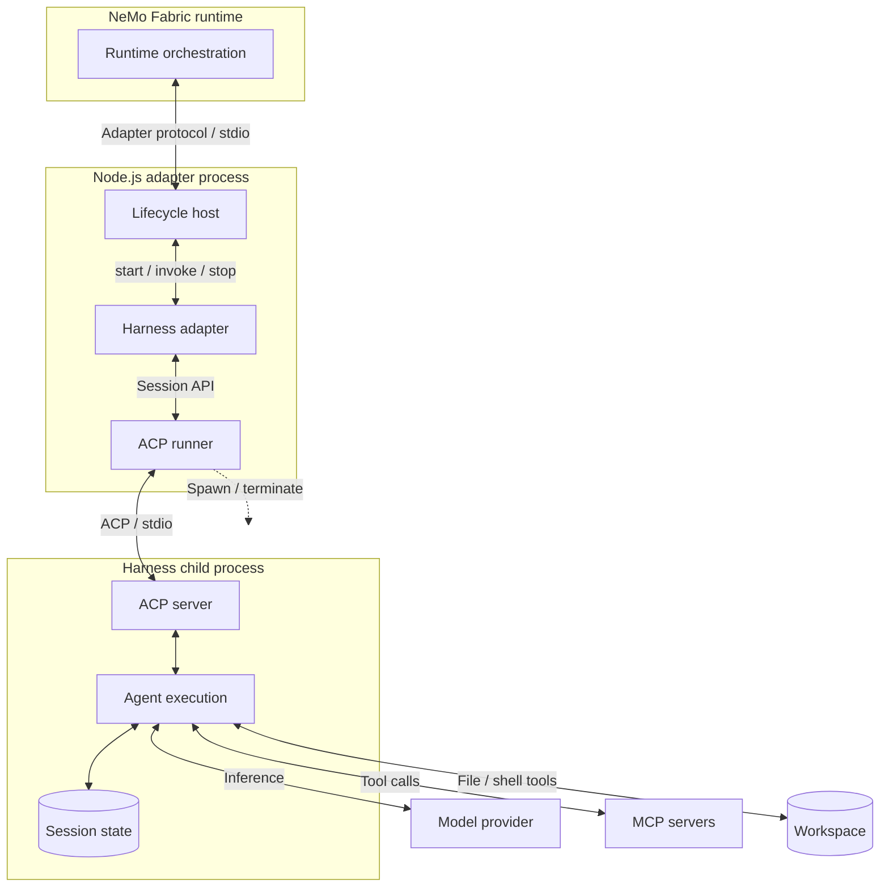

<!--
SPDX-FileCopyrightText: Copyright (c) 2026, NVIDIA CORPORATION & AFFILIATES. All rights reserved.
SPDX-License-Identifier: Apache-2.0
-->

# NVIDIA NeMo Fabric ACP Runner

The shared Agent Client Protocol (ACP) runner lets TypeScript harness adapters start an ACP agent process and reuse one session across ordered invocations. The adapter translates NeMo Fabric configuration and results; the runner manages ACP communication and the child-process lifecycle.

## Understand the Process Boundary

Each NeMo Fabric runtime creates an independent adapter runtime, ACP runner, child process, connection, and session. Ordered invocations reuse that session until the runtime stops.

The diagram separates runtime orchestration, adapter translation, ACP transport, and harness execution. Solid arrows show calls and data exchange; the dashed arrow shows child-process lifecycle control.

The lifecycle host validates requests and serializes invocations. The harness-specific adapter selects target modes and options, supplies permission policy, and normalizes results and usage. The runner retains the ACP SDK client and a local session handle, while the harness owns the conversation state and agent execution.

MCP server configuration travels through ACP during session creation; model requests and MCP tool calls originate in the harness. MCP servers run as separate local processes or remote services.

## Adapter Integration

An adapter supplies process arguments, environment variables, workspace, MCP definitions, session configuration, permission policy, timeouts, and optional readiness behavior through `AcpSessionOptions`. It calls `startAcpSession` during startup, retains the returned `AcpSession`, calls `prompt` for each ordered invocation, and calls `stop` during runtime cleanup.

## Start a Session

`startAcpSession` performs the following work before returning a session:

1. Starts the configured ACP child process.
2. Connects ACP JSON-lines transport over the child's standard input and output.
3. Negotiates the ACP protocol version and validates required MCP transport capabilities.
4. Creates one session with the workspace and configured MCP servers.
5. Applies an advertised session mode and configuration options when the adapter requests them.
6. Waits for an adapter-defined readiness notification when one is configured.

Each startup operation has its own timeout rather than sharing one overall startup deadline. A startup failure disposes any local session observer, closes the connection, and terminates the partially started child process; this cleanup does not attempt the normal `session/close` exchange.

## Agent Invocation

For each agent invocation, the runner sends one `session/prompt` request and collects text from `agent_message_chunk` updates until the response arrives.

During agent execution, permission requests are resolved through the adapter-provided permission resolver. The runner selects only an option of the requested kind that the ACP agent actually offered. If no compatible option exists, it cancels the permission request.

When the invocation completes, the runner returns the collected text, ACP stop reason, and target-reported usage. The adapter translates these into the NeMo Fabric adapter contract.

When an agent invocation exceeds its deadline, the runner attempts to send `session/cancel` and reports a stable timeout error. Cancellation does not itself stop the session or terminate the child process. The adapter decides how to translate the error and whether to stop the session; the Kiro adapter stops and invalidates the session after an invocation error.

## Stop a Session

Shutdown is idempotent. The runner disposes its active-session observer, requests `session/close` when the agent advertises that capability, and closes the ACP connection. On POSIX systems, the agent runs in a dedicated process group: cleanup sends `SIGTERM` to the group, waits for the agent to exit within the shutdown timeout, then sends `SIGKILL` to any remaining group members. On Windows, cleanup uses `taskkill /T /F` to terminate the agent and its descendants. The runner waits for the agent process to exit before returning.

Refer to the [Kiro adapter](../kiro/README.md) for the first integration that uses the shared ACP runner.
