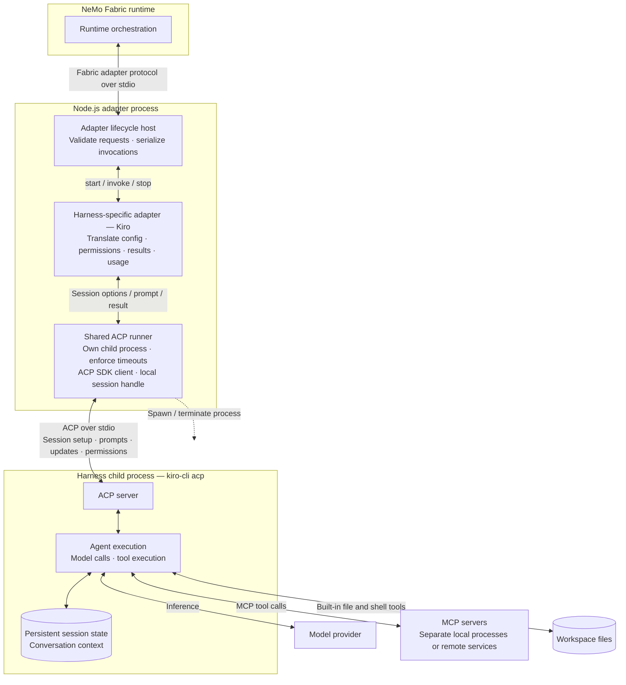

<!--
SPDX-FileCopyrightText: Copyright (c) 2026, NVIDIA CORPORATION & AFFILIATES. All rights reserved.
SPDX-License-Identifier: Apache-2.0
-->

# NVIDIA NeMo Fabric ACP Runner

The shared Agent Client Protocol (ACP) runner provides process and session lifecycle support for TypeScript harness adapters. An adapter translates NeMo Fabric configuration and results, while the runner owns the ACP child process, transport, protocol negotiation, persistent session, prompt exchange, and shutdown.

## Understand the Process Boundary

Each NeMo Fabric runtime creates an independent adapter runtime, ACP runner, child process, connection, and session. Ordered invocations reuse that session until the runtime stops.

The diagram separates runtime orchestration, adapter translation, ACP transport, and harness execution. Solid arrows show calls and data exchange; the dashed arrow shows child-process lifecycle control.

The runner does not translate `AgentConfig`, normalize target results, or choose target-specific modes and options. The adapter remains responsible for those operations.

The runner retains a local ACP session handle, while the harness owns the conversation state and agent execution. MCP server configuration travels through ACP during session creation; model requests and MCP tool calls originate in the harness.

## Startup Responsibilities

`startAcpSession` performs the following work before returning a session:

1. Starts the configured ACP child process.
2. Connects ACP JSON-lines transport over the child's standard input and output.
3. Negotiates the ACP protocol version and validates required MCP transport capabilities.
4. Creates one session with the workspace and configured MCP servers.
5. Applies an advertised session mode and configuration options when the adapter requests them.
6. Waits for an adapter-defined readiness notification when one is configured.

Startup uses one timeout for each bounded operation. A startup failure closes the connection and terminates a partially started child process.

## Prompt Responsibilities

The lifecycle host serializes adapter invocations. For each invocation, the runner sends one `session/prompt` request and collects text from `agent_message_chunk` updates until the prompt response arrives. It returns the text, ACP stop reason, and target-reported usage to the adapter.

When a prompt exceeds its deadline, the runner sends `session/cancel` and reports a stable timeout error. The adapter decides how to translate ACP errors, stop reasons, and usage into the NeMo Fabric adapter contract.

Permission requests are resolved through the adapter-provided permission resolver. The runner selects only an option of the requested kind that the ACP agent actually offered. If no compatible option exists, it cancels the permission request.

## Shutdown Responsibilities

Shutdown is idempotent. The runner disposes its active-session observer, requests `session/close` when the agent advertises that capability, closes the ACP connection, and sends `SIGTERM` to the child process. If the child does not exit before the shutdown deadline, the runner sends `SIGKILL` and waits for process exit.

The same process cleanup runs after partial startup so an adapter does not retain an orphaned ACP process.

## Adapter Integration

An adapter supplies process arguments, environment variables, workspace, MCP definitions, session configuration, permission policy, timeouts, and optional readiness behavior through `AcpSessionOptions`. It retains the returned `AcpSession` for ordered invocations and calls `stop` during runtime cleanup.

Refer to the [Kiro adapter](../kiro/README.md) for the first integration that uses the shared ACP runner.
