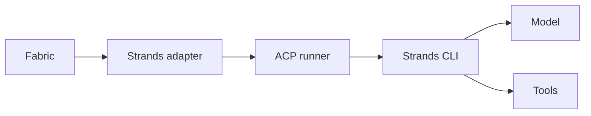

<!--
SPDX-FileCopyrightText: Copyright (c) 2026, NVIDIA CORPORATION & AFFILIATES. All rights reserved.
SPDX-License-Identifier: Apache-2.0
-->

# Strands ACP Adapter

Run the standard [Strands harness](https://github.com/strands-agents/harness-sdk/tree/main/strands-cli) through NVIDIA NeMo Fabric. The `nvidia.fabric.strands` adapter launches `strands --acp-server` using the [shared ACP runner](../common/acp-runner.md), retains one conversation per Fabric runtime, and submits ordered text invocations.



This adapter targets the standard harness. Loading arbitrary Python or TypeScript SDK agents through `--agent` requires a separate integration: the CLI's source-agent paths have different construction, MCP, permission, and usage behavior.

## Install

Use Node.js 22.19 or newer. Install the harness separately; it is not a dependency of the adapter. The tested CLI release is 0.2.1.

```bash
npm install --global @strands-agents/cli@0.2.1
```

For a source checkout, run from the repository root:

```bash
just install-typescript-strands
npm run build --prefix adapters/typescript --workspace nemo-fabric-adapters-common
npm run build --prefix adapters/typescript --workspace nemo-fabric-adapters-strands
```

The published adapter package is `nemo-fabric-adapters-strands`. Its descriptor is `strands.fabric-adapter.json` in the installed package. Fabric's Python adapter catalog also includes the descriptor; source development can select it explicitly as below.

## Configure an Agent Invocation

```python
import asyncio
from pathlib import Path

from nemo_fabric import (
    DiscoveryConfig, EnvironmentConfig, Fabric, FabricConfig, HarnessConfig,
    InstructionConfig, InstructionsConfig, MetadataConfig, ModelConfig, RuntimeConfig,
)

root = Path.cwd()
config = FabricConfig(
    metadata=MetadataConfig(name="strands-review"),
    discovery=DiscoveryConfig(local_paths=[
        root / "adapters/typescript/strands/strands.fabric-adapter.json",
    ]),
    harness=HarnessConfig(adapter_id="nvidia.fabric.strands"),
    models={"default": ModelConfig(
        provider="nvidia",
        model="nvidia/nemotron-3-nano-omni-30b-a3b-reasoning",
        base_url="https://integrate.api.nvidia.com/v1",
        api_key_env="NVIDIA_API_KEY",
    )},
    instructions=InstructionsConfig(system=InstructionConfig(
        mode="append", content="Read the relevant files before reviewing correctness.",
    )),
    environment=EnvironmentConfig(provider="local", workspace=root, artifacts=root / "artifacts/strands"),
    runtime=RuntimeConfig(input_schema="text", output_schema="message", artifacts=root / "artifacts/strands"),
)

async def main():
    async with await Fabric().start_runtime(config, base_dir=root) as runtime:
        result = await runtime.invoke(input="Review README.md for unclear setup instructions.")
        print(result.status, result.output)

asyncio.run(main())
```

Only the `default` model role is supported. With no configured model, Strands selects its native Bedrock default. To select a Bedrock model explicitly, use `ModelConfig(provider="bedrock", model="<Bedrock model ID>")` without `base_url` or `api_key_env`. Configure the AWS SDK credential chain and region before starting Fabric. AWS profiles and SSO caches remain accessible through the runtime's isolated home.

For Chat Completions endpoints, use provider `openai` or `nvidia` and an explicit `base_url`. Both map to Strands' native `litellm/` profile, which creates a direct OpenAI-compatible Chat Completions client; a LiteLLM proxy is not required. The model ID is passed unchanged after the profile prefix. The CLI's `openai/` profile uses the Responses API, so it is not used for this mapping.

Set `api_key_env` to the name of a credential in the task environment or parent process. An explicitly named but unavailable credential fails startup. Omit it for a keyless endpoint; the client receives a nonsecret placeholder credential. HTTPS and loopback HTTP are accepted. For a trusted HTTP server elsewhere, add its hostname or IP to `harness.settings.insecure_http_model_hosts`:

```python
config.models["default"] = ModelConfig(
    provider="openai", model="<served model ID>", base_url="http://model-server:8000/v1",
)
config.harness.settings["insecure_http_model_hosts"] = ["model-server"]
```

Query the endpoint's model catalog for its served ID. Strands does not provide a model server, translate model names, or make unsupported tool calling work on a model.

## Tools, Instructions, and MCP

`instructions.system` supports `append` only. The CLI appends domain instructions to the harness system prompt. Replacement fails planning and direct adapter startup.

| Harness setting | Default | Behavior |
| --- | --- | --- |
| `builtin_tools` | `shell`, `read`, `write`, `edit` | Select from these tools and `web_fetch`; an empty list disables built-in tools. |
| `max_invocations` | `100` | Maximum dispatched invocations in one conversation, from 1 to 10,000. Start a new runtime when exhausted; history is not silently reset. |
| `insecure_http_model_hosts` | `[]` | Explicit hostnames or IPs allowed for HTTP model endpoints outside loopback. |

The standard Strands ACP server executes enabled tools with the task environment's permissions. There is no adapter permission mode or normalized tool-policy support. Tool selection is not an operating-system sandbox; use an appropriate Fabric environment when running untrusted tasks.

Configure MCP through Fabric's normalized `mcp.servers`, not harness settings:

```python
import sys

config.add_mcp_server(
    "probe", transport="stdio", url=sys.executable,
    args=[str(root / "tests/_utils/probe_mcp_server.py"), "--marker", "/tmp/probe-called", "--token", "example"],
)
```

The adapter supports stdio, streamable HTTP, and SSE. Stdio requires an absolute executable. Remote servers require HTTPS except on loopback. Explicit headers can reference `${ENVIRONMENT_VARIABLE}` values; task environment values take precedence over parent values. ACP-transport MCP, normalized authentication objects, per-server tool filters, and MCP extensions are rejected. Strands initializes the agent and supplied MCP clients before returning the new-session response, so no Kiro-specific readiness notification is needed.

## Lifecycle and Boundaries

Each runtime owns one child process, an isolated temporary CLI home, and one live ACP session. Personal CLI profiles, MCP discovery, skill discovery, session persistence, long-term memory, and the todos plugin are disabled. The native environment plugin supplies workspace context. Background tool execution is disabled so tool work stays within its invocation. The adapter inherits a small process/AWS environment and applies explicit task environment values. It preserves access to the caller's `.aws` directory for native credential resolution. The temporary home is removed after stop or startup failure.

Warm invocations retain conversation history without saving it to the workspace. Deadline expiry attempts ACP cancellation, invalidates the session, and terminates its process group. Stop is idempotent. The adapter supports text input and returns `{ "response": "..." }`, with ACP session ID and stop reason in result metadata. Non-success stop reasons become failed or cancelled results.

Strands CLI usage is invocation-local and is not differenced across turns. Inclusive input, output, total, and cached-read counters are normalized when valid. Cache writes are retained in `nemo_fabric.detailed_token_usage.v1`. Missing or malformed usage remains unknown without discarding a completed response. Cost is not estimated. Public cancellation, native OpenAI streaming, live updates, services, Relay telemetry, normalized runtime limits, and normalized skills are not advertised.

## Validate

Credential-free adapter tests:

```bash
npm test --prefix adapters/typescript --workspace nemo-fabric-adapters-strands
uv run pytest tests/adapters/test_strands_adapter.py
```

Live tests run conversation continuity, independent-runtime isolation, a real MCP tool on the first turn, and a native workspace read. Set `STRANDS_TEST_MODEL` to a Bedrock model ID and configure AWS credentials/region, or select a Chat Completions endpoint:

```bash
export RUN_FABRIC_STRANDS_INTEGRATION=1
export STRANDS_TEST_MODEL='<served model ID>'
export STRANDS_TEST_BASE_URL='http://localhost:8000/v1'
# For an authenticated endpoint, also set STRANDS_TEST_API_KEY_ENV to the credential variable name.
uv run pytest tests/e2e/test_strands.py
```

The [code-review example](../../../examples/code_review_agent/README.md) includes `--variant strands` for a runnable application.
