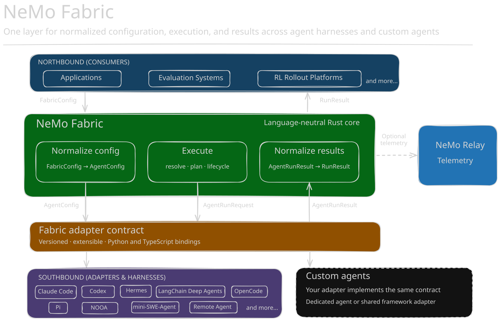

{/* SPDX-FileCopyrightText: Copyright (c) 2026, NVIDIA CORPORATION & AFFILIATES. All rights reserved.
SPDX-License-Identifier: Apache-2.0 */}

NVIDIA NeMo Fabric uses a Python SDK backed by a Rust core to validate configuration and coordinate execution through harness adapters and environment providers. Applications supply tasks and use the results; each harness retains its own agent logic and tools.

The following diagram shows how applications, evaluation systems, and rollout platforms use NeMo Fabric to run harnesses and receive execution evidence.

## Components

The components divide responsibility as follows:

| Component | Role in a Run |
| --- | --- |
| Application or evaluator | Defines the task, chooses the harness, submits requests, and uses the results. Owns scheduling, concurrency limits, retries, scoring, and recovery. |
| NeMo Fabric | Validates configuration and coordinates execution through the harness adapter and environment provider. Returns normalized results and execution evidence. |
| Environment provider | Creates or connects to the environment where the harness runs. Providers such as OpenShell supply sandbox isolation and policy enforcement. |
| Harness adapter | Implements the NeMo Fabric adapter contract for a specific harness. Translates NeMo Fabric configuration and execution requests into native harness operations, then normalizes the results. |
| Harness or custom agent | Performs the task using its own agent logic, tools, and execution behavior. |
| NeMo Relay, when enabled | Instruments supported harness execution and routes telemetry to configured destinations. |

## Data Flow

For example, an application asks an agent to review a code change:

1. **Submit the task.** Your application sends the review request with its selected harness, model, and workspace settings.
2. **Run the agent.** NeMo Fabric validates the settings and starts the harness through its adapter. The harness performs the review using its own agent logic and tools.
3. **Return the outcome.** The adapter maps the outcome into a normalized result. NeMo Fabric returns the review output or failure details, plus available artifact and telemetry references. For a single-request run, it also attempts runtime cleanup before returning.

## Related Topics

Use these guides to explore configuration, runtime ownership, and integration contracts:

- [Key Features](key-features.mdx)
- [Execution Model](../sdk/execution-model.mdx)
- [Environments and Shared Services](../sdk/environments-and-shared-services.mdx)
- [Adapter Contract](../adapter-contract/README.md)
