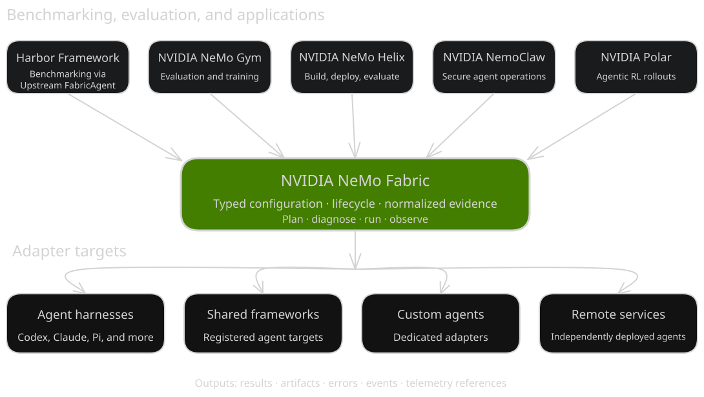

{/* SPDX-FileCopyrightText: Copyright (c) 2026, NVIDIA CORPORATION & AFFILIATES. All rights reserved.
SPDX-License-Identifier: Apache-2.0 */}

NVIDIA NeMo Fabric integrates with external applications, evaluation systems, and rollout platforms through a common agent execution interface. Explore the projects below to see how they use Fabric and find their upstream integrations.

## Integration Status

| Project | Integration status | Upstream reference |
| --- | --- | --- |
| NVIDIA NemoClaw | Available on the v1 development branch | [Fabric harnesses](https://github.com/NVIDIA/NemoClaw/blob/v1/docs/references/fabric-harnesses.md) |
| Harbor Framework | Available upstream; current `main` targets Fabric 0.6.x | [FabricAgent](https://github.com/harbor-framework/harbor/blob/main/src/harbor/agents/installed/fabric.py) |
| NVIDIA NeMo Gym | Available upstream | [NeMo Fabric agent](https://github.com/NVIDIA-NeMo/Gym/tree/main/responses_api_agents/nemo_fabric_agent) |
| NVIDIA NeMo Helix | Available platform-managed workflows | [Agent management](https://docs.nvidia.com/nemo-helix/latest/documentation/studio/agents/) |
| NVIDIA NeMo Polar | Available on the upstream `stable` branch | [NeMo Fabric preset](https://github.com/NVIDIA-NeMo/ProRL-Agent-Server/blob/stable/src/polar/agent/README.md#nemo-fabric) |

## NVIDIA NemoClaw

NVIDIA NemoClaw v1 deploys and manages agents in NVIDIA OpenShell sandboxes from desired-state configuration. Its NeMo Fabric integration manages agent runtimes across supported harnesses, while NemoClaw coordinates sandbox provisioning, inference routing, and deployment lifecycle.

Select a harness through configuration and use the same deployment workflow to plan, apply, and manage sandboxed agents.

[Explore the upstream integration](https://github.com/NVIDIA/NemoClaw/blob/v1/docs/references/fabric-harnesses.md)

## Harbor Framework

Harbor is a framework for evaluating and optimizing agents in sandboxed environments. Its `FabricAgent` integration lets teams run supported agent harnesses through NeMo Fabric while keeping task provisioning, environments, verification, and scoring in Harbor.

Use the same benchmark tasks to compare harnesses, models, and agent configurations through Fabric’s common execution interface.

[Explore the upstream integration](https://github.com/harbor-framework/harbor/blob/main/src/harbor/agents/installed/fabric.py)

## NVIDIA NeMo Gym

NVIDIA NeMo Gym provides environments for evaluating and improving models and agents at scale. Its NeMo Fabric integration lets teams run interchangeable agent harnesses while keeping tasks, environments, verifiers, and training workflows in NeMo Gym.

Use the same evaluation environments to compare harnesses and agent configurations, or collect agent rollouts for training.

[Explore the upstream integration](https://github.com/NVIDIA-NeMo/Gym/tree/main/responses_api_agents/nemo_fabric_agent)

## NVIDIA NeMo Helix

NVIDIA NeMo Helix is a platform for building, deploying, evaluating, and improving agents. Its NeMo Fabric integration translates platform-managed agent definitions into Fabric configuration and runs the selected harness, while NeMo Helix manages deployment, model infrastructure, and evaluation workflows.

Run and compare supported harnesses through NeMo Helix’s agent management and evaluation interfaces.

[Explore agent management](https://docs.nvidia.com/nemo-helix/latest/documentation/studio/agents/) · [Evaluate with a Fabric harness](https://docs.nvidia.com/nemo-helix/documentation/evaluate-models/agent-eval/fabric-runner/)

## NVIDIA NeMo Polar

NVIDIA NeMo Polar is a reinforcement learning rollout framework for real-world agent harnesses. Its NeMo Fabric integration provides a single entry point for selecting and running supported harnesses while NeMo Polar manages runtime preparation, model routing, trajectory capture, and evaluation.

Switch harnesses through configuration while keeping the same task and rollout workflow.

[Explore the upstream integration](https://github.com/NVIDIA-NeMo/ProRL-Agent-Server/blob/stable/src/polar/agent/README.md#nemo-fabric) · [Read the research paper](https://arxiv.org/abs/2605.24220)

## Build an Integration

Use the NeMo Fabric Python SDK to configure agents, manage runtimes, and consume normalized results and execution artifacts.

[Consumer integration guide](../integrations/consumer/overview.mdx) · [Python SDK guide](../sdk/python.mdx)

## Roadmap

Potential integrations to explore:

- **[NVIDIA OSMO](https://github.com/NVIDIA/OSMO)** for orchestrated agent workflows.
- **[NVIDIA NeMo CUA](https://github.com/NVIDIA/NemoCUA)** for computer-use agent workflows.
