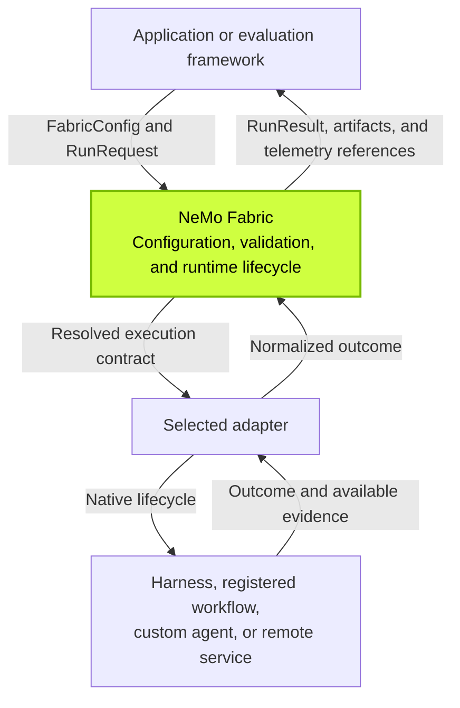

{/* SPDX-FileCopyrightText: Copyright (c) 2026, NVIDIA CORPORATION & AFFILIATES. All rights reserved.
SPDX-License-Identifier: Apache-2.0 */}

NVIDIA NeMo Fabric connects applications, evaluation systems, and rollout platforms to supported agent harnesses and custom agents through a common execution interface. Each system keeps its own workflow while NeMo Fabric standardizes configuration, runtime lifecycle, results, artifacts, and telemetry references.

<CardGroup cols={3}>
  <Card title="Run Supported Harnesses" icon="fa-solid fa-robot" href="../integrations/harness/overview.mdx">
    Reuse one application integration while adapters handle harness-specific execution.
  </Card>
  <Card title="Evaluate Agents" icon="fa-solid fa-chart-line" href="../integrations/consumer/harbor.mdx">
    Keep tasks and verification in your evaluation framework while changing the selected agent.
  </Card>
  <Card title="Bring Your Own Agent" icon="fa-solid fa-puzzle-piece" href="../adapter-contract/custom-agents.md">
    Connect a custom agent through a dedicated adapter or registered framework target.
  </Card>
</CardGroup>

## Where NeMo Fabric Fits

Your application or evaluation platform decides which task to run. NeMo Fabric resolves its agent configuration, validates requested capabilities, and drives the selected target through an adapter. The harness or custom agent decides how to perform the work.

NeMo Fabric returns execution outcomes and available evidence. The consumer still owns scheduling, concurrency limits, retries, evaluation criteria, and recovery. An environment provider such as OpenShell supplies its own resource lifecycle and security boundary.

## How NeMo Fabric Relates to Other Tooling

| Part of your stack | Examples | What NeMo Fabric adds |
| --- | --- | --- |
| Agent harnesses execute agent work. | Hermes Agent, Codex, Claude Code, Deep Agents | [Harness adapters](../integrations/harness/overview.mdx) translate a shared configuration and lifecycle into native execution. |
| Agent frameworks define custom application behavior. | NeMo Agent Toolkit, LangGraph | [Shared framework targets or dedicated adapters](../adapter-contract/custom-agents.md) expose an explicit construction and invocation boundary. |
| Applications and platforms own the user workflow. | Your service, NeMo Helix | The [Python SDK](../sdk/python.mdx) gives consumers common runtime and result handling across supported targets. |
| Evaluation and rollout systems own tasks and verification. | Harbor, NeMo Gym | A common execution boundary lets these systems change harnesses while retaining their task contracts and result processing. |
| Sandboxes isolate agent execution. | OpenShell | The [environment lifecycle](../sdk/environments.mdx) connects host-side configuration and invocation to an agent inside the sandbox. OpenShell owns isolation and policy. |
| Observability tools record and explore agent work. | NeMo Relay, OpenTelemetry and OpenInference backends | Supported adapters can produce telemetry and return evidence references alongside normalized results. [Streaming](../sdk/streaming.mdx) distinguishes native output chunks from Relay execution records. |
| Model-serving systems host inference. | NVIDIA NIM, NVIDIA Dynamo, other compatible endpoints | Adapter-supported model configuration selects endpoints and credentials. Serving and model availability remain the endpoint's responsibility. |

**Comparing harness behavior:** keep the task and verifier fixed, vary a supported configuration, and inspect both the outcome and its execution evidence. A common result shape does not make models, prompts, tools, or native defaults equivalent.

**Building a multi-harness application:** integrate your application with the public SDK once, then let adapters own native initialization and cleanup. Use planning and diagnostics to check a requested configuration before starting work.

<Tip>
Start with an existing harness adapter when it fits your agent. Use the [custom-agent decision guide](../adapter-contract/custom-agents.md) when your application owns the execution behavior. You do not need to author an adapter just to use the public SDK.
</Tip>

## Integrations and Ecosystem Connections

These connections have different implementation and release status. Use the linked workflow and its version requirements rather than treating every ecosystem relationship as a bundled integration.

| Consumer | Connection and status | Ownership boundary |
| --- | --- | --- |
| [Harbor](https://github.com/harbor-framework/harbor) | `FabricAgent` shipped upstream in Harbor 0.25.0; a separate NeMo Fabric bridge also exists. | Harbor owns task provisioning, environments, verification, rewards, and retries. NeMo Fabric runs the selected harness. See the version note below. |
| [NeMo Gym](https://github.com/NVIDIA-NeMo/Gym/tree/main/responses_api_agents/nemo_fabric_agent) | Available upstream, with Fabric-backed SWE-bench and Terminal-Bench configurations. | Gym owns tasks, verifiers, concurrency, and training integration. NeMo Fabric owns harness configuration and execution. |
| [NeMo Helix](https://docs.nvidia.com/nemo-helix/documentation/home/) | Available platform-managed agent workflows. | Helix manages agent definitions, deployment, model infrastructure, and evaluation; NeMo Fabric supplies the selected harness lifecycle. |
| [NemoClaw](https://docs.nvidia.com/nemoclaw/latest/about/overview.html) | Active integration being hardened for release compatibility and downstream validation. | NemoClaw owns OpenShell provisioning, policy, deployment, and recovery; NeMo Fabric runs agents inside the sandbox. |
| [Polar](https://github.com/NVIDIA-NeMo/ProRL-Agent-Server) | Emerging integration direction, not a shipped NeMo Fabric workflow. | The proposed boundary leaves rollout scheduling, pooling, trajectory construction, and trainer integration with Polar. |

### Choose the Harbor Integration for Your Versions

[Harbor 0.25.0](https://github.com/harbor-framework/harbor/releases/tag/v0.25.0) includes `FabricAgent`, but its `fabric` extra selects NeMo Fabric 0.5.x. Follow [that release's dependency requirements](https://github.com/harbor-framework/harbor/blob/v0.25.0/pyproject.toml) when using the upstream built-in agent.

The separately packaged [NeMo Fabric Harbor integration](../integrations/consumer/harbor.mdx) has its own supported host and task package combinations. Its [maintained walkthroughs](https://github.com/NVIDIA/NeMo-Fabric/tree/main/examples/harbor) include a credential-free calculator smoke test and model-backed benchmark tasks. Match the runtime and adapter versions across the host and task environments.

For other available workflows, refer to [Helix Studio Agents](https://docs.nvidia.com/nemo-helix/latest/documentation/studio/agents/), [Evaluate with a NeMo Fabric Harness](https://docs.nvidia.com/nemo-helix/documentation/evaluate-models/agent-eval/fabric-runner/), and the Gym [SWE-bench](https://github.com/NVIDIA-NeMo/Gym/blob/main/responses_api_agents/anyswe_agent/configs/anyswe_nemo_fabric.yaml) and [Terminal-Bench](https://github.com/NVIDIA-NeMo/Gym/blob/main/responses_api_agents/anyterminal_agent/configs/anyterminal_nemo_fabric.yaml) configurations.

## Extend NeMo Fabric With Adapters

Adapters package the translation between the public execution contract and an agent target. Choose the narrowest boundary that the target supports.

| Integration shape | Example | When to use it |
| --- | --- | --- |
| Bundled harness adapter | Hermes Agent, Codex, Claude Code, Deep Agents | The harness already provides a reusable native execution model. Configure its supported fields through NeMo Fabric. |
| Shared framework adapter and registered targets | Source-only [NeMo Agent Toolkit reference](https://github.com/NVIDIA/NeMo-Fabric/tree/main/external/nat) | One framework adapter can load several independently registered agents through stable construction semantics. |
| Dedicated custom-agent adapter | [LangGraph email-phishing analyzer](https://github.com/NVIDIA/NeMo-Fabric/tree/main/examples/langgraph_custom_agent) | The agent's own graph, state, or control flow is the clearest execution boundary. |
| Remote service adapter | [Remote Agent](../integrations/harness/remote-agent.mdx) | An independently deployed service exposes a supported API. Its internal tools, skills, and environment remain deployment-owned. |

Use the [Adapter Contract](../adapter-contract/README.md) for implementation and verification guidance. Capability claims describe behavior implemented through the adapter, rather than everything the underlying harness can do.

## How NeMo Fabric Fits in the NVIDIA Agent Toolkit Ecosystem

The [NVIDIA Agent Toolkit](https://blogs.nvidia.com/blog/enterprise-platforms-agent-toolkit/) brings together tools for building, running, securing, and improving agents. NeMo Fabric contributes a common agent execution boundary across supported harnesses and custom agents.

| Purpose | NVIDIA components | Relationship to NeMo Fabric |
| --- | --- | --- |
| Isolate execution | [OpenShell](https://docs.nvidia.com/openshell/about/overview), [NemoClaw](https://docs.nvidia.com/nemoclaw/latest/about/overview.html) | OpenShell supplies sandbox isolation and policy. NeMo Fabric's OpenShell provider connects the SDK lifecycle to task-side agent execution; NemoClaw's integration is still being hardened. |
| Observe execution | [NeMo Relay](https://docs.nvidia.com/nemo/relay) | Supported adapters integrate Relay instrumentation and return telemetry references. NeMo Fabric does not make every Relay feature available on every harness. |
| Manage and evaluate agents | [NeMo Helix](https://docs.nvidia.com/nemo-helix/documentation/home/), [NeMo Gym](https://github.com/NVIDIA-NeMo/Gym) | These consumers keep their platform and evaluation workflows while using NeMo Fabric for harness execution. |
| Serve models | [NIM](https://docs.nvidia.com/nim/large-language-models/latest/introduction.html), [Dynamo](https://docs.nvidia.com/dynamo/) | These systems serve inference. NeMo Fabric adapters configure compatible client endpoints; protocol and authentication support depend on the adapter. |
| Prepare data and customize models | [Data Designer](https://docs.nvidia.com/nemo/microservices/latest/generate-synthetic-data/index.html), [Curator](https://docs.nvidia.com/nemo/curator/latest/), [NeMo Framework](https://docs.nvidia.com/nemo-framework/user-guide/latest/nemotoolkit/index.html), [Customizer](https://docs.nvidia.com/nemo/microservices/latest/fine-tune/index.html) | These tools produce data and models upstream of execution. They complement an agent workflow; NeMo Fabric does not provide a bundled integration with each product. |
| Retrieve knowledge and evaluate effectiveness | [Retriever](https://docs.nvidia.com/nemo/retriever/latest/), [Evaluator](https://docs.nvidia.com/nemo/evaluator/latest/) | Retrieval tools and quality evaluation can surround agent execution. Wiring them into an application or evaluation pipeline remains a separate integration task. |

<Note>
These relationships describe complementary responsibilities. They do not establish feature parity, shared packaging, or a tested end-to-end integration across every product. Check the selected [harness compatibility](../reference/compatibility.mdx) and the consumer's supported versions.
</Note>

## Potential Connections

[OSMO](https://github.com/NVIDIA/OSMO) for orchestrated agent workflows and [NeMoCUA](https://github.com/NVIDIA/NemoCUA) for computer-use workflows remain areas to explore. They are not presented here as shipped integrations.
