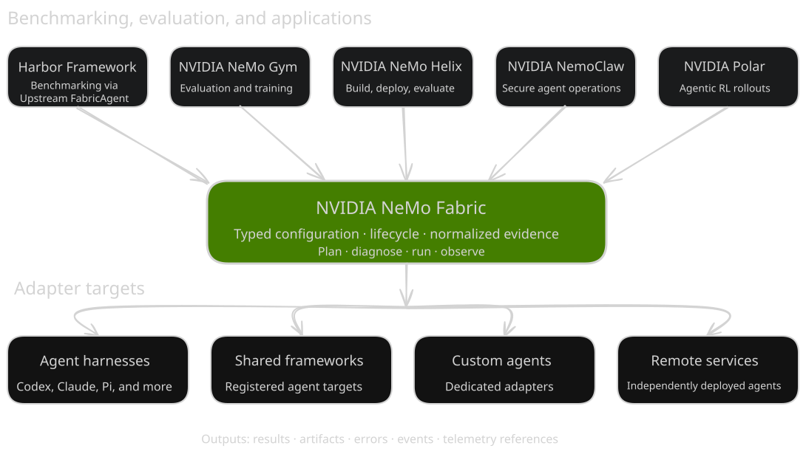

{/* SPDX-FileCopyrightText: Copyright (c) 2026, NVIDIA CORPORATION & AFFILIATES. All rights reserved.
SPDX-License-Identifier: Apache-2.0 */}

The agent ecosystem includes applications, evaluation systems, rollout platforms, and the harnesses that execute agent tasks. NVIDIA NeMo Fabric connects these systems through a common agent execution interface, so they can run supported harnesses and custom agents without implementing each harness integration.

<Note>
For NeMo Fabric's capabilities, refer to [Overview](overview.mdx) and [Key Features](key-features.mdx). For its internal design and execution boundaries, refer to [Architecture Overview](architecture-overview.mdx).
</Note>

The following diagram shows how external projects use NeMo Fabric to run agent harnesses, shared frameworks, custom agents, and remote services and collect normalized execution evidence.

## Compare Each Related Product's Purpose by Use Case

NeMo Fabric supplies the agent execution interface. The related products below own application deployment, task provisioning, evaluation, or training workflows. Explore the following projects to understand their roles and find their upstream integrations.

### Deployment and Applications

These projects use NeMo Fabric within agent deployment and management workflows:

| Project | Purpose | NeMo Fabric's Role |
| --- | --- | --- |
| [NVIDIA NemoClaw](https://github.com/NVIDIA/NemoClaw) | An open-source reference stack for running supported AI agents inside NVIDIA OpenShell sandboxes. Its `v1` development branch uses desired-state configuration and coordinates sandbox provisioning, inference routing, and deployment lifecycle. | Manages agent runtimes across supported harnesses. Select a harness through configuration while keeping the same plan, apply, and management workflow. Refer to [NeMo Fabric harnesses](https://github.com/NVIDIA/NemoClaw/blob/v1/docs/references/fabric-harnesses.md). |
| [NVIDIA NeMo Helix](https://github.com/NVIDIA-NeMo/nemo-helix) | An open-source control plane for improving and hardening production agents. Manages deployment, model infrastructure, and evaluation workflows. | Translates platform-managed agent definitions into NeMo Fabric configuration and runs the selected harness. Refer to [Agent management](https://docs.nvidia.com/nemo-helix/latest/documentation/studio/agents/) and [Evaluate with a NeMo Fabric harness](https://docs.nvidia.com/nemo-helix/documentation/evaluate-models/agent-eval/fabric-runner/). |

### Benchmarking, Evaluation, and Training

These projects use NeMo Fabric to run agents while retaining their own task, evaluation, and training workflows:

| Project | Purpose | NeMo Fabric's Role |
| --- | --- | --- |
| [Harbor Framework](https://github.com/harbor-framework/harbor) | Evaluates and optimizes agents and language models. Owns task provisioning, environments, verification, and scoring. | The [FabricAgent integration](https://github.com/harbor-framework/harbor/blob/main/src/harbor/agents/installed/fabric.py) runs supported harnesses through NeMo Fabric. Use the same benchmark tasks to compare harnesses, models, and agent configurations. |
| [NVIDIA NeMo Gym](https://github.com/NVIDIA-NeMo/Gym) | Evaluates and improves models and agents using task environments. Owns tasks, environments, verifiers, and training workflows. | Runs interchangeable harnesses through the [NeMo Fabric agent](https://github.com/NVIDIA-NeMo/Gym/tree/main/responses_api_agents/nemo_fabric_agent). Compare harnesses and configurations in the same environments, or collect rollouts for training. |
| [NVIDIA NeMo Polar](https://github.com/NVIDIA-NeMo/ProRL-Agent-Server) | A reinforcement learning rollout framework for real-world agent harnesses. Manages runtime preparation, model routing, trajectory capture, and evaluation. | The [NeMo Fabric preset](https://github.com/NVIDIA-NeMo/ProRL-Agent-Server/blob/stable/src/polar/agent/README.md#nemo-fabric) provides one entry point for selecting and running supported harnesses. Switch harnesses through configuration while keeping the same task and rollout workflow. Refer to the [research paper](https://arxiv.org/abs/2605.24220). |

## Integration Status

The following table summarizes each project's integration status and links to its upstream implementation or documentation.

| Project | Integration Status | Upstream Reference |
| --- | --- | --- |
| NVIDIA NemoClaw | Available on the v1 development branch | [NeMo Fabric harnesses](https://github.com/NVIDIA/NemoClaw/blob/v1/docs/references/fabric-harnesses.md) |
| Harbor Framework | Available upstream; current `main` targets NeMo Fabric 0.6.x | [FabricAgent](https://github.com/harbor-framework/harbor/blob/main/src/harbor/agents/installed/fabric.py) |
| NVIDIA NeMo Gym | Available upstream | [NeMo Fabric agent](https://github.com/NVIDIA-NeMo/Gym/tree/main/responses_api_agents/nemo_fabric_agent) |
| NVIDIA NeMo Helix | Available platform-managed workflows | [Agent management](https://docs.nvidia.com/nemo-helix/latest/documentation/studio/agents/) |
| NVIDIA NeMo Polar | Available on the upstream `stable` branch | [NeMo Fabric preset](https://github.com/NVIDIA-NeMo/ProRL-Agent-Server/blob/stable/src/polar/agent/README.md#nemo-fabric) |

## Build an Integration

Use the NeMo Fabric Python SDK to configure agents, manage runtimes, and consume normalized results and execution artifacts.

[Consumer integration guide](../integrations/consumer/overview.mdx) · [Python SDK guide](../sdk/python.mdx)

## Roadmap

Potential integrations to explore:

- **[NVIDIA OSMO](https://github.com/NVIDIA/OSMO)** for orchestrated agent workflows.
- **[NVIDIA NeMo CUA](https://github.com/NVIDIA/NemoCUA)** for computer-use agent workflows.
