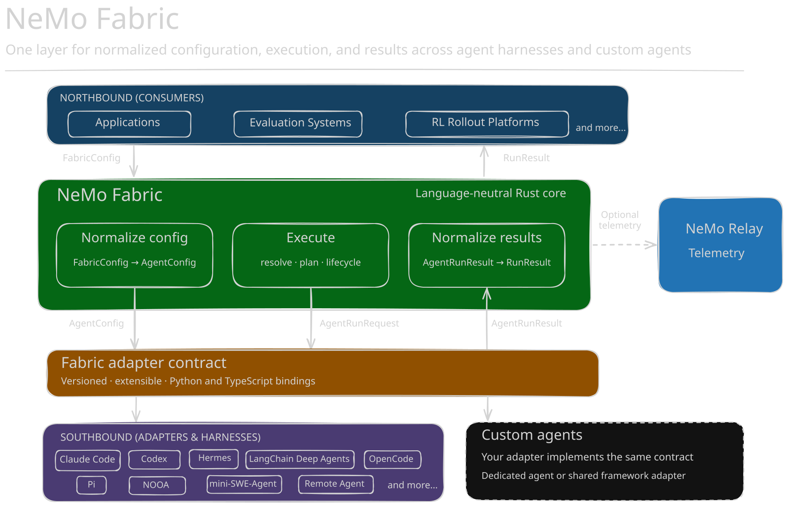

{/* SPDX-FileCopyrightText: Copyright (c) 2026, NVIDIA CORPORATION & AFFILIATES. All rights reserved.
SPDX-License-Identifier: Apache-2.0 */}

NVIDIA NeMo Fabric gives applications a common interface for running agents across supported agent harnesses. Teams can switch harnesses, compare them on the same tasks, and share custom agents without building a separate application integration for each one. NeMo Fabric provides a Python SDK backed by a Rust core.

{/* The docs sync resolves repository-relative Card source paths for the published site. */}
<CardGroup cols={2}>
  <Card title="Who Should Use NeMo Fabric" icon="fa-solid fa-users" href="#what-you-can-do-with-nemo-fabric">
    Find out how NeMo Fabric can help your team build applications, compare harnesses, and share agents.
  </Card>
  <Card title="Start Here: Run Your First Agent" icon="fa-solid fa-rocket" href="../getting-started/quickstart.mdx">
    Use the starter notebook or follow the Python Quickstart.
  </Card>
  <Card title="Bring Your Own Custom Agent or Harness" icon="fa-solid fa-puzzle-piece" href="../adapter-contract/README.md">
    Make your agent work with NeMo Fabric: implement an adapter that applications and evaluation tools can reuse.
  </Card>
  <Card title="Use Ready-Made Integrations" icon="fa-solid fa-plug" href="../integrations/consumer/overview.mdx">
    Explore sandboxed workflows, evaluation, training, and agent optimization through NVIDIA NemoClaw, Harbor Framework, NVIDIA NeMo Gym, NVIDIA NeMo Helix, and NVIDIA NeMo Polar.
  </Card>
</CardGroup>

## What You Can Do with NeMo Fabric

### Use Multiple Harnesses in Your Product

NeMo Fabric lets your product use multiple supported agent harnesses through a common application interface. Adapters handle each harness’s initialization and execution, so your product can use a common request format and receive normalized results across harnesses. Select the capabilities each harness supports without building a separate execution integration for each one.

### Evaluate and Optimize Agent Configurations Across Harnesses

Use NeMo Fabric as the agent execution layer in your evaluation systems. Compare harnesses, models, and agent configurations on the same tasks. Your evaluation framework supplies the tasks and scoring; NeMo Fabric runs the configured agent and returns normalized results and available execution evidence.

Test whether adding a skill, tool, or MCP integration improves task outcomes enough to justify its added cost for each harness and model.

Meaningful comparisons also require knowing what ran. NeMo Fabric records selected software versions and available infrastructure software versions so you can identify differences between runs that could affect results.

Available evidence depends on the selected adapter and environment; use the returned coverage and availability fields when comparing runs.

### Optimize Execution with System Stats

Use NeMo Fabric’s system stats to understand CPU and memory usage during agent execution. NeMo Fabric tracks resource usage across the harness process and its child processes, giving you a clearer picture of the run’s memory footprint. Use these insights to compare harnesses and configurations, guide resource sizing, and tune execution efficiency.

### Make Your Agent Available to Other Teams

Make your custom agent or custom harness available through NeMo Fabric by implementing the adapter contract. Other teams can then run it in their applications and evaluation systems through the same interface they use for supported harnesses, without building a separate integration.

## How NeMo Fabric Works

For example, an application asks an agent to review a code change:

1. **Submit the task.** Your application sends the review request with its selected harness, model, and workspace settings.
2. **Run the agent.** NeMo Fabric validates the settings and starts the harness through its adapter. The harness performs the review using its own agent logic and tools.
3. **Return the outcome.** The adapter maps the outcome into a normalized result. NeMo Fabric returns the review output or failure details, plus available artifact and telemetry references. For a single-request run, it also attempts runtime cleanup before returning.

The components divide responsibility as follows:

| Component | Role in a Run |
| --- | --- |
| Application or evaluator | Defines the task, chooses the harness, submits requests, and uses the results. Owns scheduling, concurrency limits, retries, scoring, and recovery. |
| NeMo Fabric | Validates configuration and coordinates execution through the harness adapter and environment provider. Returns normalized results and execution evidence. |
| Environment provider | Creates or connects to the environment where the harness runs. Providers such as OpenShell supply sandbox isolation and policy enforcement. |
| Harness adapter | Implements the NeMo Fabric adapter contract for a specific harness. Translates Fabric configuration and execution requests into native harness operations, then normalizes the results. |
| Harness or custom agent | Performs the task using its own agent logic, tools, and execution behavior. |
| NeMo Relay, when enabled | Instruments supported harness execution and routes telemetry to configured destinations. |

## Next Steps

Choose a guided first run or explore the SDK in a notebook:

<CardGroup cols={2}>
  <Card title="Follow the Quickstart" icon="fa-solid fa-rocket" href="../getting-started/quickstart.mdx">
    Install one supported harness and run your first agent task with the Python SDK.
  </Card>
  <Card title="Open the SDK Starter Notebook" icon="fa-solid fa-book-open" href="https://github.com/NVIDIA/NeMo-Fabric/blob/main/examples/notebooks/01_quickstart.ipynb">
    Work through configuration, execution, and results step by step in the source-checkout notebook.
  </Card>
</CardGroup>

The [notebook guide](https://github.com/NVIDIA/NeMo-Fabric/blob/main/examples/notebooks/README.md) covers setup and a second notebook for comparing harnesses and varying agent capabilities.
