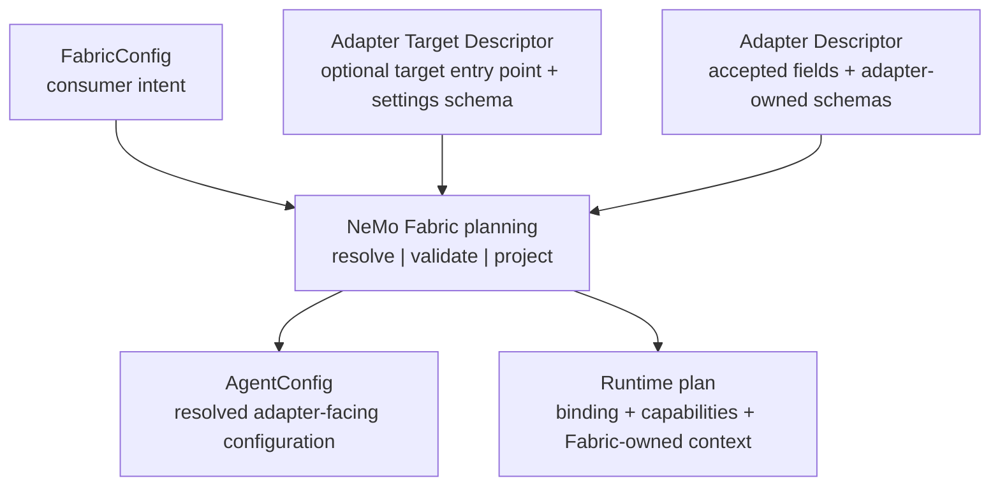

{/*
SPDX-FileCopyrightText: Copyright (c) 2026, NVIDIA CORPORATION & AFFILIATES. All rights reserved.
SPDX-License-Identifier: Apache-2.0
*/}

# Stage 2: Map Normalized Configuration

Consumers describe intent with `FabricConfig`. During planning, NVIDIA NeMo
Fabric resolves descriptors, validates compatibility, and projects only the
configuration that the selected adapter declared into `AgentConfig`.

Adapters consume `AgentConfig`. They do not parse `FabricConfig` or
consumer-owned planning fields.

## Prerequisites

Before you start, complete the following:

1. Complete [Stage 1: Describe the adapter](adapter-descriptor.md) so the
   descriptor declares, through `config.accepts`, the fields this stage
   projects.
2. Identify which `AgentConfig` blocks your adapter needs and applies.
3. Keep the canonical
   [`agent-config.schema.json`](https://github.com/NVIDIA/NeMo-Fabric/blob/main/schemas/adapter-contract/agent-config.schema.json)
   open for exact fields and constraints.

## Concepts Overview

Planning resolves consumer intent into the adapter-facing `AgentConfig`:



The smallest valid `AgentConfig` is empty. Add a block only when the adapter
needs and applies it.

`AgentConfig` contains these adapter-facing blocks:

| Block | Purpose |
| --- | --- |
| `harness` | Adapter-wide settings validated by the Adapter Descriptor. |
| `models` | Named model roles with provider, model, credential-variable name, endpoint, temperature, and provider settings. |
| `instructions` | Portable target instructions. |
| `runtime` | Target-applied behavior, such as a turn limit. |
| `skills` | Skill paths, or structured skill `directories`, resolved for the execution environment, plus bundled-skill selection and the duplicate policy when the descriptor advertises them. |
| `mcp` | Named Model Context Protocol (MCP) servers, authentication metadata, headers, and effective per-server tool policy. |
| `tools` | Named tool or tool-group definitions plus effective enabled and blocked policy. |
| `workflow` | A registered custom-agent entry point and immutable construction settings. |
| `extensions` | Adapter-owned data validated at a declared extension point. |

Use the canonical
[`agent-config.schema.json`](https://github.com/NVIDIA/NeMo-Fabric/blob/main/schemas/adapter-contract/agent-config.schema.json)
for exact fields and constraints. Python adapters can use the matching
dependency-free dataclasses from `nemo_fabric_adapter_contract.models`.

## To Map the Normalized Configuration

Work through each step in order, verifying your progress at each checkpoint.

### 1. Project Only Supported Fields

The Adapter Descriptor, capability plan, and optional Adapter Target Descriptor
control projection. Planning applies these rules:

1. Use `config.accepts` to gate adapter-applied model configuration, system
   instructions, maximum turns, tool definitions, enabled tools, and blocked
   tools.
2. Validate every configured model role against `model_schema` when the
   descriptor supplies one.
3. Validate `harness.settings` against the Adapter Descriptor's
   `settings_schema`, then project the validated settings when present.
4. Validate `workflow.settings` against the selected Adapter Target
   Descriptor, then project that target's entry point into `workflow`.
5. Validate every named tool definition against `tool_definition_schema`.
6. Project skills and MCP servers assigned to the adapter by the capability
   plan. Project `skills.directories`, `skills.bundled`, and
   `skills.duplicates` only when the descriptor's `skills` block covers
   them.
7. Validate adapter-owned extensions against the schema for their exact
   extension point.
8. Reject configured behavior that the selected adapter cannot apply.

Unsupported behavior fails planning with a field path and reason. It is never
silently dropped.

An absent optional field can preserve the target's default. An explicitly
empty value can mean something different. For example,
`tools.enabled: null` preserves the target's native selection, while
`tools.enabled: []` explicitly selects no named tools.

**Success Check**: A configured field the descriptor does not accept fails
planning with a field path and reason instead of being silently dropped.

### 2. Apply System Instructions Explicitly

An omitted `instructions.system` value preserves the harness's native system
instruction. When a system instruction is present, `mode` defaults to
`replace` for compatibility:

- `replace` replaces the harness's native system instruction with `content`.
- `append` preserves the harness's native system instruction and adds `content`
  after it.

The selected Adapter Descriptor must accept `instructions.system`. When its
`config.system_instruction_modes` capability list is present, the list must
declare the selected mode. An omitted list preserves compatibility with legacy
descriptors and supports `replace` only. Planning and `doctor(...)` reject
unsupported modes at `instructions.system.mode`. Adapters must also validate
the mode at their direct startup boundary so callers that host an adapter
without NeMo Fabric planning receive the same fail-closed behavior.

**Success Check**: An unsupported `instructions.system.mode` is rejected both
during planning and at the adapter's direct startup boundary.

### 3. Keep Fabric-Owned Context Out of AgentConfig

`AgentConfig` does not contain adapter selection, installation policy,
environment ownership, invocation deadlines, artifact manifests, or planning
diagnostics. NeMo Fabric also resolves telemetry and Relay configuration
outside `AgentConfig`. When enabled, `RuntimeContext.telemetry` supplies the
adapter with the generated Relay configuration path, environment overlay, and
telemetry metadata needed for the invocation.

Credential fields contain environment-variable names, not resolved secret
values. Environment values can be available in
`RuntimeContext.environment.env`. Never persist or log the unredacted context.

**Success Check**: `AgentConfig` carries no adapter selection, deadlines,
artifact manifests, or resolved secret values.

### 4. Translate Once at the Boundary

Keep translation in a small adapter-owned function. The following
representative code assumes the adapter's documented consumer configuration
requires a model named `default`, then resolves that model and the system
instruction into target-native values:

```python
def build_target(config: AgentConfig):
    model = config.models["default"]
    return TargetAgent(
        model=create_model(
            provider=model.provider,
            name=model.model,
            base_url=model.base_url,
            temperature=model.temperature,
        ),
        instructions=(
            config.instructions.system.content
            if config.instructions and config.instructions.system
            else None
        ),
    )
```

The descriptor must accept every field used by this translation. Do not read
undeclared values defensively or fall back to parsing the original
`FabricConfig`.

**Success Check**: The translation reads only descriptor-accepted fields and
never falls back to parsing `FabricConfig`.

### 5. Use Extensions Deliberately

Use an extension only when a normalized field cannot express the behavior:

1. Define a typed model for the adapter-owned data.
2. Publish its JSON Schema in `AdapterDescriptor.extension_schemas` at the
   exact extension point, such as `model`, `mcp_server`, `workflow`, or
   `run_result`.
3. Set the value through the corresponding block's `extensions` map or helper.
4. Reject data when the descriptor does not declare that extension point or
   the value does not satisfy its schema.

Do not use an extension to disguise an unsupported normalized field. An
extension is adapter-specific unless multiple adapters intentionally implement
the same namespaced contract.

**Success Check**: Each extension value is validated against a declared
extension-point schema and rejected when the point is not declared.

### 6. Split Static and Startup Validation

Planning validates static shape and compatibility without executing adapter
code. During `start`, the adapter validates only requirements that depend on
the target environment, such as imports, installed factories, executable
presence, credential availability, and service reachability. Report the
failing requirement or configuration field without exposing secret values.

**Success Check**: Planning validates static shape without running adapter
code, while environment-dependent checks run during `start`.

### 7. Check Skill Directories at Start

`AgentConfig.skills` can carry these fields:

| Field | Contents |
| --- | --- |
| `paths` | Skill paths. The adapter defines what a path means. |
| `directories` | A list of entries. Each sets exactly one of `skill` (one skill's folder) or `folder` (a folder of skills). NeMo Fabric resolves each path against the config base directory before the adapter receives it. Can be an empty list. |
| `bundled` | `enabled`, plus at most one of `include` or `exclude`. `None` and `[]` differ for both lists. |
| `duplicates` | `reject`, `first_wins`, or `last_wins`. Present only with `directories`. |

A non-empty `paths` never arrives together with `directories`. The folders in
`directories` exist only in the task environment, so check them in `start`.
Python adapters can use the dependency-free
`nemo_fabric_adapter_contract.skills` module. The following example raises
a lifecycle failure through the optional common Python host from
[Stage 3](execution.md):

```python
from nemo_fabric_adapter_contract.models import AgentConfig
from nemo_fabric_adapter_contract.skills import (
    DiscoveryRules,
    SkillLoadError,
    load_directories,
    warn,
)
from nemo_fabric_adapters.common import lifecycle

RULES = DiscoveryRules(
    traversal="recursive",
    nested_skills="stop_at_skill",
    max_depth=6,
    required_frontmatter_fields=("description",),
)

def load_skills(config: AgentConfig):
    skills = config.skills
    if skills is None or skills.directories is None:
        return None
    try:
        load = load_directories(
            skills.directories, rules=RULES, duplicates=skills.duplicates
        )
    except SkillLoadError as error:
        code = "not_found" if error.reason == "not_found" else "invalid"
        raise lifecycle.LifecycleError(
            f"acme_skill_{code}",
            str(error),
            metadata={
                "field": error.field,
                "reason": error.reason,
                "path": str(error.paths[0]) if error.paths else None,
            },
        ) from None
    warn("acme", load)
    return load
```

`load_directories()` follows the rules that callers see:

1. It checks each entry in list order. A missing path fails with `not_found`.
   A path that is not a folder or cannot be accessed, a `skill` entry without
   a readable `SKILL.md`, and a `folder` entry that cannot be listed fail with
   `invalid`. `SkillLoadError.field` names the failing key, such as
   `skills.directories[1].skill`.
2. It finds skills inside each `folder` entry by the `DiscoveryRules`. Make
   these rules match the descriptor's `directory_loading` block, and match
   what the harness actually loads:
   - `folder_root_is_skill`: the harness loads a `SKILL.md` at the root of a
     `folder` entry as a skill.
   - `support_dir_names`: folders the harness does not search inside a skill,
     such as `scripts`.
   - `allow_symlink_escape=False`: the harness refuses a skill whose real
     path is outside the entry. Such a skill is skipped with `path_escape`.
   - `subroot_depths`: a root child, such as `skills`, that the harness
     searches to a different depth than the rest of the entry.

   When entries need different rules, pass a function of the entry's index,
   kind, and resolved path as `rules`.
3. It records skipped candidates and empty `folder` entries instead of
   failing.
4. It applies the `duplicates` policy between entries. With a policy set, two
   skills with the same name inside one `folder` entry fail with `duplicate`.
   With no policy, it records each clash as `ambiguous`.

Pass the selected skills to the harness's native skill loader.
`DirectoryLoad.selected` lists the skills that load. With an explicit policy,
pass each selected skill's folder, so that shadowed copies never load.
Apply `bundled` with the harness's native controls, and fail `start` when an
`include` or `exclude` name is not a bundled skill. Return
`report_block(load, bundled=...)` as `output.skills` in each result. Refer to
[Configure Skills](../../integrations/harness/skills.mdx) for the full
behavior.

**Success Check**: A missing `skills.directories` path fails `start` with the
entry's field, and each result reports the loaded skills under
`output.skills`.

## Summary

In this tutorial, you have:

- Projected only descriptor-accepted fields into `AgentConfig`.
- Applied system instructions with explicit, validated modes.
- Kept Fabric-owned context and resolved secrets out of `AgentConfig`.
- Translated configuration once at the adapter boundary.
- Used extensions only where a normalized field cannot express the behavior.
- Split static planning validation from environment-dependent startup checks.
- Checked `skills.directories` entries in the task environment at start.

## Next Steps

With configuration mapping defined, continue through the adapter authoring
stages:

<CardGroup cols={2}>

<Card title="Implement execution" href="execution.md">

Continue to Stage 3 and implement the required `start`, `invoke`, and `stop`
lifecycle.
</Card>

<Card title="AgentConfig schema" href="https://github.com/NVIDIA/NeMo-Fabric/blob/main/schemas/adapter-contract/agent-config.schema.json">

Review the canonical schema for exact fields and constraints.
</Card>

</CardGroup>
