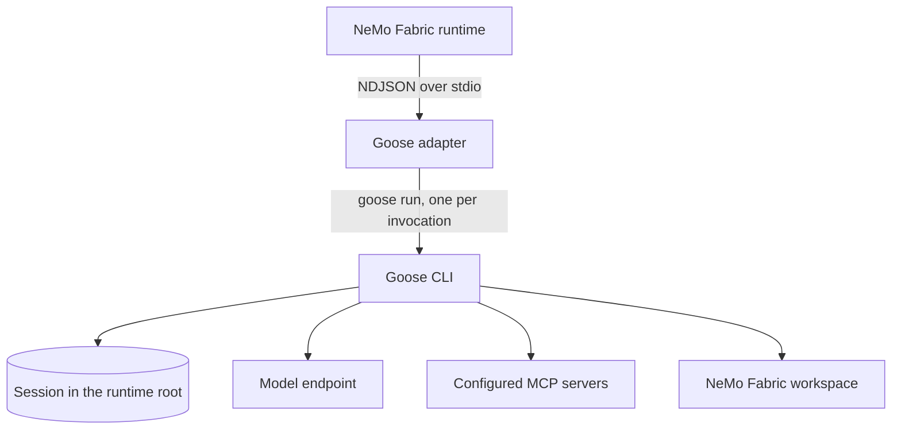

{/* SPDX-FileCopyrightText: Copyright (c) 2026, NVIDIA CORPORATION & AFFILIATES. All rights reserved.
SPDX-License-Identifier: Apache-2.0 */}

Use the NVIDIA NeMo Fabric `nvidia.fabric.goose` adapter to run tasks with the
[Goose](https://github.com/aaif-goose/goose) CLI. Each NeMo Fabric runtime owns
one Goose session, so ordered invocations retain conversation context.

## Install the Adapter

Install the Goose CLI, then install the runtime and adapter:

```bash
curl -fLO https://github.com/aaif-goose/goose/releases/download/v1.57.0/goose-x86_64-unknown-linux-musl.tar.gz
echo "6c3a05e30e1a425dc06a410dbe24b3f3697c9721b1ea2340434ddda6b64267ae  goose-x86_64-unknown-linux-musl.tar.gz" | sha256sum -c -
mkdir -p ~/.local/bin
tar xzf goose-x86_64-unknown-linux-musl.tar.gz -C ~/.local/bin ./goose
pip install "nemo-fabric[goose]"
```

NeMo Fabric tests Goose 1.54.0 and 1.57.0. Other platforms can use the matching
archive from the same release. To install only the adapter, use:

```bash
pip install nemo-fabric-adapters-goose
```

The adapter packages do not install Goose. The adapter runs `goose` from `PATH`
unless the `goose_command` harness setting names another executable.

## Configure the Adapter

```python
from nemo_fabric import EnvironmentConfig, FabricConfig, HarnessConfig
from nemo_fabric import InstructionConfig, InstructionsConfig, ModelConfig
from nemo_fabric import RuntimeConfig

config = FabricConfig(
    harness=HarnessConfig(adapter_id="nvidia.fabric.goose"),
    models={
        "default": ModelConfig(
            provider="nvidia",
            model="nvidia/nemotron-3-nano-omni-30b-a3b-reasoning",
            api_key_env="NVIDIA_API_KEY",
            base_url="https://integrate.api.nvidia.com/v1",
        )
    },
    instructions=InstructionsConfig(
        system=InstructionConfig(
            content="Review the requested code change.",
            mode="append",
        )
    ),
    runtime=RuntimeConfig(max_turns=20),
    environment=EnvironmentConfig(provider="local", workspace="."),
)
```

The adapter uses Goose's OpenAI provider for OpenAI and any OpenAI-compatible
Chat Completions endpoint. A provider other than `openai` requires `base_url`.
The adapter maps the model, `api_key_env`, `base_url`, `temperature`, `replace`
and `append` system instructions, `runtime.max_turns`, stdio and streamable
HTTP MCP servers, and the workspace. Goose keeps its default extensions,
including the developer shell and file tools, and runs tool calls without
approval because a headless run cannot answer approval prompts.

The initial integration does not support Relay telemetry, native streaming,
skills, tool selection, MCP authentication, per-server MCP tool filters, or SSE
MCP servers.

## Understand the Runtime Lifecycle

`start` writes Goose's configuration to a private temporary root, so a runtime
never reads or changes the user's Goose configuration, sessions, or keyring.
Each invocation runs `goose run` headless in the workspace. The first
invocation creates the session and later invocations resume it.



Each invocation returns the final assistant message and its own usage. Goose
reports cumulative session token totals, and the adapter reports the change
since the previous invocation. When a run passes the invocation deadline, the
adapter stops Goose and, on Linux, the tool commands it started. `stop` ends
tool commands left running on Linux and removes the runtime root.

Refer to the [Goose adapter README](https://github.com/NVIDIA/NeMo-Fabric/tree/main/adapters/python/goose)
for the configuration mapping and failure codes.

## Run the Code Review Example

Set `NVIDIA_API_KEY`. For a source checkout, also point NeMo Fabric at the
Python environment that contains the adapter:

```bash
export ADAPTER_PYTHON="$PWD/.venv/bin/python"
```

Then run:

```bash
.venv/bin/python -m examples.code_review_agent \
  --variant goose \
  --input "Review calculator.py" \
  --show-output
```

Do not combine the Goose variant with `--relay`.
