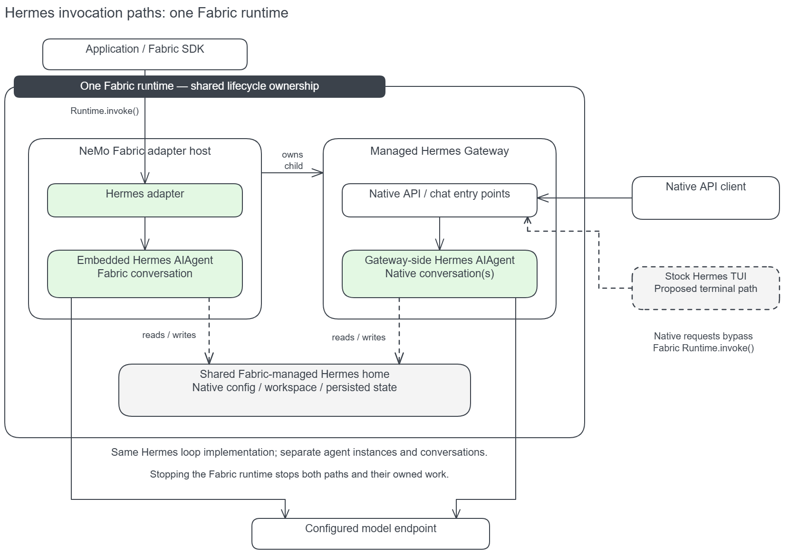

{/* SPDX-FileCopyrightText: Copyright (c) 2026, NVIDIA CORPORATION & AFFILIATES. All rights reserved.
SPDX-License-Identifier: Apache-2.0 */}

NVIDIA NeMo Fabric can start Hermes's native API server and dashboard alongside its embedded SDK agent. One Fabric runtime owns these execution paths, while each retains its own agent instances and conversations. Start with the [Hermes adapter guide](./hermes.mdx) for installation and normalized SDK configuration.

Use the following sections to configure, access, and validate the interfaces:

1. [Overview](#1-overview)
2. [Configuration](#2-configuration)
3. [Access and Use](#3-access-and-use)
4. [What Fabric Manages](#4-what-fabric-manages)
5. [Testing](#5-testing)
6. [Limitations and Planned Work](#6-limitations-and-planned-work)
7. [Implementation Details](#7-implementation-details)

## 1. Overview

The following diagram shows the two invocation paths within one runtime.



The [editable Excalidraw diagram](../../../assets/hermes-runtime-invocation.excalidraw) shows the intended ownership model. The TUI path is proposed; the adapter currently exposes API and dashboard settings only.

| Path | Execution | Conversation and result |
| --- | --- | --- |
| `Runtime.invoke()` or `Runtime.invoke_stream()` | The embedded Hermes `AIAgent` in the adapter host | Reuses the Fabric conversation and produces a normalized Fabric `RunResult`; for streaming, retrieve it through `stream.result()`. |
| Native API | Hermes creates gateway-side agent instances | Uses native conversations and returns native API responses. |
| Browser chat | Hermes's dashboard and native gateway facilities | Uses native conversation behavior and browser responses. |

These agents run the same Hermes agent-loop implementation. Sharing a Hermes home gives them access to persisted resources; it does not combine their live state or attach a native conversation to Fabric's embedded conversation.

### What NeMo Fabric Normalizes

| Surface | SDK invocation | Native interfaces |
| --- | --- | --- |
| Configuration | Mapped from `FabricConfig` | Managed child processes receive the same behavioral mapping and generated native configuration. |
| Lifecycle | Managed by the runtime | The adapter starts and stops its child processes. Descendant cleanup and independently started gateways have limits described below. |
| Results | Normalized `RunResult`, including available usage and artifact references | Native responses are not converted into Fabric `RunResult` objects. |
| Relay evidence | Standard Relay artifacts and invocation telemetry references | Supported native events use Relay's standard formats and native session identities. Emitting those records does not create a normalized invocation result. |
| Session artifacts | Collected through the SDK invocation path | Native session storage is shared, but session-scoped collection into Fabric's artifact model remains separate work. |

## 2. Configuration

### Prerequisites

Both interfaces are optional and require a POSIX host. The API server needs `aiohttp` from Hermes's `messaging` extra. The dashboard needs a built frontend at `HERMES_WEB_DIST` or `hermes_cli/web_dist`; browser chat also needs Hermes's built terminal UI bundle. The adapter does not build these frontends. Windows startup fails with `hermes_interfaces_unsupported_platform` before native setup.

### Enable Native Interfaces

Select interfaces through the Hermes adapter's `harness.settings`:

```python
from nemo_fabric import HarnessConfig

harness = HarnessConfig(
    adapter_id="nvidia.fabric.hermes",
    settings={
        "interfaces": {
            "api": {"port": 8642},
            "dashboard": {"port": 9119},
        },
        "startup_timeout_seconds": 60,
    },
)
```

Use this harness selection with the rest of your `FabricConfig`. The model, instructions, tools, MCP, skills, workspace, and telemetry remain in their existing normalized configuration fields; do not duplicate them under `interfaces`.

| Setting | Default | Behavior |
| --- | --- | --- |
| `interfaces.api` | Absent | API settings: required integer `port` from 1 through 65535, optional `enabled` boolean defaulting to `true`. |
| `interfaces.dashboard` | Absent | Dashboard settings with the same `port` and `enabled` requirements. |
| `startup_timeout_seconds` | `60` | Positive budget of at most 75 seconds, counted from the beginning of runtime startup. |

An absent interface is off. A present interface is on unless `enabled` is `false`; its closed schema currently requires a port even when disabled. Choose distinct, available ports for enabled interfaces. Ports bind to loopback in the adapter environment. No terminal interface setting is implemented yet.

## 3. Access and Use

### API Access

The API server binds to `127.0.0.1` at its configured port. After every enabled interface passes readiness, the adapter writes a per-start bearer token with mode `0600` to:

```text
<artifact root>/.fabric/hermes/runtimes/<runtime-id>/interfaces/api.token
```

Clients calling the native API must read the generated token file and include `Authorization: Bearer <token>` in each HTTP request. Only the API gateway child receives it in its environment. Processes running as the runtime's user, including agent tools, can read the token file.

### Dashboard Access

Open the configured loopback port in a browser. The dashboard has no sign-in: Hermes embeds its session token in the page, so anyone who can reach that port can use its pages and browser chat. The adapter does not disable individual dashboard pages.

### Conversations and Responses

Ordered SDK invocations reuse the embedded agent's conversation. Native clients use Hermes's native session mechanisms and receive native responses; these do not pass through `Runtime.invoke()` or become Fabric `RunResult` objects.

The runtime's Hermes home is stored under `<artifact root>/.fabric/hermes/runtimes/<runtime-id>`. Sharing that home gives access to persisted resources, but does not select a shared live conversation or establish cross-runtime resume.

## 4. What Fabric Manages

### Configuration Mapping and Precedence

NeMo Fabric resolves `FabricConfig` into a validated `AgentConfig`. The adapter uses it for the embedded agent and for agent instances created inside managed native processes. Instructions, enabled and blocked toolsets, turn limit, token limit, temperature, top-p, reasoning configuration, and trajectory settings use the same behavioral mapping.

Fabric-configured instructions and behavioral values take precedence over native constructor defaults. Native routing, conversation identity, execution, and protocol remain Hermes behavior. The model credential is supplied through the child's environment. Refer to [Implementation Details](#7-implementation-details) for the generated files and launcher mechanism.

### Startup, Readiness, and Shutdown

Startup launches enabled interfaces as child processes on the adapter's interpreter. The API server must pass `GET /health`, and the dashboard must pass `GET /api/status`, within the remaining startup budget. An occupied port, early child exit, or readiness timeout fails startup. Failed startup attempts clean up the children they started.

Stop removes the API token, sends SIGTERM to running interface process groups, and escalates to SIGKILL after a five-second grace. The API gateway is configured with a three-second drain for API work and cron jobs. The agent configuration snapshot is removed during cleanup, and the adapter closes the embedded agent and session database.

### Relay Evidence and Artifact Boundaries

Enable Relay through the normal NeMo Fabric telemetry configuration. The embedded and managed native paths receive the generated Relay plugin configuration. Native sessions retain their own trace roots rather than being assigned to the embedded Fabric invocation.

For SDK invocations, the adapter finalizes the Hermes Relay session and flushes subscribers before returning, so available ATOF/ATIF artifacts are complete at the invocation boundary. With a live Relay runtime, Hermes emits `compaction` when tracked compaction rewrites history or provider state; `compaction.attempt` describes an attempt that is blocked, skipped, fails, or aborts without a rewrite.

Native API responses remain native responses. Relay's standard artifact format provides common execution evidence, but does not by itself provide Fabric result normalization, complete usage accounting, or session-scoped collection of native transcripts and generated files.

## 5. Testing

### Run Automated Regressions

Prepare the repository's Hermes environment as described in [Install the Adapter](./hermes.mdx#install-the-adapter), then run these commands from the repository root:

```bash
export ADAPTER_PYTHON="$PWD/.venv-hermes/bin/python"
.venv-hermes/bin/python -m pytest \
  tests/adapters/test_hermes_native_config.py \
  tests/adapters/test_hermes_config_builder.py \
  tests/adapters/test_hermes_interfaces.py -q
```

These tests exercise the installed native Hermes processes against a local mock model endpoint. They check configuration mapping, two fresh API conversations, private configuration files, authentication, readiness failures, and cleanup. They do not establish compatibility with your hosted model or qualify browser interaction.

### Check a Live Model Endpoint

Reuse the `config` example from the [adapter guide](./hermes.mdx#configure-the-adapter), replacing its endpoint, model, and credential reference with your own values. With the Hermes interpreter selected through `ADAPTER_PYTHON`, run the following code in the same script:

```python
import asyncio
import json
from pathlib import Path
from urllib.request import Request, urlopen

from nemo_fabric import Fabric

marker = "FABRIC_CONFIG_CHECK"
config.harness.settings["interfaces"] = {"api": {"port": 8642}}
config.instructions.system.content = f"Reply exactly {marker} to every user message. Do not call tools."
config.models["default"].temperature = 0.0
config.models["default"].top_p = 0.41
config.models["default"].max_tokens = 128
config.environment.artifacts = Path("artifacts/hermes-interface-check").resolve()

def native_turn(token, number):
    request = Request(
        "http://127.0.0.1:8642/v1/chat/completions",
        data=json.dumps({
            "model": "hermes-agent",
            "messages": [{"role": "user", "content": f"Hello, conversation {number}."}],
        }).encode(),
        headers={"Authorization": f"Bearer {token}", "Content-Type": "application/json"},
    )
    with urlopen(request, timeout=120) as response:
        return json.load(response)["choices"][0]["message"]["content"]

async def main():
    async with await Fabric().start_runtime(config) as runtime:
        result = await runtime.invoke(input="Please respond to this simple greeting without using tools.")
        assert result.output.response == marker
        token_path = (
            config.environment.artifacts / ".fabric/hermes/runtimes"
            / runtime.runtime_id / "interfaces/api.token"
        )
        token = token_path.read_text()
        for number in range(2):
            assert await asyncio.to_thread(native_turn, token, number) == marker
    assert not token_path.exists()

asyncio.run(main())
```

This is an instruction and access smoke test. To establish configuration parity, also inspect actual model requests using your endpoint's request capture or a test-owned forwarding recorder. Do not infer parity from matching answers or generated files alone.

| Check | Required evidence |
| --- | --- |
| Model and credentials | Both paths call the configured endpoint/model with the intended credential; do not record credential values. |
| Instructions and generation | Captured requests contain the marker instruction, temperature `0`, top-p `0.41`, and token limit `128`. |
| Tool policy | The file-only configuration exposes `read_file`, `write_file`, `patch`, and `search_files`, without unrelated tools. Test blocked-tool behavior separately. |
| Conversation isolation | Two fresh native conversations remain distinct from each other and the embedded Fabric conversation. |
| Relay | With Relay enabled, actual turns emit supported records with distinct native session roots. Check artifact contents and attribution, not just file existence. |
| Cleanup | Runtime stop removes the API token and configuration snapshot and terminates the managed child. Descendant termination needs its own evidence where group signals are denied. |

An SDK call returns a normalized `RunResult`; the native call returns an API response. Successful Relay capture does not change that result boundary.

## 6. Limitations and Planned Work

### Operational Limits

- Denied process-group signals fall back to the direct child. This does not guarantee that all descendants have stopped.
- The adapter does not restart an interface child after a crash. Dashboard gateway actions can start processes outside the adapter launcher and its configuration mapping.
- Readiness currently checks the HTTP response without verifying that the child owns the listening port.
- Child processes inherit the embedded adapter's `HERMES_YOLO_MODE` environment setting. Interactive approval behavior requires separate review and validation.
- Native responses and complete usage accounting are not normalized into Fabric invocation results by these interfaces.

### Unqualified Paths

The API configuration-parity tests do not qualify browser interaction, explicit resume, or gateway replacement. Each needs its own behavioral and lifecycle evidence.

### Planned Work

Native TUI support remains proposed and is shown as a dashed path in the diagram. Session-scoped collection of native transcripts and generated files into Fabric's artifact model remains separate work; standard Relay formatting alone does not provide it.

## 7. Implementation Details

### Generated Files and Environment

The adapter prepares three configuration surfaces from the resolved `AgentConfig` for managed native children:

| Surface | Contents | Delivery |
| --- | --- | --- |
| Hermes `config.yaml` | Native model routing, workspace, MCP servers, skills, plugins, and toolset configuration | Written in the runtime's Hermes home, selected through `HERMES_HOME`. |
| `interfaces/agent-config.json` | The validated agent configuration, including instructions and behavioral settings | Owner-only snapshot passed by path to the adapter-owned native launcher. Removed on stop. |
| Relay plugin configuration | Resolved Relay components and output configuration | Generated by the adapter; its path is passed through `HERMES_NEMO_RELAY_PLUGINS_TOML`. |

The model credential value is supplied through the child's environment; the native model configuration references `api_key_env`.

Children inherit the adapter host's environment after ambient `API_SERVER_*` variables are removed. The API gateway can also activate other Hermes platforms configured by that environment, such as Telegram through `TELEGRAM_BOT_TOKEN` or webhooks through `WEBHOOK_ENABLED`.

### Native Launcher and Constructor Mapping

Hermes v0.22.5's API constructor does not read every behavioral setting from `config.yaml`. The adapter therefore launches managed children through `nemo_fabric_adapters.hermes.native`, which installs a process-local subclass of Hermes's `AIAgent` before entering the native CLI.

The subclass applies the shared behavioral mapping before calling the native constructor. It preserves native routing and session identity and does not modify the installed Hermes source.

This mapping applies within adapter-launched processes. A gateway independently spawned by Hermes does not automatically inherit the constructor mapping, even if it uses the same home. Sharing a configuration directory alone does not establish configuration parity.

