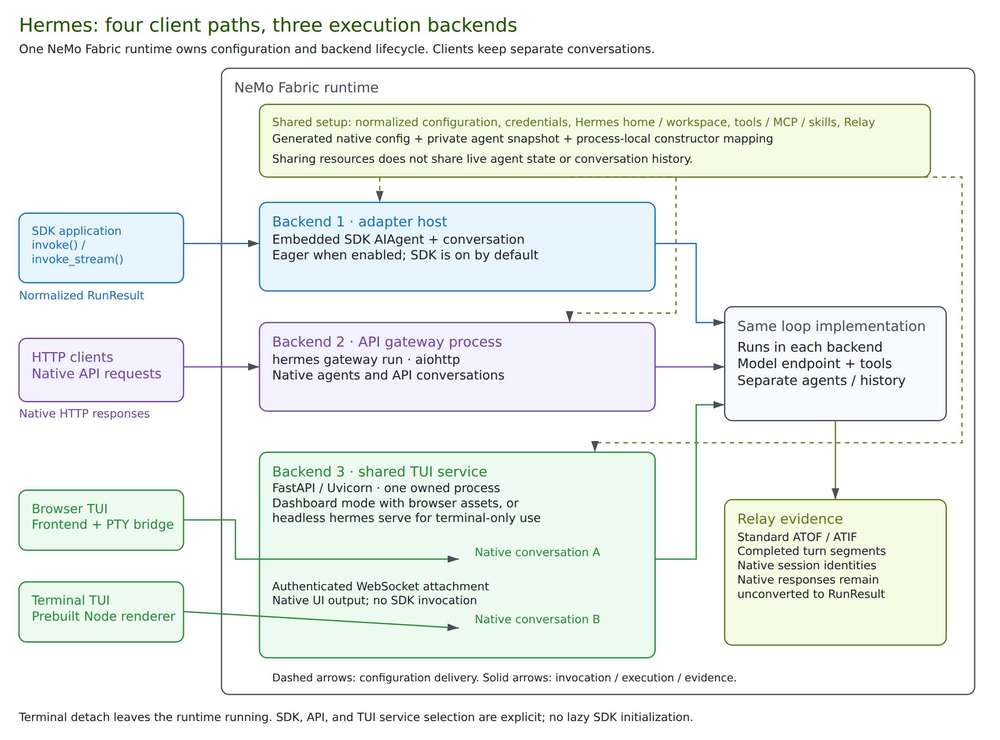

{/* SPDX-FileCopyrightText: Copyright (c) 2026, NVIDIA CORPORATION & AFFILIATES. All rights reserved.
SPDX-License-Identifier: Apache-2.0 */}

You can use Hermes Agent through the NVIDIA NeMo Fabric adapter in four ways:

- **SDK:** Invoke the embedded agent programmatically and receive normalized NeMo Fabric results.
- **HTTP API:** Send requests to Hermes's native API and receive native HTTP responses.
- **Dashboard/browser TUI:** Chat with Hermes through its dashboard in a browser.
- **Terminal TUI:** Chat with Hermes from a terminal attached to the managed TUI backend.

SDK execution is enabled by default; native interfaces are explicit options. All four paths use the normalized `FabricConfig`, which the adapter translates into Hermes's native configuration and agent settings.



| Path | Execution backend | Guide |
| --- | --- | --- |
| SDK | Embedded `AIAgent` in the adapter host | [Hermes SDK](./hermes-sdk.mdx) |
| Native HTTP API | Managed API gateway process using `aiohttp` | [Hermes API](./hermes-api.mdx) |
| Dashboard/browser TUI | Managed FastAPI/Uvicorn TUI service with browser assets and a PTY bridge | [Hermes Dashboard and Browser TUI](./hermes-dashboard.mdx) |
| Terminal TUI | Terminal renderer attaches over WebSocket to the same TUI service; headless `serve` when dashboard is off | [Hermes Terminal TUI](./hermes-tui.mdx) |

- **Agent execution:** All four paths use the same Hermes agent loop, with separate live agents and conversations.
- **Runtime ownership:** One NeMo Fabric runtime owns up to three backend processes: the adapter host, API gateway, and TUI service.
- **TUI clients:** Browser and terminal clients share the TUI service and use separate conversations. Neither requires the API gateway.

## Install the Adapter

Use [Hermes Agent v0.22.7](https://github.com/NousResearch/hermes-agent/releases/tag/v0.22.7) with Python 3.14. The adapter package supports Python 3.11 through 3.14, but Hermes Agent must be installed separately from source; versions 0.20 and later are not available from PyPI. Follow the [Hermes Agent installation guide](https://hermes-agent.nousresearch.com/docs/installation) and select v0.22.7.

Install the runtime and adapter in the environment that runs Hermes:

```bash
python -m pip install "nemo-fabric[hermes-agent]"
```

If the application runs NeMo Fabric in a separate environment, install `nemo-fabric-adapters-hermes` in the Hermes environment and set `ADAPTER_PYTHON` in the application's environment to that interpreter. Use matching runtime and adapter release versions unless a different pairing has been validated.

For Relay, install the adapter's `relay` extra in the Hermes environment. It accepts `nemo-relay>=0.10,<0.12`; select the Relay line required by the installed Hermes release:

| Hermes Agent | NeMo Relay Python Package |
| --- | --- |
| v0.22.7 | `>=0.11,<0.12` |
| v0.22.5 | `>=0.10,<0.11` |

Startup requires a stable Relay 0.10 or 0.11 release and Hermes's callable `agent.relay_runtime.resolve_plugin_sources` hook. Keep environments using the legacy pairing separate from applications requiring Relay 0.11.

For repository development, the following recipe checks out v0.22.7 at `b200f5bc60e31588ba2cb60e288029c4a54ba5fa` and prepares an isolated Python 3.14 environment with Relay support:

```bash
just install-hermes-agent
export ADAPTER_PYTHON="$PWD/.venv-hermes/bin/python"
```

The installer preserves local checkout changes and stops rather than overwriting them. Set `HERMES_AGENT_CHECKOUT` to a separate clean checkout or a new directory to install without changing `external/hermes-agent`; the target environment remains `.venv-hermes`.

Hermes reports its Python package version as `0.0.0`, so use its Git tag and commit to identify the installed release. The pinned release includes dependency security fixes absent from v2026.9.24.

## Select Execution Paths

Use normalized `FabricConfig` fields for model credentials/routing, instructions, tools, MCP, skills, workspace, turn limits, and telemetry. The [SDK guide](./hermes-sdk.mdx#configure-the-adapter) shows a complete model configuration. Use `harness.settings` to select Hermes execution paths:

```python
settings = {
    "sdk": {"enabled": False},
    "interfaces": {
        "api": {"port": 8642},
        "dashboard": {"port": 9119},
        "terminal": {"port": 9119},
    },
    "startup_timeout_seconds": 60,
}
```

This example enables three native client paths without an embedded SDK agent. Omit `sdk` to preserve the default SDK agent. Omit an interface to turn it off; a present interface is on unless `enabled` is `false`. Current closed schemas require a port even for a disabled interface. Native interfaces require POSIX. Reject a configuration with no enabled execution path.

- **Ports:** Dashboard and terminal must use the same port when both are enabled because they share one TUI service. The API requires a separate port.
- **Startup:** Terminal-only mode starts `hermes serve`; dashboard mode starts `hermes dashboard --isolated --skip-build`. Build the required frontends before runtime startup; terminal-only mode needs no browser assets.
- **Startup timeout:** Defaults to 60 seconds and must be greater than zero and no more than 75 seconds.

## What NeMo Fabric Normalizes

| Surface | SDK | Native API, Browser, and Terminal |
| --- | --- | --- |
| Configuration | Normalized fields mapped to the embedded agent | Same explicit behavioral mapping and generated native configuration in adapter-owned processes |
| Lifecycle | Runtime startup and owned shutdown when enabled | Managed child startup/readiness and shutdown; terminal detach does not stop the runtime |
| Results | Normalized `RunResult` | Native protocol/UI responses; no normalized invocation result |
| Relay evidence | Standard ATOF/ATIF, finalized/flushed per invocation | Standard native-session evidence, finalized/flushed per completed agent turn; verify export contents |
| Session artifacts | SDK invocation artifact collection | Complete session-scoped transcript/generated-file collection remains planned work |

## Shared Configuration and Ownership

### Configuration Translation

Use a single `FabricConfig` to define supported settings for all four Hermes paths through NeMo Fabric's common configuration schema:

- **Model:** provider, model, endpoint, credential references, and sampling settings.
- **System instructions:** the replacement system prompt.
- **Tool filters:** enabled and blocked Hermes toolsets.
- **MCP:** server definitions and supported authentication settings.
- **Skills:** skill search paths.
- **Workspace:** the agent's working directory.
- **Execution limits:** maximum agent turns and response tokens.
- **NeMo Relay:** telemetry and export configuration, when enabled.

NeMo Fabric resolves `FabricConfig` into `AgentConfig`. The adapter translates it into Hermes's native configuration and agent settings, applying the same explicit instructions and behavioral settings to agents in managed native processes.

The adapter writes native `config.yaml` and optional NeMo Relay plugin configuration under the runtime's Hermes home. When native interfaces are enabled, it also writes an owner-only `interfaces/agent-config.json` snapshot for the managed processes.

Model credentials are supplied through child process environments, not public attachment metadata. For OpenAI without an explicit base URL, the adapter removes inherited `OPENAI_BASE_URL` from managed children so it cannot redirect the configured credential.

### Setting Precedence

- Configured instructions, turn/token limits, sampling, and reasoning settings override Hermes's native defaults.
- Explicit enabled tools, including an empty list, override native tool selection. A nonempty blocked list overrides native exclusions.
- Unspecified native tool policies can differ from SDK defaults. Set explicit policies when comparing behavior across paths.

### Shared Runtime Home

The runtime home is `<artifact root>/.fabric/hermes/runtimes/<runtime-id>`. Agents share persisted resources in this directory while retaining separate live conversations. Keeping these files does not establish cross-runtime resume.

### Process Ownership

Managed native processes run through the adapter's launcher without modifying the installed Hermes source. Independently started processes do not automatically receive the adapter's configuration mapping.

The managed API gateway disables ambient messaging platforms and profile multiplexing. Inherited settings such as `TELEGRAM_BOT_TOKEN` do not start chat-channel dependency installers in this runtime.

## Health and Shutdown

Startup checks every enabled interface: API `/health` and TUI `/api/status`; TUI startup also verifies an authenticated RPC without creating a conversation. An enabled interface that fails startup still fails runtime startup.

When the SDK agent is enabled, runtime health and `idle`/`busy` activity describe that SDK agent. A separate API or TUI process failure does not fail SDK runtime health. Observe native endpoints and interface logs separately; a normalized interface health target is planned under [#566](https://github.com/NVIDIA/NeMo-Fabric/issues/566).

With `sdk.enabled: false`, runtime checks inspect the enabled native children and endpoints. Native activity remains `unknown` because native turns are not fully aggregated. There is no unified live-agent inventory.

Stop removes API/TUI credentials and attachment descriptors, sends SIGTERM to owned interface process groups, and escalates to SIGKILL after five seconds. API gateway drain is three seconds. The configuration snapshot is removed and owned SDK resources are closed. Cleanup errors are logged; failed private-file removal is retried on a later stop.

## Limitations and Planned Work

- Native response normalization, complete native usage accounting, and session-scoped artifact collection remain separate work.
- Child crash recovery, listener process-ownership checks, and stronger descendant cleanup when process-group signals are denied remain planned. HTTP/RPC readiness is not a live model or tool execution check.
- Browser chat is restricted to the managed runtime profile. Named-profile switching, gateway restart/migrate controls, and other dashboard operations can escape the supported ownership/configuration model. Do not use those controls to replace managed processes.
- Dashboard pages have no separate NeMo Fabric sign-in on loopback. Terminal credentials do not add a browser sign-in gate. Clients share filesystem/tools; separate conversations do not provide user isolation.
- TUI approvals and client detach/cancellation behavior need their own qualification; the adapter currently inherits `HERMES_YOLO_MODE` (defaulting to enabled). Detaching is not an explicit stop/cancel operation.
- Relay export errors are logged without replacing the execution outcome. Verify completed artifacts. Standard formatting does not establish complete telemetry coverage for every native control or background operation.
- Runtime-wide native activity discovery, same-conversation multi-client policy, cold resume, and SDK/native conversation handoff remain planned work.

## Try the Interfaces

See the [interfaces examples](../../../../examples/interfaces/hermes/README.md) for manual startup, real input, output checks, and Relay trajectory inspection. Coverage and remaining qualification limits are described there.
