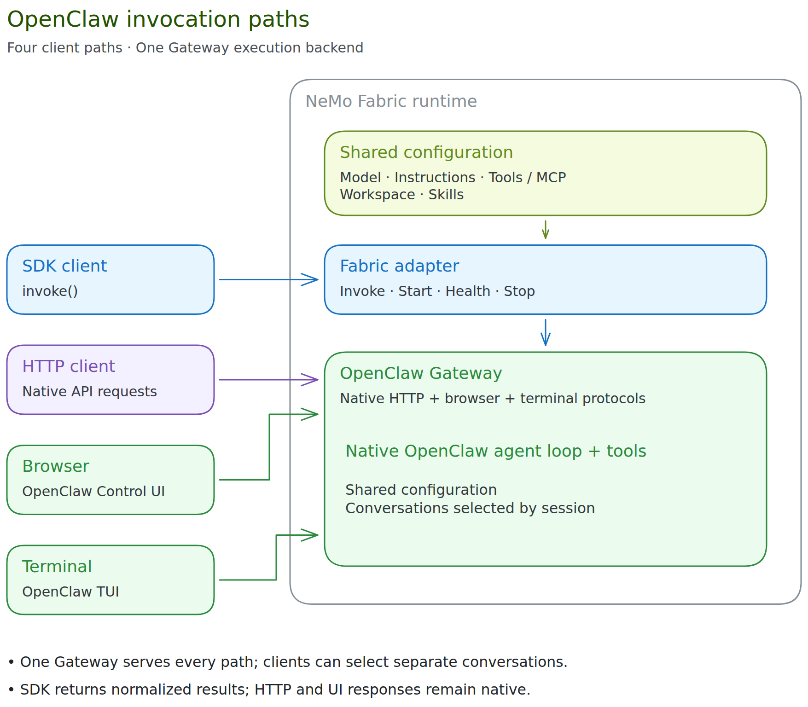

{/* SPDX-FileCopyrightText: Copyright (c) 2026, NVIDIA CORPORATION & AFFILIATES. All rights reserved.
SPDX-License-Identifier: Apache-2.0 */}

You can use OpenClaw through the NVIDIA NeMo Fabric adapter in four ways:

- **[SDK](./openclaw-sdk.mdx):** invoke through the NeMo Fabric SDK and receive a normalized `RunResult`.
- **[HTTP API](./openclaw-api.mdx):** call the owned Gateway directly and receive its native HTTP response.
- **[Browser dashboard](./openclaw-dashboard.mdx):** use OpenClaw's native Control UI for chat and session management.
- **[Terminal TUI](./openclaw-tui.mdx):** attach OpenClaw's native terminal client to the running Gateway.



## Shared Configuration

All four paths execute through one OpenClaw Gateway and its native agent runtime. NeMo Fabric translates `FabricConfig` into one private `openclaw.json`, with a fresh state directory, configured model/endpoint/credential references, generation parameters, workspace, tool policy, MCP servers, and skill paths.

When a native interface is enabled, a small adapter-owned plugin adds the configured instruction through OpenClaw's public `before_prompt_build` hook for the selected agent. It preserves OpenClaw's native system prompt, including tool guidance. SDK requests then omit their separate instruction injection, so each client receives the Fabric instruction once. SDK-only and service configurations retain their existing system-message handling.

The adapter's existing `replace` mode selects the Fabric-provided instruction; it does not replace OpenClaw's internal system prompt. Omitted instructions preserve native behavior; `append` remains unsupported.

Before publishing native connection files, startup makes an authenticated, model-free check that the loaded plugin's registered hook supplies the instruction for the selected agent. Missing, blocked, or mismatched hooks fail startup with `openclaw_shared_configuration_unavailable`. This startup check is separate from normalized runtime health checks.

The generated configuration is read-only. Native clients share the configured backend but keep separate conversations when they select different native sessions. Filesystem access and Gateway credentials are shared within the runtime; this is not a user-isolation boundary. Native session/model overrides are not qualified; shared defaults do not enforce immutable policy. Native reconfiguration controls do not provide a supported way to change the Fabric-owned configuration.

## Ownership and Normalization

The adapter host starts, checks, and stops one Gateway. The SDK remains available when browser or terminal clients are enabled; no separate embedded SDK agent or additional API/TUI server is created. Attaching or detaching a client does not start or stop the Gateway.

| Surface | Behavior |
| --- | --- |
| Configuration | Shared Fabric translation for the selected managed agent across all four paths. |
| Lifecycle | Fabric owns the managed Gateway; clients attach independently. |
| Responses | SDK returns a normalized `RunResult`; HTTP, browser, and terminal responses remain native. |
| Activity | With native interfaces enabled, activity is `unknown`; healthy native endpoints can still pass normalized health checks. |
| Relay artifacts | NeMo Relay integration and ATIF/ATOF export are deferred. |

Native interfaces are opt-in and supported only on managed runtimes. Prepared and attached services retain their existing SDK lifecycle and reject `interfaces`; refer to the [SDK guide](./openclaw-sdk.mdx#use-a-shared-service). Cold resume and prior-runtime conversation restoration are outside this feature.

## Install OpenClaw and the Adapter

Refer to the official OpenClaw [installation documentation](https://docs.openclaw.ai/install) for detailed installation and usage instructions.

To install OpenClaw from an npm package, then install the NeMo Fabric runtime and adapter run the following commands.

```bash
# Requires Node.js >=24.22.1 <25 or >=26.12.1, and npm 11.16+
npm install --global openclaw@2026.9.34 --allow-scripts=openclaw
pip install "nemo-fabric[openclaw]"
```

To install the adapter without the NeMo Fabric runtime, use
`nemo-fabric-adapters-openclaw`. The adapter package does not install OpenClaw.

### Upgrade a Gateway With Retained State

When upgrading a caller-owned Gateway from OpenClaw 2026.9.4, stop the Gateway and run `openclaw backup create --verify` with the Gateway's existing `OPENCLAW_STATE_DIR` and `OPENCLAW_CONFIG_PATH` before upgrading. The backup must include the active config, its include files, and all configured agent directories, including paths outside the state directory. Protect the archive because it can contain credentials.

Before upgrading, check the backup result and manifest for the active config, its include files, and every configured agent directory. For paths marked `covered`, confirm that the archive contains the data under a parent directory. Fix missing required paths and rerun the backup. Continue with the upgrade after confirming that all required data is backed up.

Before migration, copy every legacy session directory while the Gateway is stopped. Include `sessions.json`, `.jsonl` transcripts, and session directories outside `OPENCLAW_STATE_DIR`. The backup command excludes legacy `.jsonl` transcripts. Protect these copies and keep them with the verified archive for rollback.

Run `openclaw doctor --fix` with the 2026.9.34 executable and the same path settings. The command imports legacy `sessions.json` files and JSONL session data into each agent's SQLite database. Restart the Gateway after the command succeeds. Keep the verified backup for rollback.

Managed runtimes and NeMo Fabric-owned services use temporary state directories by default, so each new Gateway starts with fresh state. To keep OpenClaw's state across runtimes, set `runtime.keep_state` as [Keep OpenClaw State Across Runtimes](#keep-openclaw-state-across-runtimes) describes.

## Configure the Adapter

### Runtime Startup

Select the adapter and, when necessary, specify the OpenClaw executable:

```python
from nemo_fabric import HarnessConfig

harness = HarnessConfig(
    adapter_id="nvidia.fabric.openclaw",
    settings={
        "openclaw_command": "/opt/openclaw/bin/openclaw",
        "startup_timeout_seconds": 60,
    },
)
```

| Harness Setting | Behavior |
| --- | --- |
| `openclaw_command` | Omit to find `openclaw` on `PATH`. A relative path containing a directory is resolved from the NeMo Fabric base directory. The same executable is used for version checks, configuration validation, and Gateway startup. |
| `startup_timeout_seconds` | One deadline covering the executable check through Gateway readiness. Defaults to 60 seconds; maximum 75 seconds, within NeMo Fabric's 90-second start limit. |

The adapter supports OpenClaw's default `openclaw` execution runtime.

### Agent Configuration

`harness.settings.agent_id` defaults to `default`. Use 1–64 ASCII letters, digits, underscores, or hyphens, starting with a letter or digit. IDs are case-insensitive; invalid IDs are rejected instead of relying on native character replacement or truncation.

Set model provider, model, endpoint, generation parameters (`temperature`, `top_p`, and `max_tokens`), replacement system instructions, workspace, skills, and MCP servers through normalized `FabricConfig`. See [Shared Configuration](#shared-configuration) for how these settings reach all four client paths. Normalized MCP authentication is not supported.

An MCP server that cannot be reached does not stop the runtime: OpenClaw skips it for the run and retries it on a later run. Each SDK result from a managed runtime lists the servers OpenClaw could not use under `output.mcp.unavailable_servers` (`name`, `transport`, and a `reason` of `failed` or `timed_out`), read from OpenClaw's `tools.effective` session inventory, and the adapter writes a standard-error warning the first time a server is reported unavailable. Error messages are omitted because they can carry credentials. Runtimes that connect to a prepared service do not report MCP availability.

For a custom OpenAI-compatible endpoint, set the model's `base_url` and, when credentials are required, `api_key_env`.

Each `skills.paths` entry is a skill or a folder of skills, as [Load Skills from Folders](../skills.mdx) describes. Start fails with `openclaw_skill_not_found` for a missing entry and `openclaw_skill_invalid` for the other failures. The adapter passes each skill folder to OpenClaw's `skills.load.extraDirs`.

The optional `models.<role>.settings.supports_usage_in_streaming` setting controls OpenClaw's native `compat.supportsUsageInStreaming`:

- Set `true` when the endpoint supports `stream_options.include_usage`.
- Set `false` when the endpoint rejects streaming usage.
- Omit it to retain OpenClaw's endpoint capability detection.

This setting requires `base_url`. Attached services own their model configuration and do not accept it. Reported usage has separate completeness limits; see [SDK Usage Accounting](./openclaw-sdk.mdx#usage-accounting).

### Gateway Ports

By default, the adapter selects a local Gateway port range. To allocate the range yourself, set `port_range` with inclusive `start` and `end` values spanning at least 111 ports.

OpenClaw's [derived-port mapping](https://docs.openclaw.ai/gateway/multiple-gateways#port-mapping-derived) uses:

| Purpose | Port |
| --- | --- |
| Gateway | Selected base port |
| Browser control | Base port + 2 |
| Browser CDP connections | Base port + 11 through base port + 110 |

Startup checks availability of the base port and base port + 2. OpenClaw allocates CDP ports on demand, so startup does not reserve or guarantee the rest of the range. Keep the full range reserved for the runtime or service lifetime when using browser features.

For an exact dashboard base port, use the [native interface settings](#select-native-interfaces) instead of `port_range`.

### Chat Channels

For a [NeMo Fabric-owned service](./openclaw-sdk.mdx#use-a-shared-service), `harness.settings.channel_config` accepts OpenClaw-native `channels` and `bindings`, including multiple accounts for Telegram and other channels.

Every binding must target the configured `agent_id`. OpenClaw validates the nested channel settings. Channel traffic flows directly between the channel and OpenClaw; it does not pass through a NeMo Fabric runtime.

## Select Native Interfaces

An absent interface is off. A present interface is enabled unless `enabled` is `false`:

```python
settings = {
    "interfaces": {
        "dashboard": {"port": 18789, "public_origins": []},
        "terminal": {},
    }
}
```

The dashboard selects the existing Gateway's base port. Terminal has no port; it discovers that same Gateway, or uses the existing allocator when dashboard is absent. The dashboard port conflicts with `port_range`. Both clients can attach in parallel with SDK and native HTTP clients; use distinct sessions to keep conversations separate.

After readiness, the adapter publishes private connection material under `<artifact root>/.fabric/openclaw/runtimes/<runtime-id>/interfaces/`, or under `interfaces/` in the agent's state folder with `runtime.keep_state`. `gateway.json` contains endpoints, selected agent, executable, workspace, and a credential-file reference. The token is in `dashboard.token` when the dashboard is enabled, otherwise `gateway.token`. Terminal adds an executable `terminal` and `terminal.running` marker. Stop removes the marker first and revokes discovery and credentials before stopping the Gateway. An abrupt host kill can leave files; attachment also checks authenticated Gateway availability.

## Keep OpenClaw State Across Runtimes

By default, each Gateway that the adapter starts uses a temporary
`OPENCLAW_STATE_DIR` that `stop` removes, so the sessions, memory, and skills
that the agent writes there are lost when the runtime stops. Set `keep_state`
in the config's `runtime` mapping to keep that folder:

```python
from nemo_fabric import FabricConfig

config = FabricConfig.from_mapping(
    {
        "metadata": {"name": "assistant"},
        "harness": {"adapter_id": "nvidia.fabric.openclaw"},
        "models": {"default": {"provider": "nvidia", "model": "<model>"}},
        "runtime": {"artifacts": "/data/artifacts", "keep_state": True},
    }
)
```

With `runtime.keep_state`, the Gateway's `OPENCLAW_STATE_DIR` is the agent's
state folder, `<artifact root>/.fabric/state/nvidia.fabric.openclaw/<agent name>`,
for every runtime of the agent and for a NeMo Fabric-owned service:

- Skills that the agent writes through OpenClaw's Skill Workshop stay at the
  path where OpenClaw saved them,
  `agents/<agent id>/agent/workshop-skills/<skill>/SKILL.md` in that folder,
  and the next Gateway discovers them there. The adapter doesn't copy, move, or
  recreate them.
- The generated `openclaw.json` and the Gateway token remain specific to one
  runtime: the adapter writes the configuration to a temporary folder at each
  start and removes it at stop. The native interface files, including the
  dashboard token, are written to `interfaces/` in the state folder, removed
  by `stop`, and removed at the next start if an earlier runtime ended without
  `stop`.
- `stop` and a failed start never remove the state folder or its contents.
- NeMo Fabric lets one runtime at a time use the folder, as
  [Keep Agent State Across Runtimes](../../../sdk/python.mdx#keep-agent-state-across-runtimes)
  describes. A second runtime of the agent fails to start while the first runs.
- An attached caller-owned Gateway keeps its state where its deployment puts
  it, so attaching a service with `runtime.keep_state` fails with
  `openclaw_keep_state_requires_managed_gateway`.

Kept state lasts as long as the artifact root does. When the runtime runs in a
container or sandbox that is replaced, put the artifact root on durable storage,
such as a Kubernetes persistent volume. The folder can hold sessions,
credentials, and sign-ins, so protect it like a home directory. To discard it,
stop every runtime and service of the agent, then remove the folder.

Keeping files doesn't by itself keep a plugin that the agent installed enabled
and usable: the adapter generates a read-only `openclaw.json` at each start, and
plugin use after a restart is not yet qualified.

Keeping state doesn't continue an earlier conversation: each invocation still
uses the NeMo Fabric runtime ID as its OpenClaw session key, so a new runtime
starts a new session, and earlier sessions stay in the state folder.

## Testing and Limitations

Follow the [four-path OpenClaw examples](../../../../examples/interfaces/openclaw/README.md) for repeatable manual tests. The opt-in native qualification uses a recording model endpoint, a rendered browser, and a PTY to verify actual configuration and tool execution.

Terminal attachment currently requires POSIX. On Windows, dashboard tokens inherit directory ACLs; mode bits do not enforce owner-only ACLs. Interactive approvals, detach during active work, remote terminal attachment, and full native activity/inventory are not qualified. The pinned TUI can use an exit-code-130 fallback during `/quit`; this does not stop the managed Gateway. NeMo Relay integration and trajectory export remain separate work.
