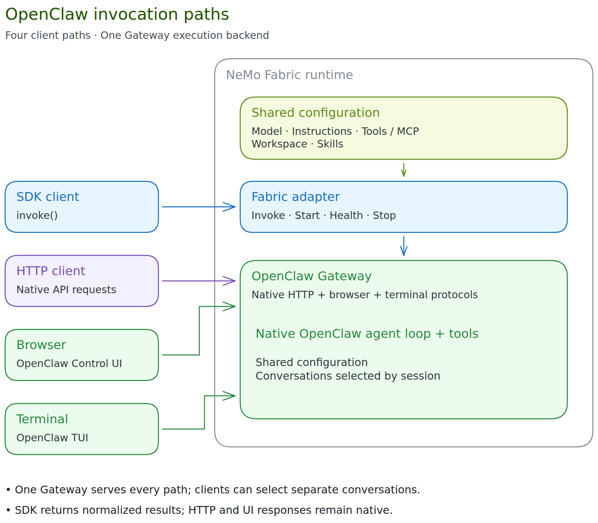

{/* SPDX-FileCopyrightText: Copyright (c) 2026, NVIDIA CORPORATION & AFFILIATES. All rights reserved.
SPDX-License-Identifier: Apache-2.0 */}

You can use OpenClaw through the NVIDIA NeMo Fabric adapter in four ways:

- **[SDK](./openclaw-sdk.mdx):** invoke through the NeMo Fabric SDK and receive a normalized `RunResult`.
- **[HTTP API](./openclaw-api.mdx):** call the owned Gateway directly and receive its native HTTP response.
- **[Browser dashboard](./openclaw-dashboard.mdx):** use OpenClaw's native Control UI for chat and session management.
- **[Terminal TUI](./openclaw-tui.mdx):** attach OpenClaw's native terminal client to the running Gateway.



## Shared Configuration

All four paths execute through one OpenClaw Gateway and its native agent runtime. NeMo Fabric translates `FabricConfig` into one private `openclaw.json`, with a fresh state directory, configured model/endpoint/credential references, generation parameters, workspace, tool policy, MCP servers, skills, and any authored [native Gateway controls](#native-gateway-controls).

When a native interface is enabled, a small adapter-owned plugin adds the configured instruction through OpenClaw's public `before_prompt_build` hook for the selected agent. It preserves OpenClaw's native system prompt, including tool guidance. SDK requests then omit their separate instruction injection, so each client receives the Fabric instruction once. SDK-only and service configurations retain their existing system-message handling.

The adapter's existing `replace` mode selects the Fabric-provided instruction; it does not replace OpenClaw's internal system prompt. Omitted instructions preserve native behavior; `append` remains unsupported.

Before publishing native connection files, startup makes an authenticated, model-free check that the loaded plugin's registered hook supplies the instruction for the selected agent. Missing, blocked, or mismatched hooks fail startup with `openclaw_shared_configuration_unavailable`. This startup check is separate from normalized runtime health checks.

The generated configuration is read-only. Native clients share the configured backend but keep separate conversations when they select different native sessions. Filesystem access and Gateway credentials are shared within the runtime; this is not a user-isolation boundary. Native session/model overrides are not qualified; shared defaults do not enforce immutable policy. Native reconfiguration controls do not provide a supported way to change the Fabric-owned configuration.

## Ownership and Normalization

The adapter host starts, checks, and stops one Gateway. The SDK remains available when browser or terminal clients are enabled; no separate embedded SDK agent or additional API/TUI server is created. Attaching or detaching a client does not start or stop the Gateway.

| Surface | Behavior |
| --- | --- |
| Configuration | Shared Fabric translation for the selected managed agent across all four paths. |
| Lifecycle | Fabric owns the managed Gateway; clients attach independently. |
| Responses | SDK returns a normalized `RunResult`; HTTP, browser, and terminal responses remain native. |
| Activity | With native interfaces enabled, activity is `unknown`; healthy native endpoints can still pass normalized health checks. |
| Relay artifacts | NeMo Relay integration and ATIF/ATOF export are deferred. |

Native interfaces are opt-in and supported only on managed runtimes. Prepared and attached services retain their existing SDK lifecycle and reject `interfaces`; refer to the [SDK guide](./openclaw-sdk.mdx#use-a-shared-service). Cold resume and prior-runtime conversation restoration are outside this feature.

## Install OpenClaw and the Adapter

Refer to the official OpenClaw [installation documentation](https://docs.openclaw.ai/install) for detailed installation and usage instructions.

To install OpenClaw from an npm package, then install the NeMo Fabric runtime and adapter run the following commands.

```bash
# Requires Node.js >=24.22.1 <25 or >=26.12.1, and npm 11.16+
npm install --global openclaw@2026.9.34 --allow-scripts=openclaw
pip install "nemo-fabric[openclaw]"
```

To install the adapter without the NeMo Fabric runtime, use
`nemo-fabric-adapters-openclaw`. The adapter package does not install OpenClaw.

### Upgrade a Gateway With Retained State

When upgrading a caller-owned Gateway from OpenClaw 2026.9.4, stop the Gateway and run `openclaw backup create --verify` with the Gateway's existing `OPENCLAW_STATE_DIR` and `OPENCLAW_CONFIG_PATH` before upgrading. The backup must include the active config, its include files, and all configured agent directories, including paths outside the state directory. Protect the archive because it can contain credentials.

Before upgrading, check the backup result and manifest for the active config, its include files, and every configured agent directory. For paths marked `covered`, confirm that the archive contains the data under a parent directory. Fix missing required paths and rerun the backup. Continue with the upgrade after confirming that all required data is backed up.

Before migration, copy every legacy session directory while the Gateway is stopped. Include `sessions.json`, `.jsonl` transcripts, and session directories outside `OPENCLAW_STATE_DIR`. The backup command excludes legacy `.jsonl` transcripts. Protect these copies and keep them with the verified archive for rollback.

Run `openclaw doctor --fix` with the 2026.9.34 executable and the same path settings. The command imports legacy `sessions.json` files and JSONL session data into each agent's SQLite database. Restart the Gateway after the command succeeds. Keep the verified backup for rollback.

Managed runtimes and NeMo Fabric-owned services use temporary state by default. Set `runtime.keep_state=true` to retain the native Gateway home across restarts.

## Resume a Retained Conversation

Set `runtime.keep_state=true` and supply `runtime.artifacts`. Save the `SessionRef` returned as `runtime.session_ref`, then pass `session_ref=reference` to `Fabric.start_runtime()` when starting a replacement. Omitting the reference creates a fresh conversation. Each replacement gets a new NeMo Fabric runtime ID and uses the selected native conversation history without replaying earlier work.

Managed runtimes and NeMo Fabric-owned services support retained sessions. A prepared service retains its Gateway and storage lock when connected runtimes stop. Release the service before starting an independent Gateway on the same storage. Caller-owned attached services reject retention because the current reference cannot identify a verifiable native storage boundary.

Mount the complete retained storage root when replacing a sandbox. OpenClaw owns the native conversations, indexes, skills, cache, and credentials inside that home. Workspace memory files such as `MEMORY.md` and `memory/` remain in the configured workspace. Retain the workspace and any external native directories as needed. NeMo Fabric regenerates managed configuration and Gateway authentication at startup. A missing session or changed native identity fails startup. Native channels retain their own conversation-selection behavior.

If startup returns `runtime.recovery_warnings`, inspect native and external state before invoking with `acknowledge_recovery=True`. NeMo Fabric never automatically replays an interrupted request. See [Cold Resume](https://github.com/NVIDIA/NeMo-Fabric/blob/main/adapters/python/openclaw/README.md#cold-resume) for an example and storage cleanup instructions.

## Configure the Adapter

### Runtime Startup

Select the adapter and, when necessary, specify the OpenClaw executable:

```python
from nemo_fabric import HarnessConfig

harness = HarnessConfig(
    adapter_id="nvidia.fabric.openclaw",
    settings={
        "openclaw_command": "/opt/openclaw/bin/openclaw",
        "startup_timeout_seconds": 60,
    },
)
```

| Harness Setting | Behavior |
| --- | --- |
| `openclaw_command` | Omit to find `openclaw` on `PATH`. A relative path containing a directory is resolved from the NeMo Fabric base directory. The same executable is used for version checks, configuration validation, and Gateway startup. |
| `startup_timeout_seconds` | One deadline covering the executable check through Gateway readiness. Defaults to 60 seconds; maximum 75 seconds, within NeMo Fabric's 90-second start limit. |
| `shutdown_timeout_seconds` | Graceful Gateway shutdown before forced termination. Defaults to 15 seconds, within OpenClaw's descriptor-defined 30-second adapter stop limit. Overrides must leave time for cleanup within that limit. Stop reports an error if the Gateway process is still running after cleanup. |

The adapter supports OpenClaw's default `openclaw` execution runtime.

### Agent Configuration

`harness.settings.agent_id` defaults to `default`. Use 1–64 ASCII letters, digits, underscores, or hyphens, starting with a letter or digit. IDs are case-insensitive; invalid IDs are rejected instead of relying on native character replacement or truncation.

Set model provider, model, endpoint, generation parameters (`temperature`, `top_p`, and `max_tokens`), replacement system instructions, workspace, skills, and MCP servers through normalized `FabricConfig`. See [Shared Configuration](#shared-configuration) for how these settings reach all four client paths. Normalized MCP authentication is not supported.

An MCP server that cannot be reached does not stop the runtime: OpenClaw skips it for the run and retries it on a later run. Each SDK result from a managed runtime lists the servers OpenClaw could not use under `output.mcp.unavailable_servers` (`name`, `transport`, and a `reason` of `failed` or `timed_out`), read from OpenClaw's `tools.effective` session inventory, and the adapter writes a standard-error warning the first time a server is reported unavailable. Error messages are omitted because they can carry credentials. Runtimes that connect to a prepared service do not report MCP availability.

For a custom OpenAI-compatible endpoint, set the model's `base_url` and, when credentials are required, `api_key_env`.

The optional `models.<role>.settings.supports_usage_in_streaming` setting controls OpenClaw's native `compat.supportsUsageInStreaming`:

- Set `true` when the endpoint supports `stream_options.include_usage`.
- Set `false` when the endpoint rejects streaming usage.
- Omit it to retain OpenClaw's endpoint capability detection.

This setting requires `base_url`. Attached services own their model configuration and do not accept it. Reported usage has separate completeness limits; see [SDK Usage Accounting](./openclaw-sdk.mdx#usage-accounting).

### Skills

[Configure Skills](../skills.mdx) describes the `skills` fields, the common setups, the start checks, and the run report. Its [Harness Differences](../skills.mdx#harness-differences) table compares OpenClaw with Hermes Agent. This section covers the rest of OpenClaw 2026.9.34's behavior. The adapter supports `skills.paths`, `skills.directories`, `skills.bundled`, and `skills.duplicates`.

#### How the Adapter Reads Skills

At start, the adapter reads every skill's front matter with OpenClaw's own `parseSkillFrontmatter`, in one `node` process. It uses the `node` on the `PATH` that the adapter gives OpenClaw, and the parser in the OpenClaw package that holds the `openclaw` executable. So names and refusals match OpenClaw's, and names are trimmed as OpenClaw trims them.

The adapter skips a skill that OpenClaw refuses before it applies `duplicates`, so the skill never counts as a copy of its name. The run report lists it under `skipped` with one of these reasons:

- `invalid_frontmatter`: OpenClaw's parser rejects the front matter.
- `missing_frontmatter_field:description`: The front matter has no `description`.
- `empty_frontmatter_field:description`: The `description` is empty after trimming.
- `file_too_large`: The `SKILL.md` is larger than 256,000 bytes.
- `no_name`: The skill has no `name`, and its folder name is empty after trimming.
- `unreadable`: The `SKILL.md` can't be read.
- `hardlinked_skill_file`: The `SKILL.md` has more than one hard link. OpenClaw refuses it outside its shipped skills. When `OPENCLAW_NIX_MODE` is `1`, OpenClaw accepts it in the Nix store, and so does the adapter.
- `path_escape`: The `SKILL.md` resolves outside the skill's folder, such as a symbolic link to a file elsewhere.

OpenClaw skips any other skill it cannot load. The run report lists those with the reason `rejected_by_openclaw`.

If `node` or the parser can't be found, or the parser fails or doesn't finish in time, the adapter writes one warning and reads simple front matter instead. Refer to [How the Adapter Reads a Skill](../skills.mdx#how-the-adapter-reads-a-skill). The adapter then can't tell which skills OpenClaw refuses:

- **Without `duplicates`:** Every skill is passed to OpenClaw, which decides. A name the adapter can't read, such as an explicit `? name` key, a `name` tagged `!!timestamp` or `!!binary`, or an alias, keeps the folder name and is marked `"name_uncertain": true`.
- **With a `duplicates` policy:** Two `directories` skills that share a name fail start with `openclaw_skill_invalid` and the reason `unsupported_frontmatter`, because the policy's result depends on whether OpenClaw accepts each copy. A name the adapter can't read fails start with the reason `unsupported_frontmatter_name`. Both errors name the skill's folder. Make `node` and the OpenClaw package available to the adapter to fix them.

#### Folders and Precedence

- **Links outside an entry:** A skill whose real folder is outside the searched folder, such as a symbolic link to another folder, does not load, with or without `duplicates`. Nothing loads from an entry whose `skills` subfolder links outside the entry. The adapter does not set OpenClaw's `skills.load.allowSymlinkTargets`, so no link target is trusted.
- **Links to one skill:** OpenClaw names a skill without a front-matter `name` after the folder it reaches the skill through, so a symbolic link gives the skill the link's name. The adapter passes each skill through the path it found it by, never the link's target, so OpenClaw uses the reported name. A folder reached through several entries loads once: when a later `skill` entry reaches a folder that an earlier entry already supplies, the adapter doesn't pass it again. A `folder` entry passed whole is the exception. When it holds a skill and a link to that skill, OpenClaw loads the skill once under each name, and the run report lists each name with the skill's real folder. With a `duplicates` policy, the adapter passes one path, so the skill loads once.
- **Policies and higher sources:** A `duplicates` policy chooses only between `directories` entries. A higher source still hides the chosen copy.
- **Duplicate report:** When more than one source holds a name at start, the run report lists every copy under `output.skills.duplicates`. The `local` origin marks a workspace skill. A shipped copy is reported at its path in the installed package. The `outcome` is `shadowed` when a higher source hides the configured copies. It is `selected` when a configured copy wins or only shipped and workspace copies clash, and `ambiguous` when the winning folder holds two copies, so OpenClaw's scan order decides. The adapter checks each workspace and shipped copy against OpenClaw's loading rules before it predicts the winner. Then it settles every name with the source that `openclaw skills list` shows for it. The list doesn't give a skill's folder, so when a name has several copies of the listed source that OpenClaw is given, such as copies from two entries without `duplicates`, the adapter runs `openclaw skills info` for that name and reports the copy it shows. A configured copy it expected to win that OpenClaw didn't load is reported as skipped with `rejected_by_openclaw`.
- **Refused winners:** With `first_wins` or `last_wins`, the adapter passes only the winning copy of a name. When `openclaw skills list` shows that OpenClaw refuses that copy, the adapter passes the next copy in policy order instead, lists the skills again, and reports the refused copy as skipped with `rejected_by_openclaw`. When no copy is left, the duplicate is reported without a `selected` path. If OpenClaw cannot list its skills, a refused winner is not detected: no copy of that name loads, while the report still shows the winner.

#### Bundled Skills

`skills.bundled` selects from the shipped `skills` and `custodian-skills` folders of the installed OpenClaw package, or of `OPENCLAW_BUNDLED_SKILLS_DIR` when set. The adapter doesn't use OpenClaw's `skills.allowBundled`, which filters shipped skills only after names are resolved, so a filtered-out skill would still hide a configured skill with the same name. Instead, when the selection leaves out a shipped skill, the adapter copies the selected shipped skills into the runtime's temporary folder and points `OPENCLAW_BUNDLED_SKILLS_DIR` at the copy for every OpenClaw process it starts. A left-out shipped skill also hides no workspace skill with its name. Custodian skills load only for OpenClaw's Custodian agent, which is the configured agent when it is the only one, and only for that agent do they hide a configured skill with the same name.

OpenClaw's own extensions in the package, such as `browser` and `canvas`, ship skills too, listed in each extension's `openclaw.plugin.json`. `skills.bundled` selects these extension skills like the shipped ones, so `include` and `exclude` can name them and `enabled: false` leaves them out. An extension skill loads only when OpenClaw activates its extension. OpenClaw loads extension skills with the `skills.load.extraDirs` folders, and no setting drops them before names are resolved. So the adapter turns off each left-out extension skill by name with `skills.entries.<name>.enabled: false`, which keeps the extension itself and its tools. That setting turns off every copy of a name, so the adapter doesn't write it for a name that a workspace skill, a selected shipped skill, or a configured skill from `directories` or `paths` also has. A workspace or shipped copy outranks the extension's copy, but an active extension's copy outranks a configured one. So for each such name that `openclaw skills list` shows from the extensions' source, the adapter asks `openclaw skills info` which copy loads. Start fails with the reason `excluded_bundled_skill_name_clash` when it is the extension's copy, or when OpenClaw can't say. If OpenClaw can't list its skills at all, start fails the same way when a configured skill shares a left-out extension skill's name.

At start, the adapter runs `openclaw skills list` for the agent to confirm the configured skills and the eligibility of the selected bundled skills. This adds a few seconds to start when `directories` or `bundled` is set. Each SDK result reports `output.skills.bundled` as `{"selected": [names], "unavailable": [{"name", "reason"}]}`. The `reason` is one of these:

- `missing_requirements`, with a `missing` object of the binaries, environment variables, configuration, or operating systems OpenClaw requires
- `disabled`
- `shadowed`, with the `by` source
- `custodian_agent_only`
- `extension_inactive`: an extension skill that `include` names, whose extension OpenClaw doesn't activate. Other extension skills of an inactive extension are left out of `selected`.
- `not_loaded`

If OpenClaw cannot list its skills, the report shows what the adapter configured. Runtimes that connect to a prepared service report the skills the service loaded at prepare.

#### Every Loaded Skill

When `directories`, even an empty list, or `bundled` is set, `output.skills.loaded` lists every skill OpenClaw loads for the agent:

- `external`: the `directories` skills, with their `entry`.
- `bundled`: the shipped skills and the extension skills, such as `canvas`, at their folder in the installed package. `skills.bundled` chooses both. Skills from plugins installed outside the package are `local`.
- `local`: the skills in the workspace's `skills` and `.agents/skills` folders.

A name OpenClaw lists that the adapter knows no copy of, such as a plugin skill, is located with `openclaw skills info`. This runs a few more OpenClaw commands at start, four at a time. Some limits remain:

- A configured skill named like a plugin skill is hidden by the plugin skill. The adapter doesn't see this clash, so it reports the configured skill as loaded. When `skills.bundled` leaves out an active extension's skill of that name, start fails instead, as described under Bundled Skills.
- A name whose winning folder holds two copies is left out of `loaded` when the adapter can't locate the copy that loads.
- A skill listed as loaded may still be unusable, for example when a binary it requires is missing. `bundled.unavailable` gives that reason for a selected bundled skill.

#### Skills the Agent Writes

Skills written into a read-write `directories` folder, for example by the agent's file tools, are checked and reported at the next start. OpenClaw can load them sooner, as [Sharing a Writable Skills Volume](../skills.mdx#sharing-a-writable-skills-volume) describes. OpenClaw's own installs don't go there. It installs workspace skills into `<workspace>/skills`, and Skill Workshop and shared installs write to the state folder. The adapter creates that folder for each runtime and removes it when the runtime stops, so skills the agent installs through OpenClaw are lost at stop. Keeping the state folder across restarts is outstanding work, tracked in [#578](https://github.com/NVIDIA/NeMo-Fabric/issues/578).

Runtimes that attach to a caller-owned Gateway do not accept `paths`, a non-empty `directories`, or `bundled`.

### Gateway Ports

By default, the adapter selects a local Gateway port range. To allocate the range yourself, set `port_range` with inclusive `start` and `end` values spanning at least 111 ports.

OpenClaw's [derived-port mapping](https://docs.openclaw.ai/gateway/multiple-gateways#port-mapping-derived) uses:

| Purpose | Port |
| --- | --- |
| Gateway | Selected base port |
| Browser control | Base port + 2 |
| Browser CDP connections | Base port + 11 through base port + 110 |

Startup checks availability of the base port and base port + 2. OpenClaw allocates CDP ports on demand, so startup does not reserve or guarantee the rest of the range. Keep the full range reserved for the runtime or service lifetime when using browser features.

For an exact dashboard base port, use the [native interface settings](#select-native-interfaces) instead of `port_range`.

### Chat Channels

For a [NeMo Fabric-owned service](./openclaw-sdk.mdx#use-a-shared-service), `harness.settings.channel_config` accepts OpenClaw-native `channels` and `bindings`, including multiple accounts for Telegram and other channels.

Every binding must target the configured `agent_id`. OpenClaw validates the nested channel settings. Channel traffic flows directly between the channel and OpenClaw; it does not pass through a NeMo Fabric runtime.

### Native Gateway Controls

The following optional `harness.settings` fields use OpenClaw's native `openclaw.json` structure:

```yaml
harness:
  adapter_id: nvidia.fabric.openclaw
  settings:
    agents:
      defaults:
        heartbeat:
          every: 0m
        compaction:
          memoryFlush:
            enabled: false
    tools:
      exec:
        notifyOnExit: false
      toolSearch: false
      codeMode: false
    plugins:
      entries:
        memory-core:
          config:
            dreaming:
              enabled: false
```

| Setting | Values | Behavior |
| --- | --- | --- |
| `agents.defaults.heartbeat.every` | Duration with units, such as `30m`, `1h30m`, or `500ms` | Recurring heartbeat interval. `0m` disables the recurring cadence; it does not stop event-driven turns. |
| `agents.defaults.compaction.memoryFlush.enabled` | boolean | `false` turns off the pre-compaction memory flush turn. Compaction itself still runs. |
| `tools.exec.notifyOnExit` | boolean | `false` stops the system event and heartbeat when a backgrounded `exec` process exits. |
| `tools.toolSearch` | boolean | `false` presents tool schemas directly instead of behind tool search. |
| `tools.codeMode` | boolean | Code Mode. When enabled, it can take precedence over tool search and exposes only `exec` and `wait`, so do not combine it with blocking `exec` through `tools.blocked`. |
| `tools.web.fetch.ssrfPolicy.allowRfc2544BenchmarkRange` | boolean | `true` lets `web_fetch`, `image`, and `pdf` connect to addresses in `198.18.0.0/15`, which a fake-IP proxy such as OpenShell's policy DNS answers for every name. OpenClaw blocks that range otherwise. Set it only when such a proxy owns the range and enforces its own destination policy. |
| `tools.web.fetch.ssrfPolicy.allowIpv6UniqueLocalRange` | boolean | The same opt-in for `fc00::/7`. |
| `plugins.entries.memory-core.config.dreaming.enabled` | boolean | `false` turns off scheduled dreaming in the `memory-core` plugin. |

The adapter merges only the fields you set into the generated `openclaw.json` before the Gateway starts. It adds them beside the generated `agents.defaults`, the `tools.allow` and `tools.deny` lists, and any adapter-owned plugin entry without replacing generated keys. Omitting a field preserves the current behavior. The closed descriptor schema rejects unknown fields and invalid values. Heartbeat durations require units. OpenClaw treats an unparseable value such as `30 minutes` as no heartbeat, so the schema rejects it, and it also rejects bare numbers such as `30` to avoid ambiguity.

- **Ownership:** Managed runtimes and NeMo Fabric-owned prepared services apply these controls, so they reach SDK invocations, every runtime connected to a prepared service, and the native API, dashboard, and terminal clients of a managed runtime. A caller-owned Gateway keeps its deployment-owned configuration: `attach_service()` rejects these fields with `openclaw_attach_configuration_unverifiable`.
- **Tool selection:** `harness.settings.tools` is OpenClaw's native tools section. It is separate from NeMo Fabric's normalized top-level `tools.enabled` and `tools.blocked` selectors, which still generate `tools.allow` and `tools.deny`.
- **Scope:** These controls reduce automatic background turns; they do not stop context compaction. They apply to every session on the Gateway and do not correlate concurrent sessions, so a consumer that tracks only the latest model request must use one session at a time. They do not add NeMo Relay support to the OpenClaw adapter.

## Select Native Interfaces

An absent interface is off. A present interface is enabled unless `enabled` is `false`:

```python
settings = {
    "interfaces": {
        "dashboard": {"port": 18789, "public_origins": []},
        "terminal": {},
    }
}
```

The dashboard selects the existing Gateway's base port. Terminal has no port; it discovers that same Gateway, or uses the existing allocator when dashboard is absent. The dashboard port conflicts with `port_range`. Both clients can attach in parallel with SDK and native HTTP clients; use distinct sessions to keep conversations separate.

After readiness, the adapter publishes private connection material under `<artifact root>/.fabric/openclaw/runtimes/<runtime-id>/interfaces/`. With `runtime.keep_state=true`, connection material is published under `<state_dir>/interfaces/`. `gateway.json` contains endpoints, selected agent, executable, workspace, and a credential-file reference. The token is in `dashboard.token` when the dashboard is enabled, otherwise `gateway.token`. Terminal adds an executable `terminal` and `terminal.running` marker. Stop removes the marker first and revokes discovery and credentials before stopping the Gateway. An abrupt host kill can leave files; attachment also checks authenticated Gateway availability.

## Testing and Limitations

Follow the [four-path OpenClaw examples](../../../../examples/interfaces/openclaw/README.md) for repeatable manual tests. The opt-in native qualification uses a recording model endpoint, a rendered browser, and a PTY to verify actual configuration and tool execution.

Terminal attachment currently requires POSIX. On Windows, dashboard tokens inherit directory ACLs; mode bits do not enforce owner-only ACLs. Interactive approvals, detach during active work, remote terminal attachment, and full native activity/inventory are not qualified. The pinned TUI can use an exit-code-130 fallback during `/quit`; this does not stop the managed Gateway. NeMo Relay integration and trajectory export remain separate work.
