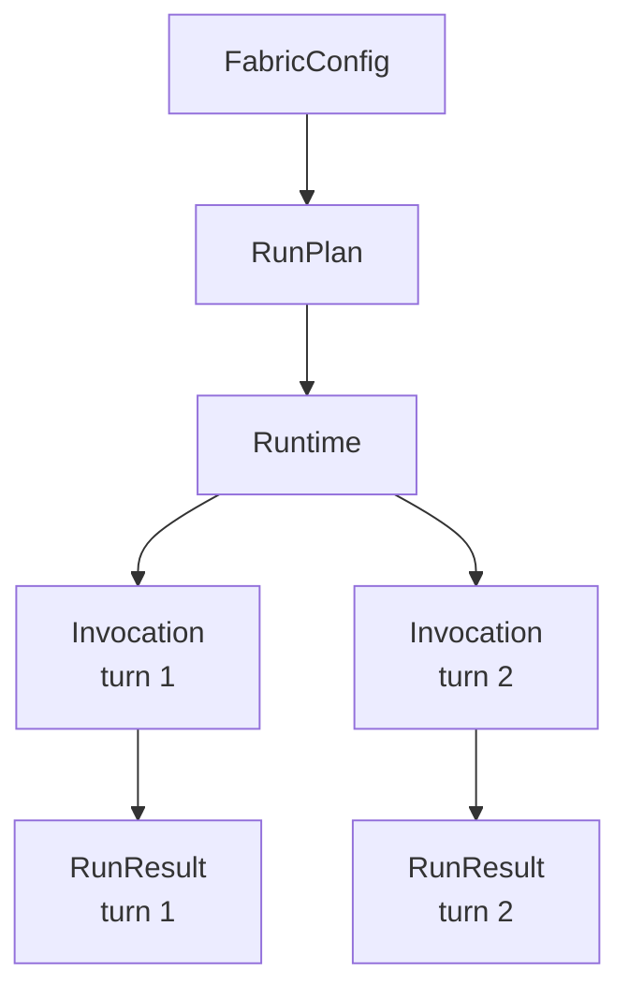

{/* SPDX-FileCopyrightText: Copyright (c) 2026, NVIDIA CORPORATION & AFFILIATES. All rights reserved.
SPDX-License-Identifier: Apache-2.0 */}

## Execution Model

NeMo Fabric separates configuration, planning, runtime lifecycle, and individual
invocations. Adapters that declare `session_resume` can also expose a portable
`SessionRef` for an explicitly selected durable conversation.

Most application code works with five objects:

| Concept | What It Represents | How Consumers Use It |
| --- | --- | --- |
| `FabricConfig` | Typed configuration for the harness, models, runtime, and capabilities. | Construct it from application config before planning or running. |
| `RunPlan` | The canonical config and path context, selected adapter, and declared capabilities. | Inspect it before starting work when adapter selection or feature support matters. |
| `Service` | A NeMo Fabric-owned or caller-owned adapter service shared by one or more runtimes. | Prepare or attach it, pass it to `start_runtime(...)`, then release it after all connected runtimes stop. |
| `Runtime` | The Python object for one logical, stateful harness execution. | Use it to send ordered invocations and stop the execution. Use it as an async context manager for cleanup. |
| `RunResult` | The normalized outcome of one invocation. | Read its status, output, error, usage, events, artifacts, and correlation IDs. |

`Fabric` is a lightweight, reusable SDK facade. It resolves configuration,
creates plans and runtimes, and provides a single-invocation convenience API,
but it does not represent a started execution and does not require cleanup. A
`Runtime` owns stateful execution and shutdown, so it is the object used as an
async context manager.

`RuntimeHandle` and `InvocationHandle` carry lifecycle identity across the
native boundary. Most Python callers use their `runtime_id` and
`invocation_id` through `Runtime` and `RunResult` rather than manipulating the
handles directly.

A runtime is a logical execution boundary, not necessarily an operating-system
process. An adapter may use an in-process SDK, a process, or shared service
infrastructure while preserving isolated state for each NeMo Fabric runtime.

Runtime hosting is selected by the adapter kind, not by a public `FabricConfig`
setting. Every local Process or Python adapter implements the persistent
local-host wire protocol. NeMo Fabric starts one host during
`start_runtime(...)`, reuses its adapter-owned native resources across ordered
invocations, and attempts to release them during `stop()`. The lifecycle start
operation carries the resolved configuration and capability plan. Each
subsequent `AdapterInvocation` carries only `runtime_context` and `request`.

Third-party local adapters must implement the persistent local-host contract.
Adapters that advertise service support can also prepare a NeMo Fabric-owned service
or attach to a caller-owned service. Multiple runtimes can connect to one
service while retaining distinct runtime IDs and harness sessions. Service
handles are process-local in this release and must not be persisted for cold
resume. A crashed persistent host is terminal for its runtime or service. The
same applies when the host exceeds the protocol response timeout. NeMo Fabric
does not silently respawn the host or replay a request.

Harness-native threads, sessions, and conversations remain adapter-owned state
associated with the NeMo Fabric runtime. They are not additional NeMo Fabric lifecycle
objects.

NeMo Fabric provides the runtime contract. Applications own scheduling, queues,
retries, worker scaling, and the number of runtimes to run.

## API Inventory

Create `Fabric()` as the primary SDK entrypoint. It is a regular Python object,
not a lifecycle context manager, and may be reused to plan, diagnose, or start
multiple independent runtimes.

The following table summarizes the SDK entry points and runtime methods:

| API | Async | Use When | Notes |
| --- | --- | --- | --- |
| `Fabric.plan(config, base_dir=...)` | No | You need to inspect the selected adapter, capability mapping, and runtime capabilities before running. | Does not start a runtime. |
| `Fabric.doctor(config, *, base_dir=...)` | Yes | You need preflight diagnostics for adapter resolution, capability routing, declared requirements, and environment assumptions. | Checks can inspect local binaries, environment variables, and files without starting a runtime. |
| `Fabric.run(config, base_dir=..., input=...)` | Yes | You need one complete start, invoke, result, stop lifecycle. | `base_dir` is optional. Pass a `RunRequest` instead when the invocation needs IDs, context, or overrides. |
| `Fabric.prepare_service(config, base_dir=...)` | Yes | NeMo Fabric should configure, start, and supervise a shared adapter service. | Returns a NeMo Fabric-owned `Service`. Release stops the service after every connected runtime stops. |
| `Fabric.attach_service(config, reference, base_dir=...)` | Yes | A deployment system already owns the service. | Returns a caller-owned `Service`. Release detaches NeMo Fabric without stopping the external service. |
| `Fabric.start_runtime(config, ..., streaming=False, launch_collector=None, completion_wait_timeout=1.0, service=...)` | Yes | You need state across multiple ordered invocations, optionally on a shared service. | Returns a `Runtime`. Use `streaming=True` with NeMo Relay enabled only to provision Relay ATOF streaming. |
| `Runtime.invoke(...)` | Yes | You need one turn on an existing runtime. | A runtime permits one active invocation at a time. |
| `Runtime.invoke_openai_stream(...)` | No | You need adapter-native OpenAI Chat Completions chunks for one turn. | Requires descriptor `capabilities.streaming`. Returns an async `OpenAIInvokeStream`; await `stream.result()` for the separate terminal `RunResult`. |
| `Runtime.invoke_stream(...)` | No | You need live ATOF records generated by NeMo Relay for one turn. | Returns an async `InvokeStream`; await `stream.result()` for the terminal `RunResult`. |
| `Runtime.resource_snapshot()` | Yes | You need the memory, process count, or CPU time of a started runtime. | Does not wait for an active invocation. Refer to [Runtime Resource Snapshots](system-stats.mdx#runtime-resource-snapshots). |
| `Runtime.stop()` | Yes | You need to stop or detach from the runtime. | Called automatically when using `async with`. |
| `Service.release()` | Yes | You need to stop a prepared service or detach from an attached service. | Fails while any connected runtime remains active. Called automatically when using `async with`. |
