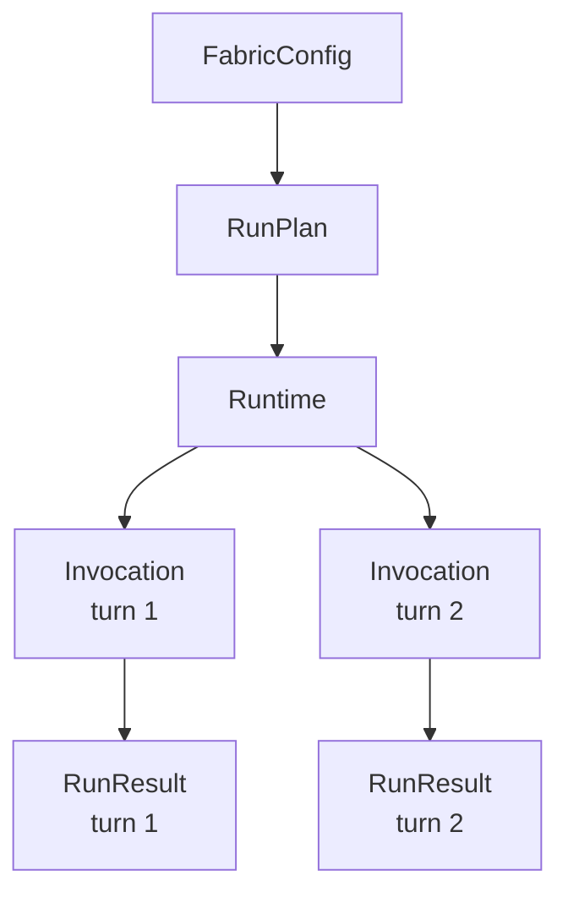

{/* SPDX-FileCopyrightText: Copyright (c) 2026, NVIDIA CORPORATION & AFFILIATES. All rights reserved.
SPDX-License-Identifier: Apache-2.0 */}

The Python SDK is the application-facing interface for NeMo Fabric. Use it to
configure an agent harness, inspect the resolved plan, run one request or a
multi-turn runtime, and collect normalized results, events, artifacts, and
telemetry references.

The SDK is config-first. Applications should construct a Pydantic
`FabricConfig` from their own job, deployment, or evaluation config.
Examples, CI jobs, and applications construct the typed config directly and
can use ordinary Python functions to create variants.

Generated API reference pages remain the source of truth for exact signatures.
This guide explains how the pieces are intended to fit together.

For installation and a package-backed example, start with the
[NeMo Fabric overview](../about-nemo-fabric/overview.mdx).

## Start With One Run

This example uses an NVIDIA-hosted model. Export your NVIDIA API key before
running it:

```bash
export NVIDIA_API_KEY=...
```

Construct a typed config, then pass it to `Fabric.run(...)`. The SDK starts a
runtime, invokes it once, collects the result, and stops the runtime.

```python
import asyncio

from nemo_fabric import (
    Fabric,
    FabricConfig,
    HarnessConfig,
    InstructionConfig,
    InstructionsConfig,
    MetadataConfig,
    ModelConfig,
    RuntimeConfig,
)

config = FabricConfig(
    metadata=MetadataConfig(name="review-agent"),
    harness=HarnessConfig(adapter_id="nvidia.fabric.hermes"),
    instructions=InstructionsConfig(
        system=InstructionConfig(
            content="Review code for concrete correctness risks.",
            mode="replace",
        )
    ),
    runtime=RuntimeConfig(max_turns=8),
    models={
        "default": ModelConfig(
            provider="nvidia",
            model="nvidia/nemotron-3-nano-omni-30b-a3b-reasoning",
            api_key_env="NVIDIA_API_KEY",
        )
    },
)


async def main() -> None:
    fabric = Fabric()
    result = await fabric.run(
        config,
        input="Review the workspace changes.",
    )

    print(result.status)
    print(result.output.response)


asyncio.run(main())
```

Omit `instructions.system` to preserve the harness's native system instruction.
When present, `InstructionConfig.mode` defaults to `replace`. Use `append` only
with an adapter whose descriptor advertises that mode; planning rejects other
combinations before the runtime starts.

Use `base_dir` to resolve relative paths in an in-memory config. Before running
in a new environment, call `plan(...)` to inspect adapter selection and
`doctor(...)` to check runtime requirements.

The remaining examples reuse this `config` value.

### Inspect Metadata On A Separate Host

Use `inspect_adapter(config, descriptor)` when the admission host cannot access
the task's installed adapter. Supply canonical metadata from the matching
`nemo-fabric-adapter-catalog` release or an external adapter:

```python
from nemo_fabric import inspect_adapter
from nemo_fabric_adapter_catalog import get_adapter_descriptor

profile = inspect_adapter(config, get_adapter_descriptor(config.harness.adapter_id))
print(profile.skills, profile.mcp, profile.atif)

# In the task environment, resolve its own executable descriptor.
result = await Fabric().run(
    config,
    input="Review the changes.",
    expected_descriptor_sha256=profile.descriptor_sha256,
)
```

The immutable `AdapterCapabilityProfile` reports declared skills and MCP support
and ATIF availability for the selected telemetry configuration. Inspection uses
the existing native planner without importing the harness SDK or reading
task-local discovery paths. Unsupported requested configuration fails admission.
Passing `None` as the descriptor permits basic execution with false capability
claims, but rejects requested skills, MCP, or telemetry.

The optional `expected_descriptor_sha256` argument on `run()` and
`start_runtime()` verifies the normalized descriptor in the actual execution
plan before startup. Catalog metadata never becomes an execution origin. A
fingerprint confirms descriptor correspondence, not installed software versions
or successful evidence production. ATIF requires a selected provider declaring
that output; Relay additionally requires one explicitly enabled observability
component with ATIF enabled. Unconfirmed ATIF requests, including ambiguous
duplicate components, fail admission.
This profile covers standalone adapters, not registered workflows or attached
services, which need route-specific admission.

## Execution Model

NeMo Fabric separates configuration, planning, runtime lifecycle, and individual
invocations. It does not expose a separate portable session layer.



Most application code works with five objects:

| Concept | What It Represents | How Consumers Use It |
| --- | --- | --- |
| `FabricConfig` | Typed configuration for the harness, models, runtime, and capabilities. | Construct it from application config before planning or running. |
| `RunPlan` | The canonical config and path context, selected adapter, and declared capabilities. | Inspect it before starting work when adapter selection or feature support matters. |
| `Service` | A NeMo Fabric-owned or caller-owned adapter service shared by one or more runtimes. | Prepare or attach it, pass it to `start_runtime(...)`, then release it after all connected runtimes stop. |
| `Runtime` | The Python object for one logical, stateful harness execution. | Use it to send ordered invocations and stop the execution. Use it as an async context manager for cleanup. |
| `RunResult` | The normalized outcome of one invocation. | Read its status, output, error, usage, events, artifacts, and correlation IDs. |

`Fabric` is a lightweight, reusable SDK facade. It resolves configuration,
creates plans and runtimes, and provides a single-invocation convenience API,
but it does not represent a started execution and does not require cleanup. A
`Runtime` owns stateful execution and shutdown, so it is the object used as an
async context manager.

`RuntimeHandle` and `InvocationHandle` carry lifecycle identity across the
native boundary. Most Python callers use their `runtime_id` and
`invocation_id` through `Runtime` and `RunResult` rather than manipulating the
handles directly.

A runtime is a logical execution boundary, not necessarily an operating-system
process. An adapter may use an in-process SDK, a process, or shared service
infrastructure while preserving isolated state for each NeMo Fabric runtime.

Runtime hosting is selected by the adapter kind, not by a public `FabricConfig`
setting. Every local Process or Python adapter implements the persistent
local-host wire protocol. NeMo Fabric starts one host during
`start_runtime(...)`, reuses its adapter-owned native resources across ordered
invocations, and attempts to release them during `stop()`. The lifecycle start
operation carries the resolved configuration and capability plan. Each
subsequent `AdapterInvocation` carries only `runtime_context` and `request`.

Third-party local adapters must implement the persistent local-host contract.
Adapters that advertise service support can also prepare a NeMo Fabric-owned service
or attach to a caller-owned service. Multiple runtimes can connect to one
service while retaining distinct runtime IDs and harness sessions. Service
handles are process-local in this release and must not be persisted for cold
resume. A crashed persistent host is terminal for its runtime or service. The
same applies when the host exceeds the protocol response timeout. NeMo Fabric
does not silently respawn the host or replay a request.

Harness-native threads, sessions, and conversations remain adapter-owned state
associated with the NeMo Fabric runtime. They are not additional NeMo Fabric lifecycle
objects.

NeMo Fabric provides the runtime contract. Applications own scheduling, queues,
retries, worker scaling, and the number of runtimes to run.

### Explicit Environment Lifecycle

`prepare_environment(config)` returns an immutable `EnvironmentHandle` without
starting an agent. Pass it to `start_runtime_in(config, environment)` to start a
runtime, then invoke and stop that runtime normally. Call
`release_environment(environment)` separately after collecting results. Local
release preserves caller-owned files and supports multiple runtimes.

`attach_environment(config, EnvironmentReference.from_mapping(...))` asks the
selected provider to verify an existing resource. Providers that do not support
attachment return an unsupported-provider error. Attachment retains caller
ownership; release detaches without deleting that resource. Provider availability
and runtime reuse limits depend on the selected environment implementation.
Non-local workspace and artifact paths refer to the task environment and are
not resolved against the host's `base_dir`. The OpenShell provider starts the
agent through the task SDK command bridge. One sandbox can host multiple
independent runtime IDs; invoke and stop target a specific ID, and stopping one
does not stop the others. Streaming and shared-service hosting remain local SDK
capabilities.

The optional [OpenShell provider](https://github.com/NVIDIA/NeMo-Fabric/blob/main/environment-providers/openshell/README.md)
uses the task command bridge and returns the task-generated SDK runtime ID and
normalized results. Declared files are collected under the host's
`runtime.artifacts/<runtime_id>/<invocation_id>/` directory. The task artifact
root is separate. OpenShell invocation is buffered; streaming and shared-service
hosting remain local SDK capabilities. Commands with uncertain outcomes are
never replayed; an uncertain start blocks further starts in that sandbox.

### Sandbox Command Bridge

`fabric-agent-ctl serve` starts one runtime server per sandbox. The `start`, `invoke`, and `stop` commands call the existing `Fabric.start_runtime()`, `Runtime.invoke()`, and `Runtime.stop()` methods. Start accepts `FabricConfig` and returns the SDK `RuntimeHandle` mapping. Invoke accepts a full `RunRequest` through `--request` or any JSON SDK input through `--input`, and returns the SDK `RunResult` mapping. Stop returns JSON null. These payloads occupy the response envelope's `result` field; command diagnostics remain separate. Targeted commands require the returned runtime ID and exact agent name. The caller waits for the private socket before start. Caller-side preflight uses `Fabric.plan()` and `Fabric.doctor()`; startup validates configuration against installed descriptors.

One sandbox can own multiple runtimes, each addressed by its returned runtime ID. Invoke and stop operations are independent across IDs; stopping one runtime leaves the others usable, and another runtime can be started after a stop. An uncertain start blocks further starts because the server cannot safely determine whether an unaddressable runtime exists. Ordinary SDK stop does not confirm descendant cleanup, so the runtime server retains `fabric.unclean` after runtime use and reports `cleanup_unconfirmed` if previous sandbox process cleanup cannot be confirmed. Refer to the [runtime server command guide](https://github.com/NVIDIA/NeMo-Fabric/blob/main/sdk/python/nemo-fabric-runtime/src/nemo_fabric/runtime_server/README.md).

## Configure Agents In Code

### Normalized Configuration Compatibility

NeMo Fabric-owned fields such as workspace, environment variables, and the
invocation deadline apply to every local adapter. Adapter-translated fields are
validated against the selected adapter descriptor during planning.

`Core` means NeMo Fabric owns the behavior and applies it uniformly before or
around adapter execution. `Yes` means the adapter translates the normalized
field into its harness. `No` means an explicitly configured value fails
planning instead of being ignored. The following table groups provider-specific
Relay subfields:

| `FabricConfig` Field | Claude | Codex | Deep Agents | Hermes Agent | mini-SWE-agent |
| --- | --- | --- | --- | --- | --- |
| `schema_version` | Core | Core | Core | Core | Core |
| `metadata.name`, `.description` | Core | Core | Core | Core | Core |
| `harness.adapter_id`, `.resolution` | Core | Core | Core | Core | Core |
| `harness.settings` | Closed adapter schema | Closed adapter schema | Closed adapter schema | Closed adapter schema | Closed `timeout` schema |
| `workflow.target_id`, `.settings` | No | No | No | No | No |
| `models.<role>.provider` | `anthropic` uses native auth; custom names require an Anthropic Messages-compatible `base_url` and `api_key_env` | `openai` uses native auth; custom names require a Responses-compatible `base_url` and `api_key_env` | Dynamic LangChain provider; custom OpenAI-compatible endpoints require `base_url` and `api_key_env` | Dynamic Hermes provider | Configured provider |
| `models.<role>.model` | Yes | Yes | Yes | Yes | Yes |
| `models.<role>.api_key_env` | Yes | Yes | Yes | Yes | Yes |
| `models.<role>.base_url` | Yes | Yes | Yes | Yes | Yes |
| `models.<role>.temperature` | No | No | Yes | Yes | Yes |
| `models.<role>.settings.<key>` | No keys declared | No keys declared | No keys declared | No keys declared | No keys declared |
| `models.<role>.top_p`, `.max_tokens` | No | No | Yes | Yes | Yes; passed through LiteLLM |
| `instructions.system` | `replace`, `append` | `replace`; maps to Codex base instructions | `replace` | `replace` | `replace` |
| `runtime.input_schema`, `.output_schema` | Core | Core | Core | Core | Core |
| `runtime.artifacts`, `.timeout_seconds` | Core | Core | Core | Core | Core |
| `runtime.max_turns` | Yes | No | Yes; maps to LangGraph supersteps | Yes; maps to Hermes iterations | Yes |
| `environment.provider`, `.control_location`, `.ownership` | Core | Core | Core | Core | Core |
| `environment.workspace`, `.artifacts`, `.env`, `.env_names` | Core | Core | Core | Core | Core |
| `environment.connection`, `.metadata`, `.settings` | Environment-provider-owned | Environment-provider-owned | Environment-provider-owned | Environment-provider-owned | Environment-provider-owned |
| `tools.definitions` | No | No | No | No | No |
| `tools.enabled`, `.blocked` | Yes | No | Yes | Yes; native selectors are Hermes toolset names | No |
| `skills.paths` | Yes | Yes | Yes | Yes | No |
| `mcp.servers.<name>.transport`, `.url` with `harness_native` exposure | Yes | Yes | Yes | Yes | No |
| `mcp.servers.<name>.allowed_tools`, `.blocked_tools` | No | No | No | No | No |
| `mcp.servers.<name>.exposure = "fabric_managed"` | No; not implemented | No; not implemented | No; not implemented | No; not implemented | No |
| `telemetry.providers.relay` | Yes | Yes | Yes | Yes | Yes |
| `telemetry.providers.native` | No | Yes; OpenTelemetry | Yes; OpenTelemetry and OpenInference | No | No |
| `telemetry.providers.<provider>.config` | Declared-provider pass-through | Declared-provider pass-through | Declared-provider pass-through | Declared-provider pass-through | Declared-provider pass-through |
| `relay.project`, `.output_dir`, `.observability` | Yes | Yes | Yes | Yes | Yes |
| `relay.components`, `.policy` | Yes | Yes | Yes | Yes | Yes |
| Other additive `extensions` on typed config objects | Rejected unless declared by the descriptor | Rejected unless declared by the descriptor | Rejected unless declared by the descriptor | Rejected unless declared by the descriptor | Rejected unless declared by the descriptor |

Model selection is deterministic: the `default` role wins; otherwise a single
named role is selected. More than one role without `default` fails planning.
All bundled adapters except Hermes publish a descriptor-owned `model_schema`
for every configured model role. The Claude and Codex native providers
(`anthropic` and `openai`, respectively) keep the existing authentication path.
Other Claude and Codex providers remain valid only with an explicit `base_url`
and `api_key_env`. Deep Agents keeps dynamic LangChain provider selection. Each
published schema rejects undeclared `ModelConfig.settings` during planning and
reports each issue through `doctor(...)` before adapter startup. Existing
configurations that supplied `top_p` and `max_tokens` as flattened model
extensions retain the same wire shape when loaded as normalized fields. Legacy
adapter descriptors that accept either name through `extension_schemas.model`
continue receiving it in `AgentModelConfig.extensions`; adapters that advertise
the normalized capability receive the typed field instead.

If a normalized field has no complete mapping, `plan(...)` and runtime start
fail with a configuration compatibility error naming the adapter and field.
`doctor(...)` retains the incompatibility and returns a failed diagnostic check
so callers can inspect all preflight findings. NeMo Fabric does not silently
drop the field. `runtime.max_turns` is optional, so a config that omits it
remains portable across adapters with different native turn-limit support.

Build the complete nested `FabricConfig` directly, or start with a base
config and use helpers to add capabilities. For example, extend the config from
the first example with skills, MCP, and telemetry:

```python
capability_config = config.model_copy(deep=True)
capability_config.add_skill_path("./skills/code-review")
capability_config.add_mcp_server(
    "github",
    transport="stdio",
    url="github-mcp",
    args=["stdio"],
    env={"GITHUB_TOKEN": "${GITHUB_TOKEN}"},
    exposure="harness_native",
)
capability_config.enable_relay(
    project="fabric-review",
    output_dir="./artifacts/relay",
)
```

### Set Environment Values Or Forward Them By Name

Use `environment.env` to set literal values. Use `environment.env_names` to forward variables that are already available to the NeMo Fabric process.

| Field | What You Supply | What NeMo Fabric Saves In The Config And Run Plan |
| --- | --- | --- |
| `env` | A name and its literal value, such as `LOG_LEVEL: debug` | The name and value |
| `env_names` | A name, such as `GITHUB_TOKEN` | Only the name |

For example, set `GITHUB_TOKEN` in the shell that launches your application:

```bash
export GITHUB_TOKEN="example-token"
```

Then extend the configuration with a literal log level and the token's name:

```python
from nemo_fabric import EnvironmentConfig

config.environment = EnvironmentConfig(
    env={"LOG_LEVEL": "debug"},
    env_names=["GITHUB_TOKEN"],
)
```

NeMo Fabric looks up `GITHUB_TOKEN` in its own process environment and passes the actual value, `example-token`, to the adapter in `RuntimeContext.environment.env`. The adapter receives the value, not a name that it must look up. The configuration and run plan contain only the name; NeMo Fabric redacts environment values in the saved adapter invocation. Execution fails if a listed variable is unset. A name cannot appear in both `env` and `env_names`.

`environment.env` does not expand `$GITHUB_TOKEN` or `${GITHUB_TOKEN}`. For example, `env={"GITHUB_TOKEN": "$GITHUB_TOKEN"}` passes the literal text `$GITHUB_TOKEN`. Use `env_names=["GITHUB_TOKEN"]` to request lookup. If your application instead reads the token and places its value in `env`, that value becomes part of the saved configuration and run plan.

A `.env` file stores names and values, such as `GITHUB_TOKEN=example-token`. Neither `env` nor `env_names` loads that file. Your launcher or application must load it into the process environment before NeMo Fabric starts the adapter. The same forwarding mechanism works with variables supplied by a shell, CI secrets, or a container.

With Harbor, the NeMo Fabric process runs inside the task environment. `env_names` reads that process's variables; listing a name does not copy its value from the Harbor host into the task. Harbor owns delivery through its managed execution environment. The existing Harbor bridge uses a separate `environment_env_names` payload field and resolves those names into `environment.env` inside the task runner. That bridge behavior is unchanged by `env_names`. Refer to [Harbor Environment Forwarding](../integrations/consumer/harbor.mdx#environment-forwarding) for the two-stage flow.

NeMo Fabric reads named values at adapter start and checks them before each invocation. Persistent harnesses and shell backends can retain their startup environment, so NeMo Fabric rejects an invocation if a named value has changed instead of sending a context that disagrees with that environment. The error identifies the variable without exposing its value. Restart the runtime and any associated service after changing a forwarded value. Connecting a new runtime to a service also fails if the named values differ from the service's startup values.

### Configure MCP Authentication And Headers

MCP authentication and custom-header support vary by adapter:

| Adapter | OAuth 2.0 Authentication | HTTP `custom_headers` |
| --- | --- | --- |
| Claude | Unsupported | Supported |
| Codex | Supported | Supported |
| Deep Agents | Unsupported | Supported |
| Hermes Agent | Supported | Supported |

Claude and Deep Agents return a configuration error when `authentication` is
set. The bundled adapters do not support `service_account` MCP authentication.

Configure OAuth 2.0 with `McpAuthenticationConfig`. The adapter and MCP server
complete the authorization flow before the first agent turn. The flow can
require interactive browser authorization.

```python
from nemo_fabric import McpAuthenticationConfig

capability_config.add_mcp_server(
    "github",
    transport="streamable-http",
    url="https://mcp.example.com/mcp",
    authentication=McpAuthenticationConfig(
        type="oauth2",
        scopes=["repo:read"],
    ),
    exposure="harness_native",
)
```

Use `custom_headers` to send HTTP headers with an `sse` or `streamable-http`
server. Header names and values must be valid HTTP header text. To provide a
sensitive value, set it in the process environment and use a `${NAME}`
reference in the header value:

```python
import getpass
import os

os.environ["MCP_ACCESS_TOKEN"] = getpass.getpass("MCP access token: ")

capability_config.add_mcp_server(
    "private-api",
    transport="streamable-http",
    url="https://mcp.example.com/mcp",
    authentication=None,
    custom_headers={
        "Authorization": "Bearer ${MCP_ACCESS_TOKEN}",
        "X-Tenant": "example-team",
    },
)
```

Set referenced environment variables before calling `run(...)` or
`start_runtime(...)`. Do not use `McpServerConfig.env` for HTTP header
variables; `env` applies only to `stdio` MCP server processes.

<Warning>
  The Claude adapter stages its MCP configuration in a file for the Claude SDK.
  A sensitive value in `custom_headers` can therefore be written to
  disk. Store sensitive values in environment variables and use `${NAME}` in
  `custom_headers`. The adapter stages the reference and supplies the value
  through the scoped child-process environment instead of writing the value to
  the MCP configuration file.
</Warning>

MCP tool policy is scoped to one server and uses the tool names that server
advertises. `allowed_tools=None` exposes every discovered tool, while an empty
allowlist exposes none. `blocked_tools` is then removed from the allowed or
discovered set, and the same tool cannot appear in both lists:

```python
capability_config.add_mcp_server(
    "github",
    transport="streamable-http",
    url="${GITHUB_MCP_URL}",
    exposure="harness_native",
    allowed_tools=["issues.read", "pull_requests.read"],
    blocked_tools=["issues.delete"],
)
```

An adapter must declare both `mcp` and `mcp.tool_filters` support before
planning accepts these fields. The bundled adapters currently support
unfiltered MCP servers only. Per-server MCP policy is distinct from the root
`ToolsConfig`, which controls adapter-native tools across the harness.
An MCP server requiring authentication also requires `mcp.auth.oauth2` or
`mcp.auth.service_account`, matching its configured authentication type.

`tools.definitions` names tools and tool groups that the adapter constructs.
Each definition has a portable `kind`, an adapter-resolved `ref`, and settings
validated by the adapter descriptor. Use `add_tool_definition(...)` only when
the selected adapter accepts `tools.definitions` and publishes a
`tool_definition_schema`.

`tools.enabled` and `tools.blocked` select across the effective named tool
surface. Configure an allowlist, a blocklist, or both:

```python
from nemo_fabric import ToolsConfig

def with_tool_policy(base):
    tool_config = base.model_copy(deep=True)
    tool_config.tools = ToolsConfig(
        enabled=["Read", "Edit", "Bash"],
        blocked=["WebFetch"],
    )
    return tool_config
```

`tools.enabled=None` preserves the harness default. An empty list disables every
executable tool. A tool cannot appear in both lists. The selected adapter must
enforce the complete configured policy or planning fails. Hermes interprets
these adapter-native selectors as Hermes toolset names.

Config helpers edit the typed config before planning or starting a runtime.
They do not modify already-started runtimes. Use `block_tools(...)`,
`remove_mcp_server(name)`, and `remove_skill_path(path)` to edit a copied config.
Telemetry is enabled by adding entries to `telemetry.providers`; settings
specific to NeMo Relay live in the top-level `relay` block.

For evaluation or deployment variations, use ordinary Python functions and
copies of the typed config. Supply the complete final config to NeMo Fabric.

```python
def review_agent_config(base, *, github_mcp: bool, relay: bool):
    config = base.model_copy(deep=True)
    if github_mcp:
        config.add_mcp_server(
            "github",
            transport="streamable-http",
            url="${GITHUB_MCP_URL}",
            exposure="harness_native",
        )
    if relay:
        config.enable_relay(project="fabric-review", output_dir="./artifacts/relay")
    return config

variant = review_agent_config(config, github_mcp=True, relay=True)
```

NeMo Relay observability is represented directly in the SDK config's top-level
`relay` block. Configure ATOF file and stream sinks as follows:

```python
from nemo_fabric import (
    RelayAtofConfig,
    RelayAtofFileSinkConfig,
    RelayAtofStreamSinkConfig,
    RelayObservabilityConfig,
)

relay_config = config.model_copy(deep=True)
relay_config.enable_relay(
    output_dir="./artifacts/relay",
    observability=RelayObservabilityConfig(
        atof=RelayAtofConfig(
            enabled=True,
            sinks=[
                RelayAtofFileSinkConfig(
                    output_directory="./artifacts/relay",
                    filename="events.atof.jsonl",
                    mode="overwrite",
                ),
                RelayAtofStreamSinkConfig(
                    name="nemo-fabric-stream",
                    url="http://localhost:4319",
                    transport="ndjson",
                ),
            ],
        ),
    ),
)
```

To write OpenTelemetry spans to local files, add `file_sinks` to the `opentelemetry` section. File sinks need NeMo Relay 0.10 or later. You can use them instead of endpoints or alongside them. When `opentelemetry` is enabled, it needs at least one endpoint or file sink.

The following example writes OpenInference spans to files instead of sending them to a collector:

```python
relay_config.enable_relay(
    output_dir="./artifacts/relay",
    observability={
        "opentelemetry": {
            "enabled": True,
            "file_sinks": [
                {"type": "openinference", "output_directory": "./artifacts/relay"}
            ],
        },
    },
)
```

NeMo Fabric handles these files as follows:

- As with ATOF and ATIF files, each runtime writes to its own directory: `<output_directory>/<runtime_id>`. If you omit `output_directory`, NeMo Fabric uses `artifacts/relay`.
- If you omit `filename`, Relay names each file with a timestamp when it starts. A later invocation can then write to a new file.
- File sinks append by default. If you set `filename`, that file keeps the spans from earlier invocations. To replace it each time Relay starts, set `"mode": "overwrite"`.
- `RunResult.artifacts` lists each file as an artifact of kind `otlp`. Its media type is `application/x-ndjson` for the default `json_lines` format and `application/x-protobuf` for the `proto` format.

Relay buffers spans and writes them in batches. It writes the final batch when it shuts down, so read the files after the runtime stops. If Relay crashes, or is forcibly stopped because it does not shut down in time, a file can be missing its most recent spans.

`RelayAtifConfig.model_name` is an optional ATIF-only override. When you omit
it, NeMo Fabric writes the selected `default` model, or the only configured
model, into the Relay plugin configuration. If `config.models` is empty, the
resolved configuration uses `"unknown"`, matching the adapter fallback.
Multiple model roles without `default` fail planning before telemetry
resolution.
The derived label preserves `ModelConfig.model` exactly, including provider
prefixes such as `openai/gpt-5-codex`. Adapter-specific wire-model translation
does not change this telemetry label. Set the override explicitly only when the
trajectory must use a different label.

Additional NeMo Relay plugin components can be supplied generically with
`RelayComponentConfig` when their component package is available in the runtime
environment.

The repository's
[code-review example](https://github.com/NVIDIA/NeMo-Fabric/tree/main/examples/code_review_agent)
uses this pattern for complete Hermes Agent, Codex, Deep Agents,
environment, MCP, and telemetry variants.

If a config contains relative paths, pass a `base_dir` to `plan(...)`,
`doctor(...)`, `run(...)`, `prepare_service(...)`, `attach_service(...)`, or
`start_runtime(...)`. The base directory anchors skills, workspaces, artifacts,
and other relative paths to the caller's package or job layout.

### Configure Dynamic Relay Plugins

Dynamic Relay plugins are configured separately under `relay.plugins.dynamic`. Enable `telemetry.providers.relay` with `enable_relay()` so NeMo Fabric forwards this configuration to the adapter's Relay integration. The following example configures a dynamic plugin without static components:

```python
from nemo_fabric import RelayConfig

plugin_config = config.model_copy(deep=True)
plugin_config.relay = RelayConfig(
    plugins={
        "dynamic": [
            {
                "manifest": "/opt/switchyard/relay-plugin.toml",
                "enabled": True,
            }
        ]
    }
)
plugin_config.enable_relay()
```

NeMo Fabric preserves the `relay.plugins` section alongside any configured `relay.observability`, `relay.components`, and `relay.policy`. Relay owns manifest validation, loading, and activation. Use absolute manifest paths accessible inside the agent environment. Plugin activation depends on the selected adapter's Relay integration and the installed Relay version. For Hermes installation requirements, refer to [Use the Hermes Agent Adapter](../integrations/harness/hermes.mdx).

## API Inventory

Create `Fabric()` as the primary SDK entrypoint. It is a regular Python object,
not a lifecycle context manager, and may be reused to plan, diagnose, or start
multiple independent runtimes.

The following table summarizes the SDK entry points and runtime methods:

| API | Async | Use When | Notes |
| --- | --- | --- | --- |
| `Fabric.plan(config, base_dir=...)` | No | You need to inspect the selected adapter, capability mapping, and runtime capabilities before running. | Does not start a runtime. |
| `Fabric.doctor(config, *, base_dir=...)` | Yes | You need preflight diagnostics for adapter resolution, capability routing, declared requirements, and environment assumptions. | Checks can inspect local binaries, environment variables, and files without starting a runtime. |
| `Fabric.run(config, base_dir=..., input=...)` | Yes | You need one complete start, invoke, result, stop lifecycle. | `base_dir` is optional. Pass a `RunRequest` instead when the invocation needs IDs, context, or overrides. |
| `Fabric.prepare_service(config, base_dir=...)` | Yes | NeMo Fabric should configure, start, and supervise a shared adapter service. | Returns a NeMo Fabric-owned `Service`. Release stops the service after every connected runtime stops. |
| `Fabric.attach_service(config, reference, base_dir=...)` | Yes | A deployment system already owns the service. | Returns a caller-owned `Service`. Release detaches NeMo Fabric without stopping the external service. |
| `Fabric.start_runtime(config, ..., streaming=False, launch_collector=None, completion_wait_timeout=1.0, service=...)` | Yes | You need state across multiple ordered invocations, optionally on a shared service. | Returns a `Runtime`. Use `streaming=True` with NeMo Relay enabled only to provision Relay ATOF streaming. |
| `Runtime.invoke(...)` | Yes | You need one turn on an existing runtime. | A runtime permits one active invocation at a time. |
| `Runtime.invoke_openai_stream(...)` | No | You need adapter-native OpenAI Chat Completions chunks for one turn. | Requires descriptor `capabilities.streaming`. Returns an async `OpenAIInvokeStream`; await `stream.result()` for the separate terminal `RunResult`. |
| `Runtime.invoke_stream(...)` | No | You need live ATOF records generated by NeMo Relay for one turn. | Returns an async `InvokeStream`; await `stream.result()` for the terminal `RunResult`. |
| `Runtime.resource_snapshot()` | Yes | You need the memory, process count, or CPU time of a started runtime. | Does not wait for an active invocation. Refer to [Runtime Resource Snapshots](#runtime-resource-snapshots). |
| `Runtime.stop()` | Yes | You need to stop or detach from the runtime. | Called automatically when using `async with`. |
| `Service.release()` | Yes | You need to stop a prepared service or detach from an attached service. | Fails while any connected runtime remains active. Called automatically when using `async with`. |

## Shared Services

Use `prepare_service(...)` when NeMo Fabric should create and supervise a
long-lived service. Start independent runtimes against the returned service,
then stop every runtime before releasing it.

```python
import asyncio

from nemo_fabric import Fabric


async def main():
    fabric = Fabric()
    async with await fabric.prepare_service(config) as service:
        async with await fabric.start_runtime(config, service=service) as first:
            async with await fabric.start_runtime(config, service=service) as second:
                first_result = await first.invoke(input="Inspect the repository")
                second_result = await second.invoke(input="Review the latest patch")


asyncio.run(main())
```

Use `attach_service(...)` when another system owns deployment and supervision.
The adapter defines the required `ServiceReference.connection` fields. The
reference contains locators and secret references, not secret values. Releasing
an attachment only removes NeMo Fabric-owned clients and temporary state.

```python
import asyncio

from nemo_fabric import Fabric, ServiceReference


async def main():
    reference = ServiceReference.from_mapping(
        {
            "adapter_id": "nvidia.fabric.openclaw",
            "service_type": "openclaw_gateway",
            "connection": {
                "gateway_url": "https://openclaw.example.com",
                "gateway_token_env": "OPENCLAW_GATEWAY_TOKEN",
            },
        }
    )

    fabric = Fabric()
    async with await fabric.attach_service(config, reference) as service:
        async with await fabric.start_runtime(config, service=service) as runtime:
            result = await runtime.invoke(input="Review the latest patch")


asyncio.run(main())
```

`Service.handle` is safe to inspect but is valid only in the process that
created it. Cold-resume behavior will be defined separately.

## Single-Invocation Runs

Use `run(...)` when the application has one input and does not need to preserve
runtime state after the result is collected.

```python
from nemo_fabric import Fabric, RunRequest

request = RunRequest(
    input="Review the workspace changes.",
    request_id="request-123",
    context={"source": "review-service"},
)

fabric = Fabric()
result = await fabric.run(
    config,
    base_dir="/workspace/review-agent",
    request=request,
)

print(result.status)
print(result.output.response)
print(result.artifacts)
```

Use `input=...` for the common case. Use `request=RunRequest(...)` for structured
invocation metadata. Applications read files themselves and pass either the
loaded input or a validated request to NeMo Fabric.

NeMo Fabric generates runtime and invocation IDs for lifecycle correlation. An
application may include its own identifiers in opaque request metadata, but
NeMo Fabric does not interpret them as job, session, scheduling, or resume state.

## Multi-Turn Runtimes

Use `start_runtime(...)` when the selected harness should keep state across
turns. Every call creates a new logical NeMo Fabric runtime; callers reuse the
returned object rather than selecting it with a job or session ID. The runtime
stops when its async context exits.

```python
from nemo_fabric import Fabric

fabric = Fabric()
async with await fabric.start_runtime(
    config,
    base_dir="/workspace/review-agent",
) as runtime:
    first = await runtime.invoke(input="Inspect the repository")
    second = await runtime.invoke(input="Now review the latest patch")

print(first.status, second.status)
```

The adapter reuses its native state between calls. Codex maps the calls to turns
on one live thread, Deep Agents invokes one compiled graph and checkpointer,
Hermes Agent reuses one agent and session database, and Claude keeps one connected SDK
client. Harness-native identifiers remain adapter-internal.

## Runtime Resource Snapshots

`Runtime.resource_snapshot()` returns a timestamped `RuntimeResourceSnapshot`
for a started local runtime. It does not wait for an active invocation, so a
monitor can call it while `invoke()` runs:

```python
snapshot = await runtime.resource_snapshot()
print(snapshot.observed_at, snapshot.resident_memory_bytes)
print(snapshot.process_count, snapshot.cpu_time_seconds)
```

| Field | Meaning |
| --- | --- |
| `runtime_id` | Runtime the snapshot describes. |
| `started_at` | When NeMo Fabric started the runtime's adapter host, as an RFC 3339 UTC timestamp. |
| `observed_at` | When NeMo Fabric read the values, as an RFC 3339 UTC timestamp. |
| `resident_memory_bytes` | Sum of the resident set sizes of the live processes. Pages shared between processes count once per process. |
| `process_count` | Live processes, including the adapter host. Exited processes that are not yet reaped are not counted. |
| `cpu_time_seconds` | CPU time used since the adapter host started, including exited descendants. It can drop when a descendant leaves the tree. |

The scope is fixed: the local adapter host process that NeMo Fabric started for
the runtime, plus its descendants. For a runtime started on a shared service,
the service process is not included. A descendant that starts a new session or
process group still counts while its parent chain leads to the host. A process
whose parent exited is reparented outside the tree and no longer counts. The
snapshot finds the tree from each process's list of children: Linux reads
`/proc/<pid>/task/<tid>/children` and `/proc/<pid>/stat`, and macOS reads
`proc_listchildpids` and `proc_pid_rusage`. Both read only the runtime's own
processes. On a Linux kernel without those children lists, the snapshot reads
the parent ID of every process on the machine to find the tree. The snapshot
exposes only the fields above, never command lines, environment variables,
credentials, or processes outside the runtime's tree.

When NeMo Fabric cannot read the values, it raises an error instead of
returning zeros or leaving a process out:

- `ResourceObservationUnavailableError` when the runtime stopped, is stopping,
  its adapter host process exited, a live process in its tree or the process
  table cannot be read, or the process tree kept changing during the read. For
  example, on macOS, the snapshot is unavailable while a descendant runs as
  another user, including setuid programs such as `ps`, `top`, and `sudo`.
- `ResourceObservationUnsupportedError` when the runtime's adapter kind,
  environment provider, or operating system has no resource reader. The `http`
  and `native_plugin` adapter kinds and Windows raise this error.

On Linux with `/proc` mounted `hidepid=invisible` or `hidepid=ptraceable`, the
snapshot is unavailable while `/proc` hides a descendant, such as one that runs
as another user. On a kernel without children lists, every snapshot is
unavailable under those mount options, because hidden processes are missing
from the process table that the snapshot reads to find the tree.

By default, each `RunResult` from a local runtime carries `system_stats` with before/after observations and a monotonic duration for the adapter exchange. Both observations run under the invocation lock, so queued invocations cannot contaminate the baseline. Runtime startup, endpoint collection, artifact preparation, and teardown are excluded from `elapsed_seconds`. Optional periodic sampling runs concurrently and can affect execution; the elapsed measurement does not subtract that effect. The existing `resource_snapshot` field retains its independent final process-tree reading even when invocation stats or the process group is disabled. When the process group is selected, it reuses `system_stats.after.snapshot`, or is `None` if unavailable.

### Invocation System Stats

**Identical configs can produce different amounts of agent work and encounter different system conditions. Stats should help separate those two.**

Omitting `system_stats` selects every supported metric group at the invocation endpoints. Explicit `None` disables invocation stats, including before/after collection and stats artifacts. The SDK preserves that explicit null across planning and task-runner serialization.

```python
from nemo_fabric import SystemStatsConfig, SystemStatsSamplingConfig

config.system_stats = None  # Disable invocation stats.
config.system_stats = SystemStatsConfig()  # All groups, endpoints only.
config.system_stats = SystemStatsConfig(
    collect=["process", "cgroup.cpu"],
    sampling=SystemStatsSamplingConfig(interval_ms=1000, max_samples=10_000),
)
config.system_stats.sampling = None  # Endpoints only for subsequent runs.
```

| `collect` group | Measurements |
| --- | --- |
| `process` | Adapter-host tree CPU time, RSS, and process count. |
| `cgroup.cpu` | Visible CPU limits, usage, and throttling. |
| `cgroup.memory` | Visible memory limits, accounted memory, provider peak, swap, and OOM kills. |
| `cgroup.pressure` | CPU, memory, and I/O pressure counters. |

Omit `collect` for all supported groups. Empty lists, duplicates, and unknown names are rejected; use `system_stats=None` to disable stats. The invocation stats collector skips excluded groups in both endpoints and periodic samples. `collected_groups` records the selected groups, including those unavailable on the current platform. A `not_collected` status identifies excluded process observations and cgroup measurements; it differs from `unavailable` and `unsupported`, and never substitutes zero. Unselected process gauge reductions and an entirely excluded cgroup block are omitted. Identity, duration, scope, and sampling-quality metadata remain available. Metric selection does not change the separate `resource_snapshot` contract.

```python
result = await runtime.invoke(input="Fix the failing test")
stats = result.system_stats
if stats is not None:
    print(stats.elapsed_seconds, stats.cpu_time_seconds_estimate)
    if stats.after.status == "available":
        print(stats.after.snapshot.resident_memory_bytes)
    elif stats.after.status in {"unavailable", "unsupported"}:
        print(stats.after.status, stats.after.reason)
    else:
        print(stats.after.status)
```

For example, a serialized `RunResult` contains this fragment. The IDs already associate the measurements with one invocation; no additional identity file is required.

```json
{
  "runtime_id": "runtime-1",
  "invocation_id": "invocation-2",
  "request_id": "trial-42",
  "system_stats": {
    "elapsed_seconds": 8.0,
    "before": {
      "status": "available",
      "snapshot": {
        "runtime_id": "runtime-1",
        "started_at": "2026-10-21T09:00:00.000Z",
        "observed_at": "2026-10-21T09:01:00.000Z",
        "resident_memory_bytes": 52428800,
        "process_count": 1,
        "cpu_time_seconds": 12.0
      }
    },
    "after": {
      "status": "available",
      "snapshot": {
        "runtime_id": "runtime-1",
        "started_at": "2026-10-21T09:00:00.000Z",
        "observed_at": "2026-10-21T09:01:08.000Z",
        "resident_memory_bytes": 83886080,
        "process_count": 1,
        "cpu_time_seconds": 14.5
      }
    },
    "cpu_time_seconds_estimate": 2.5
  }
}
```

The CPU estimate is 2.5 seconds for this invocation, excluding the warm runtime's previous 12 seconds. It is omitted when either reading is missing, runtime identities differ, or the counter decreases. Process reaping and reparenting can distort even a positive difference; this is an estimate, not exact accounting. Background work in the same process tree also contributes; the difference does not isolate agent-only CPU. Endpoint memory and process counts are instantaneous gauges, not peaks, averages, or invocation allocations.

For Harbor, these measurements come from the adapter host inside the task runner, even when a separate host selects the task and capabilities. Harbor's existing result JSON carries the new field without a new stats file. For a model team comparing identical configs, pair `usage` with these measurements: more tokens or tool calls can explain more agent work; similar work with longer elapsed time warrants investigating execution conditions. Endpoint observations alone miss intermediate peaks and cannot explain every source of latency. Enable sampled stats and inspect native cgroup evidence below; remote inference latency requires serving-side evidence.

A failed read appears as `{"status": "unavailable", "reason": "..."}`; an unsupported provider or operating system uses `"unsupported"`. Collection failures preserve the adapter outcome, including a normalized failed result. Disabled collection, older results, and execution backends without collection have `system_stats=None`. Protocol failures and timeouts that raise without a `RunResult` still raise. When sampling is enabled, NeMo Fabric retains sample and summary artifacts where possible even if the adapter exchange fails. These measurements require neither NeMo Relay collection nor invocation recording.


### Sampled Peaks and Means

A process can allocate 400 MiB during execution and return to 80 MiB before the final reading. Endpoints miss that spike. Enable native sampling independently of Relay or invocation recording:

```python
from nemo_fabric import SystemStatsConfig, SystemStatsSamplingConfig

config.system_stats = SystemStatsConfig(
    sampling=SystemStatsSamplingConfig(interval_ms=1000, max_samples=10_000),
)
config.runtime.artifacts = "artifacts"
result = await Fabric().run(config, input="Fix the failing test")
stats = result.system_stats
sampled = None if stats is None else stats.sampled
if sampled is not None:
    rss = sampled.resident_memory_bytes
    if rss is not None:
        print(rss.sampled_peak, rss.time_weighted_mean, rss.covered_fraction)
    if sampled.samples is not None:
        print(sampled.samples.path)

```

The mean holds the preceding reading across adjacent valid observations and excludes missing readings or gaps larger than twice cadence. Retained JSONL offsets allow benchmark tooling to correlate samples with trajectory events and select its own analysis windows. Temporal overlap with a span does not prove exclusive attribution.

For readings **80 MiB → 400 MiB → 80 MiB** at 0, 1, and 2 seconds, the final value is 80 MiB, sampled peak is 400 MiB, range is 80–400 MiB, and hold-last-value mean is 240 MiB. A sampled maximum can miss brief spikes between observations. It is not a true high-water mark.

Sampling uses one process-wide scheduler, retains both endpoints, and bounds intermediate retention with `max_samples`. The result exposes retained/dropped sample counts, collection time, largest gap, truncation, per-gauge covered time, diagnostics, and artifact references. Late samples are discarded after invocation closes. A full series preserves the final endpoint rather than silently reporting an old value as final. Counter resets, changed targets, missing observations, and long gaps invalidate affected sampled CPU estimates. Sampling does not replace endpoint-derived CPU or cgroup deltas; collection quality and continuity are reported under `sampled`.

With an artifact root, the layout is:

```text
artifacts/.fabric/<runtime_id>/<invocation_id>/
  adapter-invocation.json
  system-stats.jsonl
  system-stats-summary.json
  stdout.txt
```

Every sample and saved summary carries the existing runtime, invocation, and request IDs. `RunResult.artifacts` references both stats files. Without an explicit artifact root, these files use the runtime's temporary `.fabric` directory. Optional stats persistence failures produce diagnostics and preserve the agent outcome. A known series write failure suppresses its artifact reference while retaining in-memory reductions and a `sample_write_failed` diagnostic. Samples and a summary are retained even if the adapter protocol raises without a normalized result; they do not invent a terminal agent status or a second lifecycle journal. Consumers should handle an interrupted last JSONL line explicitly.

### Native Cgroup Constraints

On Linux cgroup v2, `result.system_stats.cgroup` contains before/after observations for the **adapter host's cgroup**, plus CPU-use, throttled-time, and OOM-kill deltas. Snapshots expose visible CPU/memory limits, container-accounted current memory, swap, provider memory high-water, and CPU/memory/I/O pressure totals. Missing limit sources report `unsupported`. Visible numeric limits take precedence over `max`; `unlimited` requires an explicit `max` source with no numeric bound. Individual missing measurements remain explicit; unsupported platforms do not substitute host-wide readings.

This cgroup can contain the NeMo Fabric runner, the adapter tree, and other workloads. Its totals overlap process-tree totals and must not be added to them. Limits account for visible ancestors only; namespaces can hide additional restrictions. `memory_peak_bytes` covers cgroup lifetime or an external reset, not one invocation. The collector does not reset shared counters or write to cgroup control files.

Pair these observations with `usage` and reward: more tokens/tool calls can explain more agent work; similar work with throttled CPU and a lower visible limit suggests a constrained execution environment. These signals support investigation and do not establish causality. Remote inference-server GPU usage still requires serving-side telemetry.

The [native stats example](https://github.com/NVIDIA/NeMo-Fabric/tree/main/examples/system_stats) produces a transient memory spike and retained artifacts without model credentials.

Snapshots observe resources only. They do not enforce limits, stop runtimes, or
queue requests. Use the operating system or execution environment, such as
cgroups or container limits, to enforce resource limits.

## Native OpenAI Streaming

Use `Runtime.invoke_openai_stream()` when the selected adapter provides native
OpenAI Chat Completions chunks. `Runtime.supports_openai_streaming` reflects the
selected descriptor's existing `capabilities.streaming` claim. If the claim is
false, `invoke_openai_stream()` raises `FabricCapabilityError` with code
`openai_streaming_unavailable`.

```python
from nemo_fabric import Fabric

async with await Fabric().start_runtime(config) as runtime:
    if not runtime.supports_openai_streaming:
        raise RuntimeError("the selected adapter does not support OpenAI streaming")

    stream = runtime.invoke_openai_stream(input="Review the latest patch")
    async for chunk in stream:
        print(chunk)

    result = await stream.result()
    print(result.status, result.output)
```

`invoke_openai_stream(...)` is synchronous and starts exactly one adapter
invocation in the background. Its `OpenAIInvokeStream` yields only JSON mappings
whose `object` field is `chat.completion.chunk`. An empty stream is valid. The
terminal normalized `RunResult` is not a final chunk; obtain it separately with
`await stream.result()` and treat it as authoritative.

Only one turn can be active on a runtime. Fully consume the stream before
starting another turn. If iteration stops early, call `await stream.aclose()`;
it drains the invocation and discards unread chunks so the runtime can be reused.
It does not cancel the target invocation. Awaiting `stream.result()` also drains
and discards any unread chunks before it returns, so consume the iterator first
when the application needs every chunk.

The SDK owns an authenticated listener on the loopback interface and supplies
the adapter host with a single-invocation HTTP sink that uses chunked NDJSON
framing. It validates chunk shape, framing, authentication, and invocation
correlation. This transport is an implementation detail; consumers provide no
listener address, token, or protocol configuration.

Native OpenAI streaming does not require NeMo Relay or
`start_runtime(..., streaming=True)`. It is independent of Relay ATOF streaming:
`supports_openai_streaming` and `invoke_openai_stream()` describe adapter-native
OpenAI chunks, while `supports_streaming` and `invoke_stream()` describe Relay
ATOF. Enabling one does not enable or change the other.

## NeMo Relay Streaming

Enable NeMo Relay before starting a runtime to consume raw ATOF records while a
turn runs. `Runtime.supports_streaming` reports whether this NeMo Relay path is
available. It is separate from `RuntimeCapabilities.streaming`, which describes
adapter-native progressive output. This separation is intentional:
`Runtime.invoke_stream()` exposes only ATOF records generated by NeMo Relay; it
does not call the adapter's native OpenAI stream operation.

Install the matching collector for the default embedded streaming path:

```bash
pip install "nemo-fabric[streaming]"
```

This extra is not required when `launch_collector=False` selects an externally
managed collector.

The following example streams one invocation and collects its terminal result:

```python
import asyncio

from nemo_fabric import (
    EnvironmentConfig,
    Fabric,
    FabricConfig,
    HarnessConfig,
    MetadataConfig,
    ModelConfig,
)


async def main() -> None:
    config = FabricConfig(
        metadata=MetadataConfig(name="streaming-agent"),
        harness=HarnessConfig(adapter_id="nvidia.fabric.codex"),
        models={
            "default": ModelConfig(provider="openai", model="openai/gpt-5.4")
        },
        environment=EnvironmentConfig(provider="local", workspace="."),
    ).enable_relay()

    async with await Fabric().start_runtime(config, streaming=True) as runtime:
        stream = runtime.invoke_stream(input="Review the latest patch")
        async for record in stream:
            print(record)
        result = await stream.result()
        print(result.status, result.output)


asyncio.run(main())
```

`invoke_stream(...)` is synchronous and starts the invocation in the background.
The returned `InvokeStream` is an async iterator of raw NeMo Relay ATOF
dictionaries. The terminal `RunResult` stays out of band and is available only
through `await stream.result()`. Treat that terminal result as authoritative:
replace any provisional rendering instead of appending it. Calling
`stream.result()` does not finalize unread stream records. Calling
`Runtime.stop()` after the result completes finalizes the stream and discards
those unread records.

Streaming has the following v0.1 constraints:

- Streaming requires two explicit settings: enable NeMo Relay in `FabricConfig`
  and pass `streaming=True` to `start_runtime(...)`. The `streaming=True` flag
  does not enable NeMo Relay by itself; without NeMo Relay telemetry,
  `start_runtime(...)` raises `FabricConfigError`. By default, streaming starts
  an embedded collector and configures Relay to publish NDJSON to it. Set
  `launch_collector=False` to use an externally managed collector. In that
  case, configure exactly one `nemo-fabric-stream` sink with an `http` or
  `https` collector base URL and `transport="ndjson"`; Fabric sends Relay to
  `<base-url>/v1/atof`. Pi is the exception as Pi streaming supports only the
  default embedded collector. Do not set `launch_collector=False` for Pi
  because its extension does not attach the NeMo Fabric request IDs required
  for external correlation. The embedded collector waits one second for a late
  Pi `agent_settled` marker by default. Increase `completion_wait_timeout` when
  Relay delivery can take longer.
- The default `streaming=False` leaves the existing NeMo Relay configuration
  unchanged; it neither enables nor disables ATOF. It also avoids collector
  startup and streaming control traffic for runtimes that use only ATIF,
  OpenTelemetry, OpenInference, or application-configured ATOF sinks.
- One invocation can be active on a runtime. Fully consume the stream or call
  `await stream.aclose()` before starting another turn.
- Breaking an `async for` loop does not finalize the stream. Call
  `await stream.aclose()` explicitly. It waits for the invocation to finish and
  discards unread records; it does not cancel the harness turn.
- The end of async iteration only means that no more ATOF records are available.
  It does not indicate invocation success. Always await `stream.result()`.
  Invocation exceptions raise from that call, while harness-reported failures
  are represented by the returned result's status and error fields.
- The collector limits each request queue to 1,024 records and 16 MiB of
  encoded record data. It rejects individual records larger than 1 MiB and
  applies TCP backpressure for up to 30 seconds. If the queue remains full,
  the collector drops the record and logs a warning.
  NeMo Relay can drop records if a consumer stalls longer than its delivery
  timeout.
- ATOF granularity depends on the NeMo Relay integration. Gateway harnesses expose
  per-delta event structure, but current ATOF records keep token text in the
  terminal scope. In-process harnesses expose scope-level progress.
- Reconstruct nested and parallel work with `uuid` and `parent_uuid`. Stream
  order alone does not define the Deep Agents scope tree.
- For request-correlated adapters, the runtime registers its request ID with
  the collector before invoking the agent. The collector routes the ATOF root
  scope carrying that request ID and its descendants, based on UUID ancestry,
  to that invocation's private queue. With `relay_streaming: true`, Remote
  Agent services receive the ID as `metadata.nemo_fabric_request_id` in the
  mapped request body and must carry it into Relay metadata. Records that
  cannot be correlated to a registered request are discarded. Pi instead
  serializes both streaming and plain invocations behind one embedded-collector
  lease. Streaming capture begins at the first `turn_start` and closes at
  `agent_settled`. If output is interrupted or late, the collector discards the
  remainder through that same terminal marker before allowing the next
  invocation to start.
- An external collector can be shared by multiple NeMo Fabric runtimes whose
  adapters propagate request IDs. It must be reachable by both Relay
  publishers and NeMo Fabric clients. Use HTTPS and its configured authentication
  when it is deployed beyond a trusted local boundary.

Claude and Codex streaming use the NeMo Relay `nemo-relay` gateway CLI and
require a release in the `>=0.9,<0.11` range. Their adapter `harness` and
`full` extras install the supported CLI. Deep Agents uses its in-process NeMo
Relay integration. Hermes Agent uses its in-process Relay integration when
installed from the merged Relay 0.10 Hermes revision in a separate Python 3.14
environment.
Remote Agent services own their Relay installation and publish to the same
configured `nemo-fabric-stream` collector
base URL. The local adapter does not install or start Relay for the service.

## Application-Owned Parallelism

Applications create independent runtimes when they want parallel work. NeMo Fabric
does not own a queue, worker pool, semaphore, retry policy, timeout policy, or
numeric concurrency limit. Each `Runtime` accepts one invocation at a time so
its ordered harness state cannot be changed by two calls at once. If an
application overlaps calls on the same `Runtime`, the second call raises
`FabricStateError`. To perform work in parallel, start independent runtimes;
the application decides how many to run.

Async lifecycle calls run blocking native work outside the Python event loop,
so independent runtimes can make progress concurrently. This does not add a
NeMo Fabric concurrency limit or scheduler.

```python
import asyncio


async def review_one(prompt: str):
    return await Fabric().run(config, input=prompt)


async def main() -> None:
    results = await asyncio.gather(
        review_one("Review patch A"),
        review_one("Review patch B"),
    )
    print([result.status for result in results])


asyncio.run(main())
```

For example, each Harbor job starts an independent NeMo Fabric runtime. Harbor owns
job IDs and concurrency policy; NeMo Fabric does not use a job ID to select or
resume runtime state.

## Unified Run Results

Every invocation that reaches the adapter boundary returns a normalized
`RunResult`, even when the harness invocation itself failed. Inspect `status`,
`error`, `events`, and `artifacts` first, then process `output` when the status
is successful.

Important fields:

| Field | Meaning |
| --- | --- |
| `status` | Terminal invocation status such as success, failure, or cancellation. |
| `output` | Harness output normalized to the configured output schema. |
| `error` | Structured failure metadata when available. |
| `model_usage` | Optional normalized complete counts, observations, gaps and separately reported/estimated cost. |
| `usage` | Optional `RunUsage` with invocation-local input, cached-input, output, and total token counts, reported cost in USD, and provider metadata. |
| `system_stats` | Optional `InvocationSystemStats`: monotonic adapter exchange duration, before/after observations with availability, and an optional CPU counter difference estimate. |
| `resource_snapshot` | Optional `RuntimeResourceSnapshot` of the runtime, read once after the adapter returned the result. |
| `artifacts` | Output files, logs, patches, native artifacts, and other materialized references. |
| `telemetry` | References to NeMo Relay or other telemetry streams produced by the run. |
| `events` | Ordered normalized lifecycle and invocation events. |
| `metadata` | Result-specific structured metadata. |
| `what_ran` | What executed for this invocation, and how NeMo Fabric learned each fact. |
| `runtime_id`, `invocation_id`, `request_id` | IDs for correlation across runtimes, logs, telemetry, and artifacts. |

These are structured correlation fields, not interchangeable metadata:
`runtime_id` identifies the runtime lifecycle, `invocation_id` identifies one
invocation within that runtime, and `request_id` correlates the caller's
request. NeMo Fabric-generated values use type-specific prefixes such as `runtime-`,
`invocation-`, and `request-`; callers may provide their own `request_id`.
Consumers should store and log each field separately and otherwise treat its
value as opaque rather than parsing the identifier encoding.

Usage is absent when the target does not report it. Read the typed values only
when `usage` is available:

```python
if result.usage is not None:
    print(result.usage.get("input_tokens"))
    print(result.usage.get("cached_input_tokens"))
    print(result.usage.get("input_tokens_include_cache"))
    print(result.usage.get("output_tokens"))
    print(result.usage.get("total_tokens"))
    print(result.usage.get("cost_usd"))
```

Each counter is optional: missing values are unknown, not zero. `cached_input_tokens` reports cached prompt tokens. `input_tokens_include_cache` is `True` when those tokens are already included in `input_tokens`, `False` when they are excluded, and absent when the adapter cannot establish the semantics. Consumers must not add cached tokens to an inclusive input count. Adapters can report cache-write, reasoning, peak request, and per-model detail through the descriptor-declared `usage.extensions["nemo_fabric.detailed_token_usage.v1"]` object. NeMo Fabric preserves that object at `RunUsage.metadata["nemo_fabric.detailed_token_usage.v1"]`. Consumers treat detailed input and output independently: any detailed accounting field for a dimension makes that dimension authoritative, with no fallback to its top-level counters. The views can diverge, and an inclusive total remains unknown when the selected detailed counters do not provide enough information to calculate it. `cost_usd` contains reported cost only; keep estimates separately in provider metadata rather than presenting them as measured charges.

If NeMo Fabric cannot resolve config, start a runtime, or obtain a normalized result,
the SDK raises a `FabricError` subclass instead of returning a partial
`RunResult`.

### Complete counts and useful observations

`result.model_usage` is present when the adapter supplies the declared
`nemo_fabric.usage_accounting.v1` evidence. Its token fields are independently
nullable counts: input includes cache reads and writes, output includes
reasoning, and total requires known input plus output. The independent raw
provider total remains in `result.usage`.

Typed access to `model_usage` requires an updated SDK. Permissive readers can retain or ignore the new field; closed validators must use the updated result schema. Current readers still accept older results without this field.

```python
from nemo_fabric import summarize_usage

if result.model_usage is not None:
    print(result.model_usage.input_tokens)          # Complete count, or None.
    print(result.model_usage.observed.input_tokens) # Available observations.
    print(result.model_usage.gaps)                 # Affected dimensions/reasons.
    print(result.model_usage.cost.estimated.amount_nano_usd)

summary = summarize_usage(
    [result], expected=[(result.runtime_id, result.invocation_id)]
)
print(summary["dimensions"]["input_tokens"])
```

A complete count covers work initiated by the invocation, including descendants,
at return. Owned unfinished work or missing usage leaves only the affected
complete counts unknown. Failure alone is not a gap. Observations remain visible
but are not guaranteed mathematical lower bounds. Returned evidence is frozen;
late usage never transfers to a later invocation. If accounting passes the adapter contract but cannot be normalized, `model_usage` is absent and a sanitized
`model_usage_invalid` event records the accounting failure. The execution status,
output and raw usage remain available. Undeclared or structurally invalid adapter
extensions still fail the adapter contract. Legacy usage without supported
accounting remains available in `result.usage` and is not certified complete by
`summarize_usage`.

`cost.reported` contains only provider-reported amounts; `cost.estimated` contains
catalog estimates. Both distinguish `amount_nano_usd` from `observed_nano_usd`
in integer nano-USD.
Estimates retain their pricing basis and distinct selected rate snapshots.
Set `FabricConfig(pricing=PricingConfig(catalog_path="prices.json"))` for a
Relay-compatible catalog override; planning freezes its bytes. An explicitly established provider must match the catalog entry's provider, including aliases and shorter model paths. A different provider's entry cannot price that source solely because the model name matches. When no provider identity is available, an explicit user catalog can match the model name alone. Bundled provider prices apply only
when the configured route establishes the native provider. Unknown model,
cache-price or request-tier evidence affects estimates without erasing tokens.
Nonzero Anthropic cache writes currently lack expiry-price evidence, so their
complete estimate remains unknown; independently priceable parts remain observed.
Known zero writes need no expiry evidence. Estimates are not invoices.

`summarize_usage` requires an explicit expected invocation inventory. It retains
missing results in coverage, keeps complete totals separate from observed sums,
checks uint64 overflow and separates incompatible pricing bases. It never adds
legacy, log or Relay/ATIF values to native accounting. Do not rank partial spend
as cheaper or silently remove timed-out attempts from comparisons.


### What Ran

`what_ran` records what executed for the invocation, as schema
`nemo.fabric.what_ran` version `v1alpha1`. Each fact is an object with a
`value`, or with a `state` and a `reason` when it has no value. Both forms
carry `source`, `collected_by`, and `method`:

- `source` is `observed` when NeMo Fabric core saw the fact itself, `reported`
  when the adapter, harness, an MCP server, or a remote service said so, and
  `configured` when it comes from the resolved plan.
- `state` is `not_applicable` when the fact cannot exist for this run,
  `unsupported` when there is no source for it, `collection_failed` when the
  source failed, and `unavailable` when NeMo Fabric holds no value and no
  evidence for the other states.
- `collected_by`, `method`, and `reason` are open codes that match
  `^[a-z0-9_.:#+/-]{1,128}$`. Accept values you do not recognize.
  `collected_by` is `task_core` for facts a core inside an OpenShell sandbox
  collected. `method` names the technique, such as `crate_version`,
  `resolved_plan`, or `adapter_report`.

| Part | Facts |
| --- | --- |
| `fabric` | `core_version` of the core that ran the adapter. `host_core_version` is `not_applicable` with reason `local_run` in a local run, and the host core's version in an OpenShell run. |
| `adapter` | `id` from the plan, and the reported `package_version`. |
| `harness` | The reported `name` and `version` of the harness program. |
| `models.<role>` | `provider` and the `requested` model from the plan, and the reported `served` model. |
| `mcp.servers.<name>` | `origin`, `transport`, the configured `endpoint`, and a `runtime` block with the reported `connected`, `protocol_version`, `server_name`, `server_version`, and `tool_names`. |
| `environment` | The environment `provider`, such as `local` or `openshell`. |

An adapter reports its facts through the result keys `nemo_fabric.versions.v1`
(package version, harness name and version, and served models) and
`nemo_fabric.mcp.v1` (MCP `runtime` blocks) when its descriptor declares them.
Bundled adapters other than Strands report their package version. Strands
declares the versions report key but does not emit a report. Its adapter package
version, harness facts and served-model facts have state `unavailable` with
reason `key_omitted`.

The Claude Code, Codex, Hermes Agent, OpenClaw, Deep Agents, and mini-SWE-agent
adapters also report their harness name and version. Other adapters that emit a
versions report mark those harness facts `unsupported` with reason `no_source`. The Claude Code adapter also reports the served model of the role
it runs: the one model that this invocation's main-thread assistant messages
name, skipping subagent messages and Claude Code's `<synthetic>` API-error
messages. Two models give `unavailable` with reason `not_attributed`, and none
gives `unavailable` with reason `empty_response`. The Cline adapter reports the
served model of the role it runs as `unavailable` with reason `not_attributed`,
because nothing yet shows that the model its SDK names served this invocation.
No bundled adapter reports
MCP runtime facts yet.

When the descriptor does not declare a report key, ingestion leaves the
corresponding facts `unsupported` with reason `key_not_declared`.
Result-extension validation runs first: if the schema rejects an emitted
undeclared key, the run fails before ingestion and no `RunResult` is returned.

If you maintain an external descriptor copy for a bundled adapter, update its
`run_result` extension schema before upgrading the adapter implementation. Add
`"nemo_fabric.versions.v1": {"type": "object"}` under `properties`, preserving
existing properties and requirements, and do not add the key to `required`.
Without a schema that accepts the report, invocation fails during
result-extension validation.

A fact the adapter has no source for has state `unsupported` with reason
`no_source`. A declared key that the result omits gives `unavailable` with
reason `key_omitted`, and a fact the key omits gives `unavailable` with reason
`fact_omitted`. A malformed fact, or one that does not name source `reported`
and collector `adapter`, gives `collection_failed` with reason
`invalid_report`. A key larger than 64 KiB of compact JSON gives
`collection_failed` with reason `too_large`. These ingestion outcomes do not
change a returned run's status or error.

An MCP entry has `origin` `plan` for a server the plan configures. An entry
with `origin` `harness` describes a server the harness reports but the plan
does not configure. It has
the same shape, except that `endpoint` has state `not_applicable` with reason
`not_configured`. A `plan` entry always has `transport`. An entry of any other
origin can leave it out.

`endpoint` keeps no secret. A network server's endpoint is its lowercase scheme
and host and its port. A URL without a port gets 80 for `http` and `ws` and 443
for `https` and `wss`, so `https://example.com` and `https://example.com:443`
give the same endpoint. An IPv6 host keeps its brackets, in compressed lowercase
form such as `[2001:db8::1]`. A `stdio` server's endpoint is the file name of
its executable, such as `server.exe` for `C:\MCP\server.exe`.
User info, paths, queries, fragments, headers, arguments, and environment values
are never copied.

An endpoint NeMo Fabric cannot reduce safely has state `collection_failed` with
reason `endpoint_unparsed` or `executable_unparsed`. Examples are a URL with an
`@` after the host, a bracketed host that is not an IPv6 address, and an
executable that contains `=` or any whitespace, even in a folder name. An empty
URL or executable has state `unavailable` with reason `not_configured`.

A string value longer than 256 characters keeps its first 240 characters, then
`~`, then the first 15 hex digits of its SHA-256. The rule applies to each
element of a list value too. `tool_names` keeps at most 64 names in sorted
order, and a `tool_names_truncated` marker in the `runtime` block counts the
names the adapter or NeMo Fabric dropped.

`models` keeps at most 16 roles and `mcp.servers` at most 32 servers, taken in
sorted key order. Servers the plan configures take their places first, and
servers only the harness reports fill the places left. An entry whose key is
longer than 128 characters is dropped. While the whole `what_ran` is larger
than 128 KiB of compact JSON, MCP servers are dropped from the end of the
sorted order, harness-reported servers before plan servers, and then model
roles. A map that lost entries has a marker next to it, `models_truncated` or
`mcp.servers_truncated`, with the `reason` (`key_too_long`, `entry_cap`, or
`byte_budget`) and the `dropped` count. Each map has one marker: when more than
one rule dropped entries, `reason` names the last rule applied, in that order,
and `dropped` counts every dropped entry. When the adapter's report drops
servers to fit its own size limit, its `servers_truncated` marker counts only
dropped server names absent from the full capability plan supplied at lifecycle
start, because those entries disappear. `mcp.servers_truncated` adds that count. A plan server the report drops keeps
its entry, and its runtime facts read `unavailable` with reason `fact_omitted`.
`dropped` is a JSON integer. The Rust core and the Python SDK
reject `1.0`, although a JSON Schema validator may accept it. If `what_ran` is
still too large with no MCP server and no model role left, it holds only
`schema`, `version`, and `what_ran_truncated` with
reason `byte_budget` and `dropped` 1. Check for `what_ran_truncated` before you
read a section. Dropping entries never changes the run's status or error.

`what_ran` is `None` when the core that produced the result predates it. The
Rust core and the Python SDK apply the same structural checks. A `what_ran`
that is not an object, names another schema or version, or has a malformed
section or fact reads as `None`, and the rest of the result is unchanged. A
fact with both `value` and `state` is malformed. Unknown properties are
ignored. Treat `what_ran` as evidence, not as a key for grouping runs.

```python
what_ran = result.what_ran
if what_ran is not None and "what_ran_truncated" not in what_ran:
    core = what_ran["fabric"]["core_version"]
    print(core.get("value"), core["source"])
    for role, model in what_ran["models"].items():
        print(role, model["requested"].get("value"), model["served"].get("state"))
```

## Events

Each `RunResult` includes the normalized events collected for that invocation.
Event kinds and detail may vary by adapter, but their lifecycle and correlation
fields use the common NeMo Fabric contract.

Events are useful for:

- rendering invocation history in application or service UIs;
- forwarding logs and status to evaluation harnesses;
- correlating runtime, invocation, adapter, and telemetry IDs;
- reporting structured failures alongside the terminal result.

## Feature Support Across Harness Adapters

The SDK presents one consistent shape across adapters, but adapters differ in
their runtime requirements, accepted configuration, and optional capabilities.

Use `plan(...)` and `doctor(...)` before relying on optional features:

```python
fabric = Fabric()
plan = fabric.plan(config)
report = await fabric.doctor(config)

print(plan.adapter.adapter_id)
print(report.status)
```

Use the plan to confirm adapter selection and capability routing. Use the doctor
report to catch unresolved adapter descriptors, unsupported normalized
capabilities, missing declared requirements, and environment problems before
starting a runtime.

Capability routes assign execution ownership; they do not describe network
routing. `harness_native` means the selected adapter executes the capability
through its harness. `fabric_managed` means NeMo Fabric executes it outside the
harness-native surface. `unsupported` means neither side can execute it.
Routes apply to tools, skills, and MCP servers. Scalar fields such as
`instructions.system` and `runtime.max_turns` are validated separately against
the adapter descriptor.

## Install And Runtime Responsibilities

In production, the consumer or execution environment is responsible for
installing NeMo Fabric, the selected harness, adapter dependencies, model access,
credentials, and any required native tools. NeMo Fabric validates and diagnoses the
runtime assumptions, but it does not silently install harnesses or credentials at
invocation time.

Development environments may use extras, virtual environments, or local source
checkouts to make iteration easy. Production environments should prefer explicit
images, preinstalled dependencies, or managed deployment packages.

Runtime compatibility checks should validate:

- NeMo Fabric SDK and native extension versions;
- selected adapter version;
- selected harness version or version range;
- required environment variables or secret references;
- optional capability support such as NeMo Relay, MCP, or tool exposure.

## Custom Fields And Adapter Settings

Use normalized NeMo Fabric fields for portable behavior: models, system
instructions, turn limit, runtime, environment, skills, MCP, telemetry, tools,
and artifacts.

Supply request context through `RunRequest.context` for each invocation. Request
context is not part of `FabricConfig`.

Use `harness.settings` only for stable, harness-native behavior declared by the
selected descriptor. Each bundled adapter declares a closed settings schema.
Executable paths, Relay command discovery, state directories, and similar
launch mechanics are runtime implementation details rather than public adapter
settings.

Use the optional `workflow` block to select a registered target by `target_id`
and provide its immutable construction settings. The Adapter Target Descriptor
selects the adapter, supplies the target-native entry point, and validates
`workflow.settings` during planning. Fabric then projects the entry point and
settings into `AgentConfig.workflow`; consumer configuration does not repeat
adapter-specific entry-point semantics. Validation does not apply schema
defaults.

Use `FabricConfig.metadata` for human-readable agent identity and caller-owned
annotations. NeMo Fabric preserves these values in the resolved configuration
but does not copy them into `RunResult.metadata`. Use `request_id` and
`RunRequest.context` for per-invocation correlation. `RunResult.metadata`
contains adapter-specific result details.

To group several invocations into one NeMo Relay session, set
`RunRequest.relay_session_root` to the same UUID string on each
invocation. Deep Agents and mini-SWE-agent, which own an in-process Relay Agent
scope, use it as the propagated Relay root. A UUID `request_id` stays the
parent; otherwise the session root is also the parent. ATIF exports one
trajectory per invocation under one `session_id`. An unusable value falls back
to the per-request root without an error, and the invocation still succeeds. A
context key named `session_id` does not group traces.

For example, invoke each turn with `RunRequest(input=message, relay_session_root=conversation_uuid)`. Core forwards the typed field as `AgentRunRequest.relay_session_root`. Context keys do not control Relay grouping. Omitting the field preserves per-request behavior. Use matching runtime and adapter-contract versions when sending this field.

Adapter settings are not portable by default. The exact descriptor selected
during planning owns their JSON Schema. Planning and doctor reject settings
that do not satisfy that schema. A descriptor without `settings_schema` accepts
an empty settings map and rejects a non-empty map. Validation does not apply
schema defaults or otherwise change the settings preserved in `RunPlan`.
Validation errors identify the adapter, descriptor source and path, and
offending settings path.

## Errors

All public SDK errors inherit from `FabricError`.

| Error | Meaning |
| --- | --- |
| `FabricConfigError` | Invalid config, request, or override. |
| `FabricCapabilityError` | Selected adapter does not support the requested operation. |
| `FabricRuntimeError` | Runtime startup, invocation, or shutdown failed before a normalized result could be returned. |
| `FabricStateError` | Invalid runtime state transition, such as invoking after stop or starting overlapping invocations. |
| `FabricNativeUnavailableError` | Native extension is not installed or importable. |
| `ResourceObservationUnavailableError` | `Runtime.resource_snapshot()` cannot read the runtime because it stopped, is stopping, its adapter host exited, a live process in its tree or the process table cannot be read, or the process tree kept changing during the read. Subclass of `FabricRuntimeError`. |
| `ResourceObservationUnsupportedError` | The runtime's adapter kind, environment provider, or operating system has no resource reader. Subclass of `FabricRuntimeError`. |

Consumers own job-level retries and rollout-level failure policy.
Core host-operation deadlines (`host_timeout`) become Python `TimeoutError`, then
`FabricRuntimeError` with `code == "timeout"` and the failed lifecycle stage.
If invocation succeeds in `Fabric.run()` but stop reaches this deadline,
it returns a failed `RunResult` with `error.stage == "stop"` and
`error.code == "timeout"`. Check the returned result as well as raised errors.
Adapters can report execution deadlines in normalized results with
`result.error.code == "timeout"`. Other adapter-specific timeout codes are not
automatically reclassified. Diagnostic text is not a timeout classifier.
Single-invocation runs attempt to stop the runtime before returning. A `Runtime`
used with `async with` also attempts cleanup after an invocation error; if cleanup
fails, that failure is attached to the original exception rather than replacing
it. NeMo Fabric records structured error metadata when possible and returns enough
detail for the consumer to decide what to do next.

## SDK Contract Boundaries

NeMo Fabric keeps a narrow execution contract. Applications own product behavior
around that contract.

### Schemas And Python Models

The SDK's Pydantic models are maintained against the Rust-generated public
schemas. The schemas describe the typed cross-language contracts. Use the
generated API reference for exact Python signatures.

| Contract | Source |
| --- | --- |
| SDK Pydantic models | `nemo_fabric.models`; refer to the generated [Models reference](../reference/api/python-library-reference/nemo_fabric.models.md) |
| Agent config | `schemas/sdk/agent.schema.json` |
| Adapter contract | `schemas/adapter-contract/`, including the descriptor, `AgentConfig`, execution types, and runtime context |
| Run plan | `schemas/sdk/run-plan.schema.json` |
| Request, result, and events | `schemas/sdk/run-request.schema.json`, `schemas/sdk/run-result.schema.json`, `schemas/sdk/fabric-event.schema.json` |
| Runtime and invocation handles | `schemas/sdk/runtime-handle.schema.json`, `schemas/sdk/invocation-handle.schema.json` |
| Artifacts and errors | `schemas/sdk/artifact-manifest.schema.json`, `schemas/sdk/error-info.schema.json` |
| Runtime resource snapshot | `schemas/sdk/runtime-resource-snapshot.schema.json` |

### Versioning

NeMo Fabric uses explicit contract versions where persisted or independently
maintained artifacts cross package boundaries:

- `schema_version` identifies the typed NeMo Fabric config contract transported
  across SDK and language boundaries.
- `contract_version` identifies the contract implemented by
  `*.fabric-adapter.json` and `*.fabric-target.json` records.
- Python and Rust package versions identify the installed SDK/core release.

NeMo Fabric versions top-level typed contracts and independently maintained adapter
metadata. It does not version each config subsection independently. For
example, MCP, skills, models, telemetry, and runtime fields evolve under the
enclosing `schema_version`.

NeMo Fabric validates adapter descriptor contract versions during planning. Package
semver identifies the installed implementation, but it is not the compatibility
contract for independently maintained adapters.

### Config Extensibility

The public schema has typed fields for stable NeMo Fabric concepts and controlled
extension points for adapter- or application-owned data. Use known fields for
portable concepts such as harness selection, models, runtime, skills, MCP,
telemetry, and artifacts. Use adapter-owned `harness.settings` for settings
validated by the selected descriptor and interpreted by its adapter. Use
metadata or preserved extension fields for data NeMo Fabric should carry but
not interpret.

Additive optional fields may be introduced within the existing document schema
version when old configs remain valid. Required fields, removed fields, or
semantic changes that alter how existing configs are interpreted require a new
enclosing document schema version or an explicit compatibility path.

Unknown data is not the same as supported behavior. An adapter must advertise
and implement a capability before NeMo Fabric treats it as runnable.

### Resilience

NeMo Fabric reports lifecycle failures; applications own recovery policy. If a
runtime process dies, a connection is permanently lost, or an adapter cannot
complete an invocation, NeMo Fabric marks the relevant runtime/invocation as
failed and returns structured error metadata when possible.

Transient I/O failures may be marked with retryable error metadata, but NeMo Fabric
does not perform job-level retries by default. Consumers decide whether to retry
the request, start a replacement runtime, fail the job, or escalate to a user.

### Capacity And Backpressure

If a harness reports capacity pressure, an adapter should surface it as a
structured error or event such as busy, rate limited, capacity exceeded, or
backpressure. The consumer decides whether to wait, retry, scale out, or fail.

## Next Steps
- Review the examples in the GitHub repo [`examples/`](https://github.com/NVIDIA/NeMo-Fabric/tree/main/examples).


## Opt-in Run Recording

Set `runtime.record.enabled` and a host-side artifact root to retain evidence from local runs:

```python
from nemo_fabric import RecordConfig

config.runtime.record = RecordConfig(enabled=True)
config.runtime.artifacts = "./runs"
```

The CLI accepts the same settings:

```bash
nemo-fabric run --preset scripted --input "Inspect the example" --record --artifacts ./runs
```

Recording supports the local environment provider with Python or process adapters. It is disabled by default. Enabling it without an artifact root or at an unsupported execution location fails validation. Recording requires neither a benchmark framework nor NeMo Relay.

### One Run Journal

Each recorded request writes one journal at `<artifact-root>/.fabric/requests/<recording_id>/run.jsonl`. The recording ID identifies this journal; it is separate from the caller's request ID. Reusing a request ID does not combine separate requests into one file.

JSONL means one JSON object per line. New events are appended during execution. Each record has a schema and version, recording and request identities, an append sequence, a full UTC timestamp, monotonic elapsed seconds, a source, a kind and a typed payload. Runtime and invocation IDs appear after those identities are known. Nested objects remain structured data inside each line.

The final record retains the full returned result or a typed error when no result was returned. A one-shot request finishes after its owned runtime shutdown. An invocation on a persistent runtime finishes before any later shutdown; its final record does not establish that later outcome. Configuration resolution occurs before request recording begins.

The journal can contain output and other sensitive result data. Treat it with the same access controls as the returned result. Native harness artifacts and task work products remain separate and can be referenced by the result. Native resource collection continues to publish its own sample and summary artifacts separately from invocation recording.

Recording appends to an exclusively created private file and never replaces an existing file or symlink. Writes are synchronous and best effort. A storage failure stops further writes and produces a diagnostic without retrying model work or replacing the execution outcome. A process crash can leave a journal with no final summary. That establishes retained evidence, not completion or zero consumption.

### Inspect a Saved Run

Use the saved journal path with the inspector:

```bash
python -m nemo_fabric.reporting "runs/.fabric/requests/<recording_id>/run.jsonl"
python -m nemo_fabric.reporting "runs/.fabric/requests/<recording_id>/run.jsonl" --details
python -m nemo_fabric.reporting "runs/.fabric/requests/<recording_id>/run.jsonl" --json
```

Replace `<recording_id>` with the recorded directory name or use the returned `run_log` artifact path. The default view shows harness and model identities, execution status, start and finish times, and a two-column measurement table. Durations use seconds with three decimal places. The readable view shows the UTC date and timezone once when both times fall on the same date; stored timestamps always include the full date and UTC timezone.

Token values describe the invocation's complete counts unless marked `recorded; total unknown`. `Unavailable` is not zero. Cache-read and cache-write tokens are included in input and must not be added again. Execution failure can retain complete usage; execution success does not establish task correctness or complete accounting.

Provider-reported cost and catalog estimates remain separate. An estimate is not an invoice. A partial estimate is labeled `recorded; full estimate unknown`. Text formatting does not change stored values, and a positive cost never displays as zero.

Use `--details` for a bounded execution history, relevant diagnostic messages, resource scope, pricing evidence and artifact references. Individual resource samples do not flood the timeline. CPU and memory describe the measured agent-side processes, not remote model-server resources. Endpoint memory is not a peak; a sampled peak is the highest collected reading and can miss shorter spikes. Availability depends on the evidence retained for that request.

`--json` prints the inspector's structured summary to stdout. It does not create another file or copy the entire journal. The terminal record retains the returned result, while earlier records retain the execution history. The inspector does not open referenced artifacts or use logs and traces to fill missing counts.

### Interrupted and Older Records

The reader accepts the legacy saved-result and invocation-record formats. A valid final result remains authoritative; unknown final values are never filled from earlier events. An unfinished trailing line can be ignored. Malformed complete records, changed identities and duplicate terminal summaries are errors.

The reader processes journals incrementally rather than loading the entire event stream. It limits retained history and rejects a terminal record larger than its supported 16 MiB record size with an explicit error. The saved evidence is not silently truncated or modified. Diagnostic records have a separate 64 KiB limit. Structured invocation evidence and terminal results are not discarded by that diagnostic limit.

The inspector retains up to 1 MiB of display history, with a 64 KiB reserve for lifecycle milestones. It marks shortened fields and reports omitted entries. Unknown event kinds retain their envelope in this view without copying their payload. The saved journal and final result remain unchanged.
