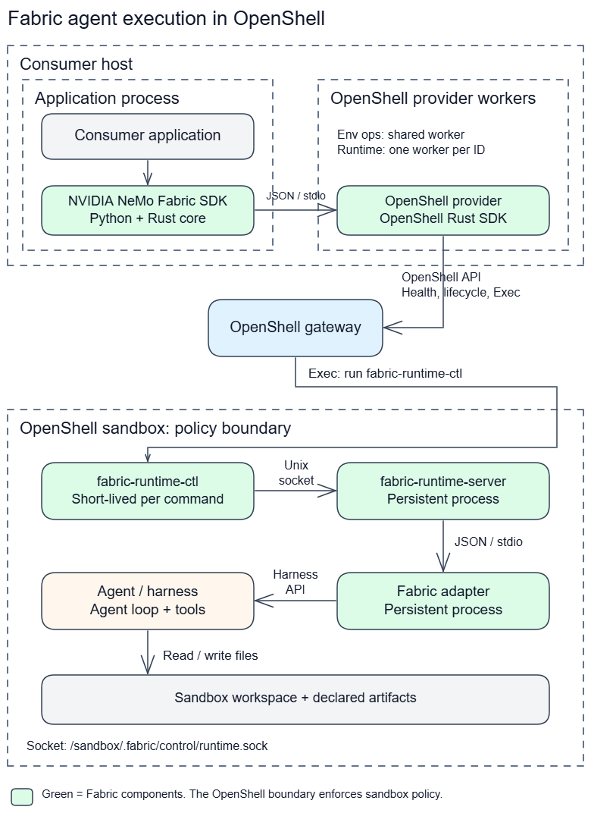
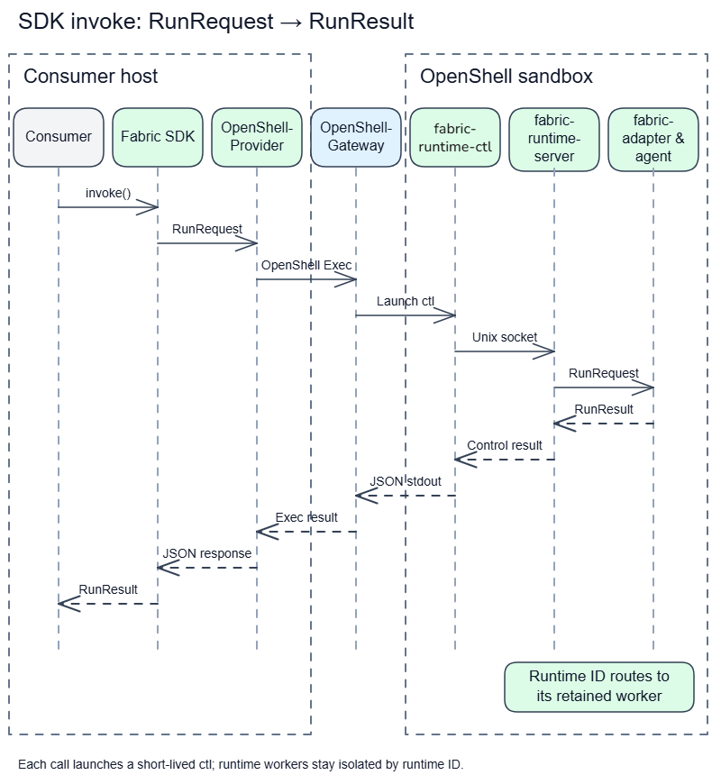

<!--
SPDX-FileCopyrightText: Copyright (c) 2026, NVIDIA CORPORATION & AFFILIATES. All rights reserved.
SPDX-License-Identifier: Apache-2.0
-->

# OpenShell Environment Provider

This optional host process connects NVIDIA NeMo Fabric to OpenShell through its Rust SDK. The application uses the normal NeMo Fabric SDK; OpenShell owns sandbox isolation, network policy, and deletion. The agent and its adapter run inside the task image.

## Architecture

The diagram shows where Fabric processes run on the host and in the sandbox.



[Edit the architecture diagram](../../assets/openshell_architecture.excalidraw).

On the first OpenShell operation, Fabric launches the OpenShell environment
provider (`fabric-environment-openshell serve --stdio`) as a child process on
the host. It uses `NEMO_FABRIC_OPEN_SHELL_PROVIDER` when set or finds the binary
on `PATH`. Fabric exchanges JSON with that process through standard input and
output. It reuses an OpenShell provider process for environment operations and
keeps runtime command processes separate by runtime ID.

For a Fabric-owned sandbox, the OpenShell provider passes `settings.command`
to OpenShell when creating it; for a caller-owned sandbox, it verifies the
existing startup command. The examples use `fabric-agent-ctl serve` as that
long-running sandbox command.

## Invocation Flow

This diagram follows one SDK `invoke` call into the sandbox and back.



[Edit the invocation diagram](../../assets/openshell_invocation.excalidraw).

The OpenShell provider process on the host checks the sandbox identity, then
asks OpenShell to run a short-lived `fabric-agent-ctl invoke` command there.
The command sends the full `RunRequest` over a Unix socket to the persistent
task runtime server. That server selects the runtime ID and returns a
`RunResult` through the same path.
Start and stop use the same command route.

## Use the OpenShell Provider

Build from the repository root:

```sh
just build-openshell-provider
export NEMO_FABRIC_OPEN_SHELL_PROVIDER="$PWD/target/debug/fabric-environment-openshell"
```

Use a registered OpenShell gateway and match the CLI, gateway, and runtime components to **0.1.2**. The OpenShell provider pins that release's SDK to commit `6648bd0c290efbc41ba131ee9831ee45cd431f94`. Initial support has been tested only on Linux.

Environment configuration uses `provider="openshell"` and `control_location="in_env_control"`. The gateway connection selects a named workspace or explicitly uses OpenShell's default workspace. Workspace and artifact roots are absolute POSIX paths inside the sandbox; `runtime.artifacts` remains the host collection destination. Select an immutable image digest or local Docker image ID. Task images contain the SDK, `fabric-agent-ctl`, the selected adapter, and the agent/harness.

When `settings.sandbox_name` is omitted, the OpenShell provider derives a stable 19-character name from the Fabric environment ID, within OpenShell's sandbox-name limit. This lets it reconcile a create request whose response times out.

With an existing Fabric-ready configuration, use the normal SDK lifecycle:

```python
from nemo_fabric import EnvironmentReference, Fabric

fabric = Fabric()
environment = await fabric.attach_environment(
    config,
    EnvironmentReference.from_mapping({
        "provider": "openshell",
        "resource": {"sandbox_name": sandbox_name, "sandbox_id": sandbox_id},
    }),
)
try:
    async with await fabric.start_runtime_in(config, environment) as runtime:
        result = await runtime.invoke(input=agent_input)
finally:
    await fabric.release_environment(environment)
```

The host sends a task-local `FabricConfig` to `fabric-agent-ctl start`, then full
`RunRequest` values to invoke. The task SDK owns runtime IDs, state, and normalized
results, including failed results with partial output. Host gateway settings and
host discovery paths stay outside the sandbox. Installed task descriptors are
discovered normally; custom descriptor directories use
`environment.settings.task_discovery_paths` with absolute POSIX paths. Skills and
MCP command paths in the agent configuration must refer to task-visible files.

Declared artifacts are copied to
`runtime.artifacts/<runtime_id>/<invocation_id>/` on the host. Each reference
becomes a readable host path; earlier invocation files remain intact. Collection
accepts up to 16 regular files, 256 KiB per file, and 512 KiB total. Files are read
through directory descriptors with symlink and traversal checks; directories and
special files are rejected. Collection never truncates files or copies the
workspace. Relay file references retain their correlation metadata.

OpenShell bridge invocations return a buffered result. Set the task deadline
with `runtime.timeout_seconds` (default 240 seconds; maximum 300 seconds).
Streaming requests are rejected before startup. Direct local SDK runtimes
retain streaming and service support.

One OpenShell sandbox can host multiple bridge runtimes. Stopping one runtime
does not prevent starting another.

If a start response is missing or invalid, Fabric cannot safely recover the
runtime ID. It keeps an unknown binding against the sandbox ID, even after
reattachment, and blocks further starts for that sandbox. Fabric does not
replay the command. Known runtimes can still be stopped; Fabric-owned sandboxes
can be deleted for cleanup.

The two ownership paths have separate responsibilities:

| Operation | Resource ownership | Release behavior |
| --- | --- | --- |
| `prepare_environment` | Fabric creates the sandbox | Confirm deletion of the bound sandbox |
| `attach_environment` | Caller supplies an existing sandbox name and ID | Detach without deleting or connecting to the gateway |

For `attach_environment`, Fabric looks up the caller-owned sandbox by name and
checks its ID and workspace. OpenShell must report it as `Ready`; its image and
startup command must match `settings.image` and `settings.command`. If
`settings.policy_yaml` is set, the sandbox policy must match too. Attachment
fails on a mismatch without changing the sandbox.

Later operations check the sandbox ID, so a same-name replacement is rejected.
Fabric-owned release checks typed deletion acknowledgements and waits for the
original ID; an accepted acknowledgement alone does not prove deletion.
Readiness cleanup also preserves replacements.

Gateway credentials use environment-variable references, such as `connection.token_env` and `connection.ca_cert_env`. Tokens require verified HTTPS. Literal credential fields are rejected. Routine OpenShell provider and transport errors exclude raw SDK exceptions and process stderr. OpenShell provider timeout settings accept 1–600 seconds. Calls are bounded and are not automatically replayed after a lost response. Cancelling preparation releases a confirmed resource; an unconfirmed cleanup error includes its sandbox identity for recovery.

The OpenShell provider communicates privately over JSON and stdio. This interface is internal to NeMo Fabric. The public task command schemas are described in the [command bridge guide](../../sdk/python/nemo-fabric-runtime/src/nemo_fabric/host/README.md).
