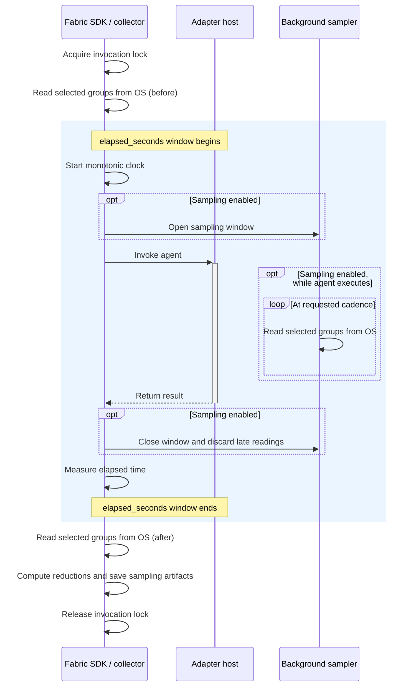

{/* SPDX-FileCopyrightText: Copyright (c) 2026, NVIDIA CORPORATION & AFFILIATES. All rights reserved.
SPDX-License-Identifier: Apache-2.0 */}

Resource stats help answer two questions: what resource limits apply to an agent invocation, and how does resource usage change while it runs? NVIDIA NeMo Fabric records duration, CPU, memory, and execution conditions to help answer them.

Before/after readings show the starting and ending state. Optional sampling reveals temporary demand between them, such as memory used by a tool that exits before the agent returns.

## What Stats Measure

An invocation is one request sent to an agent through the runtime. Its stats describe two resource boundaries:

- **Adapter process tree:** the adapter host and its child processes. This includes the agent's local work and tools that execute within that tree.
- **Linux cgroup:** the resource group containing the adapter host, including its descendant groups. It reports resource limits and usage, and can include other workloads sharing that group.

A resource limit is a ceiling, not a reservation or a measure of free capacity. Shared cgroup usage cannot be attributed exclusively to one invocation.

CPU and memory used by remote model and tool servers are outside this scope. Invocation duration includes time spent waiting for them. Measuring their resource usage requires collection where those services run.

## Configure and Run

This example uses the maintained [code-review agent](https://github.com/NVIDIA/NeMo-Fabric/blob/main/examples/code_review_agent/README.md) with the Deep Agents harness and an OpenAI-compatible model endpoint. The same `system_stats` settings apply to other NeMo Fabric workflows.

### Choose Collection Settings

`FabricConfig.system_stats` has three controls:

| Setting | What it controls | Default |
| --- | --- | --- |
| `system_stats` | Whether invocation stats are collected; set it to `None` to disable them | Enabled |
| `system_stats.collect` | Which metric groups are read and retained | All four groups |
| `system_stats.sampling` | Whether periodic readings supplement the before/after readings | `None`: before/after only |

For the first run, keep all metric groups and enable sampling every second with the example flags below.

### Prepare the Environment

Run from the NeMo Fabric repository root on a checkout containing this example's `--stats` option. Install the locked Deep Agents dependencies and build the native runtime from the same source. The native build requires Rust and the platform's compiler toolchain; see the [installation guide](../getting-started/install.mdx).

```bash
uv sync --frozen --no-default-groups --group adapters --extra deepagents
uv pip install --python .venv/bin/python --no-deps --reinstall \
  --editable sdk/python/nemo-fabric-runtime

export ADAPTER_PYTHON="$PWD/.venv/bin/python"
```

`ADAPTER_PYTHON` ensures the adapter host uses the environment containing Deep Agents. Rebuilding the native runtime avoids mixing a current Python SDK with an older extension that does not recognize `system_stats`.

Configure your endpoint and the model ID it serves. The captured run used `nvidia/nemotron-3-ultra-550b-a55b` at a privately hosted endpoint. Replace the hostname below with your own reachable server. Set `STATS_MODEL_API_KEY` to its credential; for an endpoint without authentication, use a nonempty placeholder such as `unused`.

```bash
export MODEL_BASE_URL="http://your-model-host:8000/v1"
export MODEL_ID="nvidia/nemotron-3-ultra-550b-a55b"
export STATS_MODEL_API_KEY="unused"
export RUN_DIR="$(mktemp -d "$PWD/stats-review.XXXXXX")"
```

### Enable Sampling and Run

Run the code-review agent with one-second sampling:

```bash
.venv/bin/python -m examples.code_review_agent \
  --variant deepagents \
  --model "$MODEL_ID" \
  --base-url "$MODEL_BASE_URL" \
  --api-key-env STATS_MODEL_API_KEY \
  --stats sampled \
  --stats-interval-ms 1000 \
  --stats-max-samples 1000 \
  --input "Review calculator.py and its nearby tests. Read the files first. Do not edit any files. Report correctness findings with file and line references, or explain if there are no substantiated findings." \
  > "$RUN_DIR/run-result.json" 2> "$RUN_DIR/stderr.log"
```

The command writes a normalized JSON result to `$RUN_DIR/run-result.json`. Do not add `--show-output` when redirecting to a JSON file: that option appends human-readable text. The run's sampled readings and summary are separate artifacts under `examples/code_review_agent/artifacts/deepagents/`; their exact paths are in the result.

Add `--plan` to inspect the configuration without invoking the model. Look for `config.system_stats`: it should select all four metric groups, a 1000 ms sampling interval, and a 1000-sample bound. These settings belong to NeMo Fabric and are not forwarded as adapter configuration.

### Compare Collection Modes

Repeat the command with a new `RUN_DIR` and change only these flags:

| Mode | Flags | Default | Result |
| --- | --- | --- | --- |
| Before and after | `--stats before-after` | Yes; used when `--stats` is omitted | All metric groups, before/after readings only |
| Sampled | `--stats sampled --stats-interval-ms 1000 --stats-max-samples 1000` | No | Before/after and periodic readings, plus sample and summary artifacts |
| Disabled | `--stats off` | No | No invocation stats or stats artifacts; the independent final `resource_snapshot` remains available when supported |

Sampling interval and retention flags require `--stats sampled`. Intervals range from 100 to 60000 ms; retention ranges from 2 to 100000 readings, including before/after readings. Without overrides, sampled mode uses 1000 ms and 10000 readings. Agent behavior may change between runs; differences do not by themselves measure collector overhead.

### Select Metric Groups

The four metric groups are:

| Group | Measurements |
| --- | --- |
| `process` | Adapter process-tree CPU, resident memory, and process count |
| `cgroup.cpu` | Visible CPU limit, CPU usage, and throttling |
| `cgroup.memory` | Visible memory limit, memory usage and lifetime peak, swap usage, and OOM kills |
| `cgroup.pressure` | CPU, memory, and I/O pressure counters |

The example CLI selects all groups. To select a subset, configure the Python SDK directly:

```python
from examples.code_review_agent import deepagents_config
from nemo_fabric import SystemStatsConfig, SystemStatsSamplingConfig

config = deepagents_config()
config.system_stats = SystemStatsConfig(
    collect=["process", "cgroup.cpu"],
    sampling=SystemStatsSamplingConfig(interval_ms=1000, max_samples=1000),
)
```

Selection applies to both before/after and periodic reads. `collected_groups` in the result records the selection. Excluded observations or measurements use `not_collected`; unselected process reductions and an entirely excluded cgroup block are omitted.

Empty, duplicate, and unknown group selections are rejected. Use `system_stats=None` to disable collection, or `system_stats.sampling=None` to disable only periodic sampling. The separate final `resource_snapshot` remains independent of these controls.

## Read the Results

For the code-review example, inspect `$RUN_DIR/run-result.json` with `jq` or open it directly in your editor:

```bash
jq '{status, runtime_id, invocation_id, request_id, system_stats}' \
  "$RUN_DIR/run-result.json"

# Exact paths to the raw readings and summary for this invocation.
jq '.artifacts.artifacts[] | select(.kind | startswith("system_stats"))' \
  "$RUN_DIR/run-result.json"

# Read the raw JSONL observations without searching through other invocations.
SAMPLES_PATH="$(jq -r '.system_stats.sampled.samples.path' "$RUN_DIR/run-result.json")"
cat "$SAMPLES_PATH"
```

### A Captured Code-Review Run

The following values came from a Linux run of the command above using NeMo Fabric source `67acf1cff0d598fc3e6a32370cd63fc088e86958` plus the example's stats CLI changes, Deep Agents 0.7.9, and the model named above. Model work and resource values vary between runs; these are observations, not expected outputs.

| Measurement | Observed value | Interpretation |
| --- | --- | --- |
| `elapsed_seconds` | 3.919 s | Time around the adapter exchange, including remote calls; excludes runtime startup and before/after collection |
| `cpu_time_seconds_estimate` | 0.14 s | Process-tree CPU counter difference, not remote inference CPU |
| Process RSS before / after | 203.46 / 203.96 MiB | Memory already held before the invocation and present at its end |
| Sampled process RSS peak / mean | 203.96 / 203.81 MiB | Largest retained reading and time-weighted mean across covered intervals |
| Live process count | 1 in every retained reading | One process observed at each reading; shorter-lived children could be missed |
| Retained samples | 5 | Baseline, three periodic readings, and final endpoint |
| RSS coverage / dropped samples | 100% / 0 | All adjacent intervals qualified for the RSS mean; no samples were reported dropped |
| Visible CPU limit | 8 cores | A visible capacity bound, not a guarantee of eight available cores |
| Cgroup CPU delta | 8.480 s | Shared cgroup accounting; includes work beyond this adapter process tree |

Memory values use MiB (bytes divided by 1048576). The final RSS is not memory leaked or left behind by the invocation: most of it was present before the invocation, and the final observation occurs before runtime teardown.

The shared cgroup's 8.480 CPU-seconds cannot be attributed exclusively to this run. The configured memory limit was reported as `unlimited` within the visible hierarchy; this does not establish unlimited physical memory or available headroom.

Read collection quality alongside usage. A sampled maximum can miss a spike between readings even with 100% reported coverage. When sources are missing, availability states carry the reason rather than substituting zero. Disabled collection yields no `system_stats`; failures before a normalized result may leave only partial artifacts.

For stats collection with SWE-bench tasks, see the [Harbor walkthrough](https://github.com/NVIDIA/NeMo-Fabric/blob/main/examples/harbor/swebench/README.md#run-deep-agents-with-resource-stats).

### Representative Metrics

Use these fields to interpret your own run. Paths are relative to `result.system_stats`.

#### Duration and CPU

| Field | Meaning | Unit |
| --- | --- | --- |
| `elapsed_seconds` | Duration of the adapter exchange, including waiting for remote services; excludes startup, before/after collection, and teardown | Seconds |
| `cpu_time_seconds_estimate` | Difference between the process tree's before/after CPU counters | CPU-seconds |

CPU-seconds measure processor work, while elapsed seconds measure time passing. In the example, 0.14 CPU-seconds over 3.919 elapsed seconds describes the local adapter's work; it does not measure remote model compute. The CPU estimate is absent if a reading is missing, identities differ, or the counter decreases. Processes leaving the tree can distort the estimate even when it is positive.

#### Memory

| Field | Meaning | Unit |
| --- | --- | --- |
| `before.snapshot.resident_memory_bytes`, `after.snapshot.resident_memory_bytes` | Process-tree resident memory immediately before and after the invocation, when observations are available | Bytes |
| `sampled.resident_memory_bytes.sampled_peak` | Largest valid retained RSS reading during the invocation | Bytes |
| `sampled.resident_memory_bytes.time_weighted_mean` | Average RSS over the intervals covered by valid readings | Bytes |

RSS sums the resident memory of the adapter host and its descendants; shared pages can be counted more than once. Before/after values are instantaneous observations. Sampling can reveal temporary demand that disappears before the final reading, but its peak can still miss shorter spikes. The mean holds each reading until the next valid reading and excludes intervals with missing readings or gaps longer than twice the requested cadence. Check coverage alongside the mean.

#### Resources and Execution Conditions

The limits below come from `cgroup.after.snapshot` when that observation is available. The CPU usage and throttling fields are invocation deltas under `cgroup`.

| Field | Meaning | Unit |
| --- | --- | --- |
| `cgroup.after.snapshot.visible_cpu_limit_cores` | CPU bound derived from the effective cpuset and visible ancestor quotas | CPU cores |
| `cgroup.after.snapshot.visible_memory_limit_bytes` | Smallest configured memory limit among visible ancestors | Bytes |
| `cgroup.cpu_usage_microseconds` | Increase in the cgroup's CPU usage counter between before/after readings | Microseconds of CPU time |
| `cgroup.cpu_throttled_microseconds` | Increase in the cgroup's CPU throttling counter between before/after readings | Microseconds |

A limit is a ceiling, not a reservation or a measurement of free capacity. An `unlimited` memory limit means no numeric bound was found among the visible limit sources; it does not mean physical memory is unlimited. These counters cover the cgroup and its descendants, potentially including parallel workloads.

Throttled time is cumulative accounting and can exceed invocation wall time. It is not additional elapsed delay or proof that another task caused contention.

#### Collection Quality

| Field | Meaning | Unit |
| --- | --- | --- |
| `sampled.resident_memory_bytes.covered_fraction` | Fraction of invocation time contributing to the RSS mean | Fraction from 0 to 1 |
| `sampled.dropped_samples` | Samples skipped because collection fell behind or retention was full | Count |

Coverage of 1 means the full duration qualified for the mean under the collector's gap rules, not that every memory spike was observed. Dropped samples disclose incomplete sampling; zero drops does not guarantee every measurement was available. Read availability states and diagnostics too. `not_collected` means a metric group was excluded, `unsupported` means the source is not supported, and `unavailable` means evidence could not be obtained. None of these states represents zero usage.

#### Complete Field Reference

See the [RunResult JSON Schema](https://github.com/NVIDIA/NeMo-Fabric/blob/main/schemas/sdk/run-result.schema.json) for the complete field list, types, and required or optional structure. Start at `system_stats` and follow its definitions for invocation stats, cgroup observations, sampled summaries, and gauges. For configuration fields, see the [FabricConfig JSON Schema](https://github.com/NVIDIA/NeMo-Fabric/blob/main/schemas/sdk/agent.schema.json). Use the schemas from the same release or commit as your runtime when checking saved results.

## Collection Details

### The Invocation Window

For a local adapter host, collection follows this sequence:



The lock serializes the adapter host's request/response protocol and remains active when stats are disabled. Collection uses that existing lock to prevent another invocation on the same host from running between the before/after readings. Time waiting for the lock is excluded from `elapsed_seconds`, along with startup, before/after reads, artifact preparation, and teardown. Other processes in a shared cgroup can still run during this window.

CPU estimates subtract cumulative before/after counters. Memory and process counts are instantaneous readings. On a warm runtime, a new before reading establishes a baseline for each invocation; it does not reset the process or cgroup counters.

### Periodic Sampling and Retention

When sampling is enabled, one background sampler thread per collector process serves its active invocations. It reads the selected groups at the requested cadence while the adapter executes. Cadence is a target: collection and scheduling take time, and sampling can affect execution. Late readings are discarded after an invocation's sampling window closes.

The retention bound includes both before/after readings. Once the intermediate-sample budget is full, further periodic readings are skipped and counted as dropped; the final reading is preserved. Sampling produces a JSONL trace and a summary artifact when persistence succeeds. Before/after-only collection adds neither file.

Optional collection failures preserve the adapter outcome and appear as missing evidence or diagnostics. A protocol failure can still raise without a normalized result; available partial artifacts do not imply a completed invocation.

### Local and Remote Execution

Process-tree measurements cover the adapter host and its descendants. In the Deep Agents example, the Fabric SDK starts a separate Python adapter host, and Deep Agents executes inside that host. Its memory and CPU usage, tools running in that process, and child processes launched for local tools fall within this scope. The calling application's resources are excluded.

Remote model inference and remote MCP tool execution fall outside this process tree. The adapter's local work to prepare requests and process responses is included, and invocation duration includes time spent waiting for those services. Their server-side CPU, memory, and GPU usage are not measured. A local MCP server is included only if it belongs to the observed process tree; a separately running local service is outside that scope too.

The same distinction applies to agents reached through ACP or gateways: local adapter measurements describe the client-side work, not the remote agent's resource usage. Measuring remote execution requires collection where it runs, with an explicit execution scope and correlation to the invocation.

Linux cgroup measurements describe a different boundary: the adapter host's cgroup and its descendants. That boundary can include other workloads. Do not attribute shared cgroup usage exclusively to this invocation or add it to overlapping process-tree usage.
