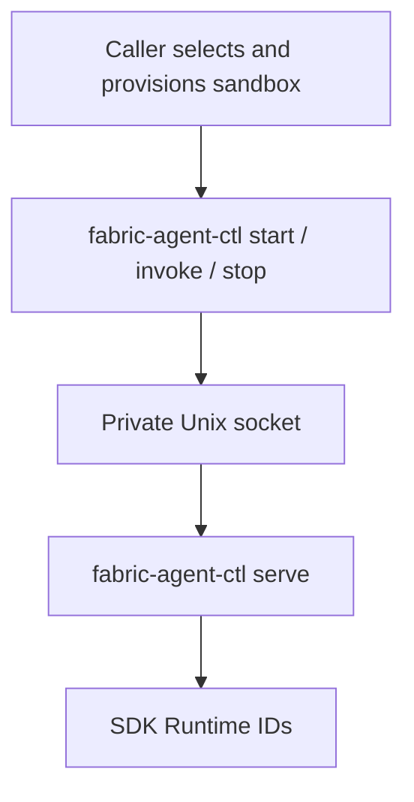

<!--
SPDX-FileCopyrightText: Copyright (c) 2026, NVIDIA CORPORATION & AFFILIATES. All rights reserved.
SPDX-License-Identifier: Apache-2.0
-->

# NVIDIA NeMo Fabric Runtime Server And Command Bridge

`fabric-agent-ctl` is installed with `nemo-fabric-runtime`. One foreground `serve` process owns any number of independently addressed SDK runtimes inside one sandbox. Short-lived commands connect through a private Unix socket and call the existing public SDK. The caller owns image selection, credentials, mounts, network policy, retained storage, and sandbox deletion.

## Commands

| Command | Operation |
| --- | --- |
| `serve` | Start the foreground runtime server; no agent selection |
| `check [--timeout-seconds SECONDS]` | Check runtime server responsiveness |
| `start --agent NAME --config FILE` | `Fabric.start_runtime(config, base_dir=...)` |
| `invoke --agent NAME --runtime-id ID --input FILE` | `Runtime.invoke(input=...)` |
| `invoke --agent NAME --runtime-id ID --request FILE` | `Runtime.invoke(request=RunRequest(...))` |
| `stop --agent NAME --runtime-id ID` | `Runtime.stop()` |

Run the server under the sandbox supervisor:

```sh
fabric-agent-ctl serve
```

Wait for `/sandbox/fabric.sock` with a caller-owned deadline, then issue commands through separate sandbox exec calls:

```sh
fabric-agent-ctl check
fabric-agent-ctl start --agent researcher --config /sandbox/config.json
fabric-agent-ctl invoke --agent researcher --runtime-id RUNTIME_ID --input /sandbox/input.json
fabric-agent-ctl stop --agent researcher --runtime-id RUNTIME_ID
```

The response envelope separates command diagnostics from the public SDK payload in `result`: start returns `RuntimeHandle.to_mapping()`, invoke returns `RunResult.to_mapping()` directly, and stop returns JSON `null` for the SDK's `None` return. There is no `fabric_result` wrapper. Replace `RUNTIME_ID` with `result.runtime_id` from start. Multiple invocations retain the same runtime and conversation. Targeted commands require both the returned runtime ID and exact agent name. Repeated successful stop is a no-op. Serve starts a process and is never forwarded over the socket.

Use `--request FILE` to forward a complete public `RunRequest`, including `request_id`, `relay_session_root`, `context`, `overrides`, and supported extensions. For example, a request file can contain `{"input": "Review calculator.py", "request_id": "review-1", "context": {"review_tag": "cedar-4827"}}`. `--input FILE` is a mutually exclusive convenience for any JSON-compatible SDK input: an object, array, string, number, boolean, or null. Null follows the SDK's normalization to an empty input string. Agent input fields named `stream` or `streaming` remain ordinary input data; this command calls `Runtime.invoke()`, never a streaming method.

`check` reports runtime server responsiveness. A responding server passes, including before runtime startup and during invocations. A stopping server returns `failed/server_stopping`.

Each completed check preserves a `fabric.check/v1alpha1` report in `result`, with `scope: "server"`, a server state, UTC observation and completion times, elapsed milliseconds, and one server observation. `runtime_id`, `requested_level`, and `runtime` are null. `changed` is always false. A passed check exits 0; failed or unknown health exits 1. Check errors have `effects: "none"`. Missing or invalid responses produce fixed transport errors with `result: null`.

`fabric.check/v1alpha1` identifies the shared health request and report format so readers can reject formats they do not support. The identifier stays the same across SDK releases while the health format remains compatible. `fabric-agent-ctl` ships with `nemo-fabric-runtime`; the executable and all subcommands follow the SDK package release.

Report timing covers the client call, including connection, response decoding, and validation. `completed_at` records client completion; each `observed_at` records when the server collected the evidence. Successful checks, confirmed failures, and timeouts use the same timing interval.

Checks use one three-second deadline for connection, sending, and response decoding. Use `fabric-agent-ctl check --timeout-seconds 1` to select another positive, finite budget. A timeout returns `unknown/probe_timeout`, with an unobserved server observation. The public `Fabric.check(environment=..., request=CheckRequest(scope="server"))` method maps OpenShell server requests to this command.

## Runtime Ownership

Each successful start is recorded by its returned runtime ID. Invoke and stop address that ID and the exact agent name, so several runtimes can be active independently. Stopping one runtime does not affect the others, and a new runtime can start after a previous one stops. A failed stop retains the runtime handle so the caller can inspect failure and shutdown can retry it. An uncertain start or runtime-ID collision blocks further starts because the server cannot establish an unambiguous owner; replace the sandbox in that case.



The outer server is separate from the SDK's adapter process and the selected harness. It serializes starts and serializes invoke/stop operations for each runtime ID, while separate runtimes can progress independently. It waits for an active invocation before ordinary stop. Direct SDK consumers can also use streaming or shared services.

Ordinary SDK stop does not establish that all harness descendants exited. A successful stop response reports completion of the SDK operation. The caller must use the sandbox supervisor to terminate remaining descendants. The server does not interrupt adapters through a new forced-stop SDK API.

## Transport And Failure Behavior

Completed commands except serve write exactly one newline-terminated JSON response to stdout. Logs use stderr. A completed SDK call exits 0; command or transport failure or unsupported behavior exits 1. A completed invoke can return a failed `RunResult` with partial or null output and artifacts, just as the SDK does. Inspect `result.status` and `result.error` for the invocation outcome; command diagnostics remain in the envelope's separate `error` field. Requests are bounded to 512 KiB and responses to 4 MiB, including framing. Lifecycle and invocation calls have a 320-second transport deadline; checks default to three seconds, and incomplete input has a ten-second deadline. The caller also bounds OpenShell execution and startup polling.

A timeout or missing, malformed, truncated, or oversized response leaves dispatched effects unknown. Errors use fixed diagnostics with `effects: none`, `applied`, or `unknown`. Routine errors exclude prompts, configuration values, and raw exceptions. Invocation results preserve normalized SDK results, including failed results with null output, and may contain user data. Calls are never replayed after an uncertain outcome.

`--config -`, `--request -`, and `--input -` explicitly select stdin. Otherwise commands read staged regular files containing exactly one bounded UTF-8 JSON value. Configuration and complete requests must be objects matching `FabricConfig` and `RunRequest`; convenience input follows the SDK's JSON input semantics. Unknown or duplicate flags, duplicate JSON keys, and oversized input are rejected.

## Ownership And Shutdown

The default socket is `/sandbox/fabric.sock`, mode `0600`. `FABRIC_HOST_SOCKET` selects another socket path; all callers must use the same path. An exclusive lock on `fabric.lock` prevents a second server from replacing an active socket. The parent directory is the SDK base directory. Missing `tmp`, `workspace`, and `artifacts` directories are created with mode `0700`; existing data remains in place.

The server creates a private `fabric.unclean` ownership marker before accepting requests. After any successful or uncertain runtime start, the marker stays present even after SDK stop and normal server exit. A replacement server reports `cleanup_unconfirmed` if previous process cleanup cannot be confirmed. Automatic marker removal requires a private Linux process namespace, a matching `/proc` view, and a marker directory used only by that sandbox. An unused server can remove its own marker on orderly shutdown. With retained storage, clear the marker manually only after the enclosing supervisor has terminated the previous sandbox's processes.

SIGTERM and SIGINT reject new work. An idle runtime receives ordinary SDK stop. If runtime work is active, shutdown reports `runtime_busy` and leaves descendant cleanup to the sandbox supervisor; an uncertain start or failed teardown reports `cleanup_unconfirmed`. A four-second process watchdog bounds exit when native worker threads remain active. Failed teardown also preserves the marker. Shutdown removes only the owned socket and preserves caller-owned files.

The bridge requires Unix sockets and `fcntl`; Windows imports remain safe and commands report `platform_unsupported`. The public SDK does not depend on this bridge or OpenShell.

## Local Qualification And Migration

Follow the [OpenShell Code Review instructions](../../../../../../examples/code_review_agent/README.md#openshell-code-review) to build the image and create a sandbox. The image contains the current SDK, runtime server, adapter, and harness, and advertises `fabric-agent-ctl`, interface version 2, and `start/invoke/stop/serve/check`. The server implementation is `nemo_fabric.runtime_server.state.RuntimeServer`. Rebuild the image and create fresh sandboxes after updating the command interface.

The example starts the server, waits for its socket, starts a runtime, invokes twice, and stops through separate exec calls. The older NemoClaw client using `validate/prepare/configure` requires migration. Version 1 requests fail explicitly. Direct SDK lifecycle and streaming APIs retain their existing behavior.
